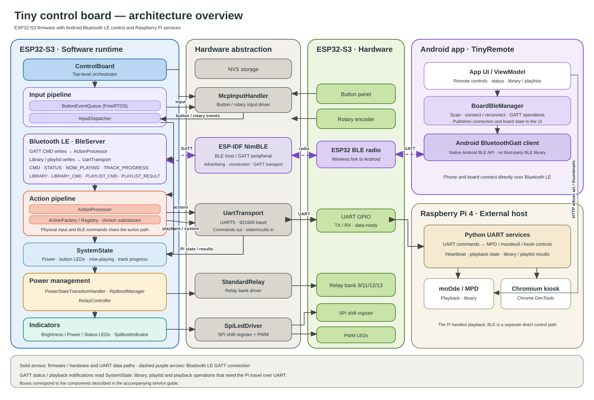
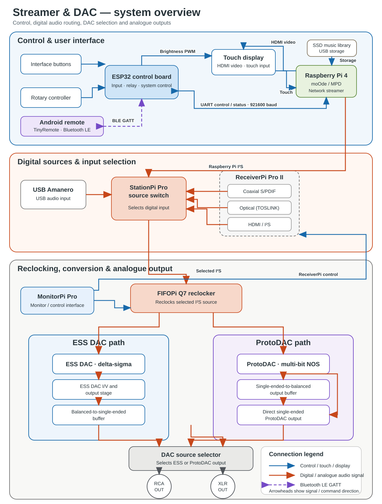
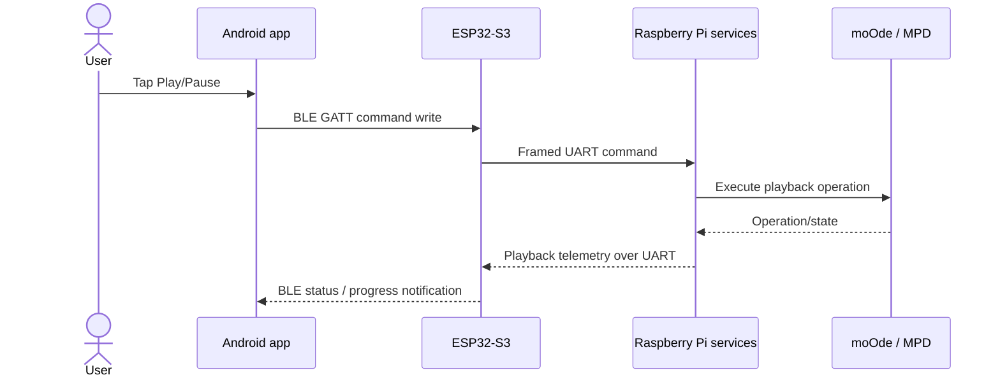
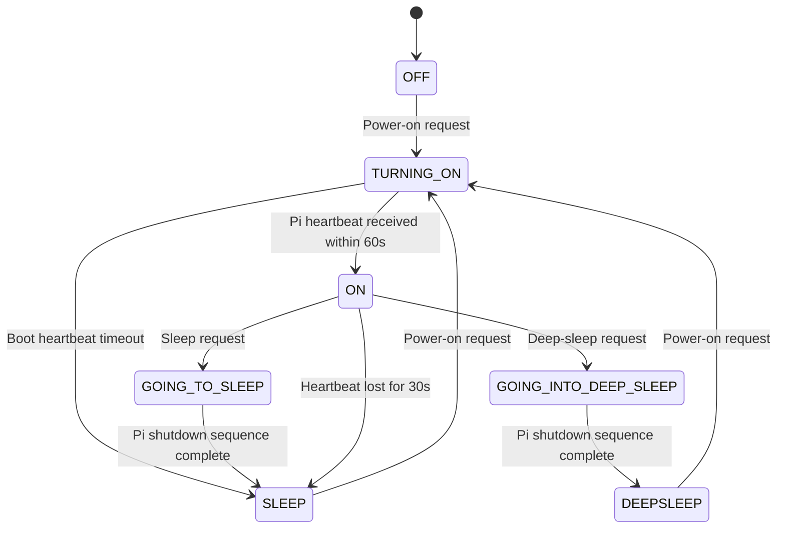

# TinyControlBoard System Architecture

This document is the architectural overview for the TinyControlBoard control system and
its Riverbank Streamer DAC host. It follows an arc42-style structure, using the existing
control-board and audio-system diagrams from the [Service Guide](userDocumentation/ServiceGuide.md).

For implementation detail, use the focused references: [ESP32 firmware](DeveloperGuides/03-esp32-developer-guide.md),
[Android app](DeveloperGuides/02-android-developer-guide.md), [Raspberry Pi services](DeveloperGuides/04-rpi-developer-guide.md),
[communication protocol](DeveloperGuides/05-communication-protocol.md), and
[hardware interface](DeveloperGuides/06-hardware-interface.md).

## 1. Introduction and Goals

### Purpose

The system provides local front-panel control and optional Android remote control for a
Raspberry-Pi-based moOde Audio streamer. The ESP32-S3 reads physical controls, operates
front-panel indicators and power relays, and bridges commands and playback state between
the Android app and the Raspberry Pi.

The wider audio assembly accepts network playback from the Raspberry Pi and other digital
sources, routes selected digital audio through reclocking and DAC stages, and provides
analogue outputs. Its signal path is shown in the audio-system diagram below; construction
and component-level details belong in the [Service Guide](userDocumentation/ServiceGuide.md).

### Scope

This document covers the architecture and interactions of:

- ESP32-S3 firmware in [`lib/`](../../lib/) and [`src/`](../../src/).
- Raspberry Pi companion services in [`scripts/rpi/`](../../scripts/rpi/), running alongside
  moOde Audio and MPD.
- The Kotlin Android app in [`android/TinyRemote/`](../../android/TinyRemote/).
- The control-board and audio-system context needed to understand their relationship.

It does not replace the circuit schematics, board references, service procedures, or
field-level protocol specification.

### Primary quality goals

1. **Safe power control:** the ESP32 owns relay sequencing and reacts to missing Pi
   heartbeats.
2. **Usable control:** physical controls work independently of the optional Android app;
   the app provides playback, library, search, and playlist operations over BLE.
3. **Clear responsibility boundaries:** audio execution and library/playlist operations
   reside on the Pi; the ESP32 owns hardware and power state; Android is a client.
4. **Recoverable communication:** startup and runtime Pi liveness are monitored, and the
   Android client attempts to reconnect after an unexpected BLE disconnect.
5. **Serviceability:** control, protocol, hardware, and audio-subsystem details are
   maintained in focused documents linked above.

## 2. Architecture Constraints

| Constraint                                                                                                                                    | Architectural effect                                                                                                                                                                  |
| --------------------------------------------------------------------------------------------------------------------------------------------- | ------------------------------------------------------------------------------------------------------------------------------------------------------------------------------------- |
| Existing controller hardware is an ESP32-S3 with a physical front panel and relay outputs.                                                    | The firmware is the authority for front-panel I/O and power sequencing; see the[hardware reference](DeveloperGuides/06-hardware-interface.md).                                                         |
| The Android app connects to the board over BLE; the board and Pi communicate over a wired UART link with GPIO handshake lines.                | Control commands are mediated by the ESP32 rather than sent from Android to the Pi.                                                                                                   |
| The deployed Pi runs moOde Audio and MPD.                                                                                                     | Pi-side actions use MPD and moOde-specific facilities; the ESP32 does not implement playback.                                                                                         |
| The UART carrier uses the repository's framed protocol at 921600 baud. BLE carries characteristic-specific payloads rather than UART framing. | Protocol changes must remain consistent across firmware, Pi services, and Android. See[05-communication-protocol.md](DeveloperGuides/05-communication-protocol.md).                                    |
| The BLE service currently supports one connected client.                                                                                      | The Android control surface is single-client; concurrent phone control is not a supported deployment assumption.                                                                      |
| The design integrates with a mains-powered audio assembly.                                                                                    | Wiring, enclosure, and service work must follow the[Service Guide](../userDocumentation/ServiceGuide.md) and applicable schematics; this architecture document is not a safety procedure. |

The repository does not define budget, schedule, or formal operating-environment constraints.
The exact moOde release and a separate staging topology are also not specified in the
developer documentation.

## 3. System Context and Scope

### Control and communication context

The diagram is maintained in the Service Guide's media directory and is embedded here as
the canonical architecture view.



| External party or system               | Interaction with TinyControlBoard                                                                                                                                |
| -------------------------------------- | ---------------------------------------------------------------------------------------------------------------------------------------------------------------- |
| User / front panel                     | Buttons, rotary input, LEDs, display controls, and power controls connect to the ESP32 hardware.                                                                 |
| Android app (TinyRemote / DanStreamer) | Connects to the ESP32 BLE GATT service for controls, state, library browsing, search, and playlist operations.                                                   |
| Raspberry Pi 4 / moOde Audio           | Exchanges framed UART messages with the ESP32. Pi services translate commands into MPD,`moodeutl`, or moOde UI actions and report heartbeat and playback data. |
| moOde web server                       | The Android app accesses it directly over HTTP for album art and thumbnails only; this is not a command channel.                                                 |
| Audio hardware                         | Receives digital sources and produces analogue output through the selected reclocking, DAC, and output stages.                                                   |

### Audio-system context

This existing Service Guide diagram shows the wider source, reclocking, DAC, and output
topology. It describes the audio assembly, not the software command path.



### System boundary

The control system boundary includes the ESP32 firmware, Pi companion services, and Android
client. moOde/MPD, the Pi operating system, and audio conversion hardware are integrated
external systems or subsystems. Android communicates with the Pi directly only for artwork
and thumbnails; control, status, library, and playlist traffic follows the ESP32 path.

## 4. Solution Strategy

- Use the **ESP32-S3 as the control and power authority**. It handles local inputs, LEDs,
  relay sequencing, BLE, UART transport, and heartbeat monitoring.
- Use **BLE GATT between Android and ESP32**. Ordinary commands enter the firmware's
  action handling; library and playlist requests are forwarded to the Pi.
- Use **framed UART between ESP32 and Pi** for commands and returned telemetry. A shared
  protocol definition is mirrored in C++, Python, and Kotlin.
- Keep **media execution on the Pi**. Pi services map commands to MPD, `moodeutl`, or the
  moOde browser interface and send playback/health data back.
- Keep **audio conversion separate from control processing**. Digital sources are selected
  and routed through the audio modules shown in the audio-system diagram.
- Keep **hardware and service instructions in their specialist documents** rather than
  duplicating pinouts, parts lists, or field layouts here.

## 5. Building Block View

| Building block                | Responsibility                                                                                                                                 | Detailed reference                                                                                                                    |
| ----------------------------- | ---------------------------------------------------------------------------------------------------------------------------------------------- | ------------------------------------------------------------------------------------------------------------------------------------- |
| ESP32-S3 firmware             | Physical input and LED handling, relay control, power state machine, BLE GATT server, UART transport, heartbeat monitoring, and state updates. | [03-esp32-developer-guide.md](DeveloperGuides/03-esp32-developer-guide.md), [06-hardware-interface.md](DeveloperGuides/06-hardware-interface.md)                        |
| Raspberry Pi UART listener    | Receives ESP32 commands and dispatches playback, library, playlist, panel, and power operations.                                               | [04-rpi-developer-guide.md](DeveloperGuides/04-rpi-developer-guide.md)                                                                                 |
| Raspberry Pi heartbeat sender | Sends heartbeat, now-playing, and track-progress information to the ESP32.                                                                     | [04-rpi-developer-guide.md](DeveloperGuides/04-rpi-developer-guide.md)                                                                                 |
| moOde / MPD                   | Provides playback, queue, library, and system services used by the Pi scripts.                                                                 | [04-rpi-developer-guide.md](DeveloperGuides/04-rpi-developer-guide.md)                                                                                 |
| Android app                   | Provides BLE-based control and browsing UI and fetches artwork from moOde over HTTP.                                                           | [02-android-developer-guide.md](DeveloperGuides/02-android-developer-guide.md)                                                                         |
| UART protocol                 | Defines packet framing, message types, commands, and payloads shared by the ESP32 and Pi.                                                      | [05-communication-protocol.md](DeveloperGuides/05-communication-protocol.md)                                                                           |
| Audio assembly                | Digital source selection, reclocking, DAC conversion, and analogue outputs.                                                                    | [Service Guide](../userDocumentation/ServiceGuide.md) and its [DAC/audio subsystem guide](../userDocumentation/service-guide/DacSubsystem.md) |

## 6. Runtime View

### Playback command and state return

This representative flow shows that command writes are not directly acknowledged as
completed playback actions; the app observes subsequent state notifications.



The exact GATT characteristic payloads, command identifiers, and UART packet fields are
specified in [05-communication-protocol.md](DeveloperGuides/05-communication-protocol.md) and  [02-android-developer-guide.md](DeveloperGuides/02-android-developer-guide.md).

### Power-state lifecycle

The ESP32 firmware owns the system power state machine. The Pi heartbeat confirms boot
progress and is monitored while the system is on.



Power-on timing, relay order, shutdown behavior, and state implementation are documented in
the [firmware guide](DeveloperGuides/03-esp32-developer-guide.md) and [hardware reference](DeveloperGuides/06-hardware-interface.md).
The enum also contains `SHUTTING_DOWN`; its role in transitions remains to be confirmed.

## 7. Deployment View

```text
Android phone/tablet
  ├── BLE GATT ──> ESP32-S3 control board
  └── HTTP (artwork/thumbnails only) ──> Raspberry Pi / moOde web server

ESP32-S3 control board
  ├── GPIO / I2C / SPI ──> front-panel controls, indicators, relays
  └── UART + GPIO handshake ──> Raspberry Pi 4

Raspberry Pi 4
  ├── systemd: uart5-listener.service
  ├── systemd: heartbeat-sender.service
  ├── MPD / moOde services
  └── Chromium kiosk / Chrome DevTools Protocol for moOde UI actions

Audio sources ──> reclocking / source selection ──> DAC and output stages
```

The ESP32 and Pi are deployed as connected hardware. The Android app is an optional client.
No distinct staging or cloud deployment is documented. Raspberry Pi installation and
service setup are covered by [RPI4_SETUP.md](../userDocumentation/RPI4_SETUP.md); firmware
and Android build/deployment steps belong to their respective developer guides.

## 8. Cross-Cutting Concepts

### Power safety and liveness

Relay sequencing and power-state transitions are firmware responsibilities. The firmware
waits up to 60 seconds for the Pi's boot heartbeat and uses a 30-second heartbeat timeout
while on. The software can detect missing Pi communication, but relay GPIO writes do not
provide physical relay-state readback; consult the [hardware reference](DeveloperGuides/06-hardware-interface.md).

### Communication and errors

UART uses framing and checksum validation. Invalid frames are dropped by the Pi listener;
the documented path does not retry or send a NACK for those invalid frames. Android BLE
connection recovery behavior and protocol payload details are maintained in the
[Android guide](DeveloperGuides/02-android-developer-guide.md) and [protocol specification](DeveloperGuides/05-communication-protocol.md).

### Security and privacy

Android control uses BLE to the ESP32. Direct Android-to-Pi HTTP is limited to artwork and
thumbnails and is documented as cleartext HTTP on the home network. The architecture
references do not establish a complete BLE pairing/encryption policy or a system-wide
authorization policy; those should be verified before deployment on an untrusted network.

### Logging and diagnostics

Diagnostics are component-specific rather than collected in a shared observability system.
Use the Android, firmware, and Pi developer guides for their respective logging and
troubleshooting procedures. No cross-component log correlation or central logging service
is documented.

## 9. Architecture Decisions (ADRs)

No standalone ADR records are maintained in the documentation set. These are the current
architectural choices visible in the implementation and documentation; the rationale below
describes their apparent role and is not a substitute for a historical decision record.

| Current choice                                                          | Architectural role / trade-off                                                                                                                       |
| ----------------------------------------------------------------------- | ---------------------------------------------------------------------------------------------------------------------------------------------------- |
| ESP32 mediates control between Android and the Pi.                      | Keeps hardware and power control local to the board; mobile control depends on BLE and the board being available.                                    |
| UART connects the ESP32 and Pi; BLE connects Android and ESP32.         | Uses separate links for wired device-to-device exchange and optional mobile access; protocol changes must be coordinated across software components. |
| The Pi executes playback and library operations.                        | Reuses moOde/MPD behavior rather than implementing media services on the microcontroller; Pi services are a runtime dependency for those operations. |
| Artwork uses a direct Android-to-moOde HTTP path.                       | Keeps image retrieval out of the UART/BLE control path; the documented transport is cleartext HTTP on the local network.                             |
| The audio source/reclocking/DAC path is distinct from the control path. | Separates audio conversion from user-command processing; the wider topology is described by the Service Guide diagram.                               |

When a decision changes, record the alternatives, consequences, date, and owner in a
dedicated ADR rather than relying on this summary alone.

## 10. Quality Requirements

| Quality attribute      | Scenario / evidence                                                           | Current target or status                                                                                       |
| ---------------------- | ----------------------------------------------------------------------------- | -------------------------------------------------------------------------------------------------------------- |
| Power reliability      | Pi does not provide a heartbeat during startup.                               | Firmware waits up to 60 seconds, then leaves the startup path for`SLEEP`.                                    |
| Runtime liveness       | Pi heartbeat is lost while the system is on.                                  | Firmware timeout is 30 seconds and triggers a transition toward`SLEEP`.                                      |
| Control availability   | Android app is disconnected or unavailable.                                   | Physical controls remain the local control path; Android is optional.                                          |
| Communication capacity | ESP32 and Pi exchange framed UART packets.                                    | UART is configured for 921600 baud; end-to-end latency/throughput goals are not specified.                     |
| Mobile concurrency     | Multiple clients attempt to connect.                                          | BLE server supports one client; multi-client support is not a requirement currently documented.                |
| Maintainability        | A developer changes a protocol or subsystem.                                  | Responsibilities and references are split across focused guides; no maintainability metric is specified.       |
| Security               | Commands and artwork traverse local wireless/network links.                   | No measurable security target or complete BLE security policy is documented; direct artwork HTTP is cleartext. |
| Scalability            | Additional concurrent clients, streamers, or deployment nodes are introduced. | No scale-out target is documented; current design describes one board, one Pi, and one BLE client.             |

## 11. Risks and Technical Debt

| Risk or open item                                                                                           | Impact                                                                                 | Follow-up reference                                                                                                |
| ----------------------------------------------------------------------------------------------------------- | -------------------------------------------------------------------------------------- | ------------------------------------------------------------------------------------------------------------------ |
| Invalid UART frames are dropped without a documented retry/NACK path.                                       | A lost or corrupt command/update may not be explicitly reported to its sender.         | [05-communication-protocol.md](DeveloperGuides/05-communication-protocol.md), [04-rpi-developer-guide.md](DeveloperGuides/04-rpi-developer-guide.md) |
| Relay GPIO writes have no hardware readback.                                                                | Software cannot confirm that a relay physically changed state.                         | [06-hardware-interface.md](DeveloperGuides/06-hardware-interface.md)                                                                |
| Android-to-Pi artwork requests use cleartext HTTP.                                                          | Artwork traffic is not protected by HTTPS on the local network.                        | [02-android-developer-guide.md](DeveloperGuides/02-android-developer-guide.md)                                                      |
| BLE pairing/encryption and command authorization policy are not established in the architecture references. | Security behavior should not be assumed for deployments outside a trusted environment. | Verify firmware BLE configuration and Android connection behavior.                                                 |
| BLE currently accepts one client.                                                                           | Concurrent remote controllers are not supported.                                       | [06-hardware-interface.md](DeveloperGuides/06-hardware-interface.md)                                                                |
| Exact moOde version and separate staging deployment are unspecified.                                        | Reproducibility and environment-specific validation are limited.                       | [04-rpi-developer-guide.md](DeveloperGuides/04-rpi-developer-guide.md)                                                              |
| The`SHUTTING_DOWN` power-state enum value is not mapped to an observed transition here.                   | State documentation may not fully match implementation intent.                         | Confirm in firmware state-transition code.                                                                         |
| Wiring and commissioning documentation still has areas marked TODO.                                         | Builders may need to consult schematics and verify details before assembly or service. | [System Wiring and Commissioning](../userDocumentation/service-guide/SystemWiring.md)                                  |

No dated refactoring plan or prioritization for these items is currently documented.

## 12. Glossary

| Term                  | Definition                                                                                   |
| --------------------- | -------------------------------------------------------------------------------------------- |
| **BLE**         | Bluetooth Low Energy; the Android-to-ESP32 wireless control link.                            |
| **CDP**         | Chrome DevTools Protocol; used by Pi-side scripts for moOde browser UI actions.              |
| **DAC**         | Digital-to-analogue converter; one of the audio conversion stages in the system.             |
| **GATT**        | Generic Attribute Profile; BLE services and characteristics exposed by the ESP32.            |
| **GPIO**        | General-purpose input/output pin used for hardware signals such as the UART handshake.       |
| **I2S**         | Digital audio interface used by the streamer/audio path.                                     |
| **MPD**         | Music Player Daemon; playback and library service used by moOde Audio.                       |
| **moOde Audio** | Raspberry Pi-based audio player software and web interface used by this system.              |
| **NimBLE**      | BLE host stack used by the ESP32 firmware.                                                   |
| **UART**        | Universal Asynchronous Receiver/Transmitter; wired framed-message link between ESP32 and Pi. |
| **FIFOPi Q7**   | Reclocking stage identified in the Service Guide audio-system overview.                      |
