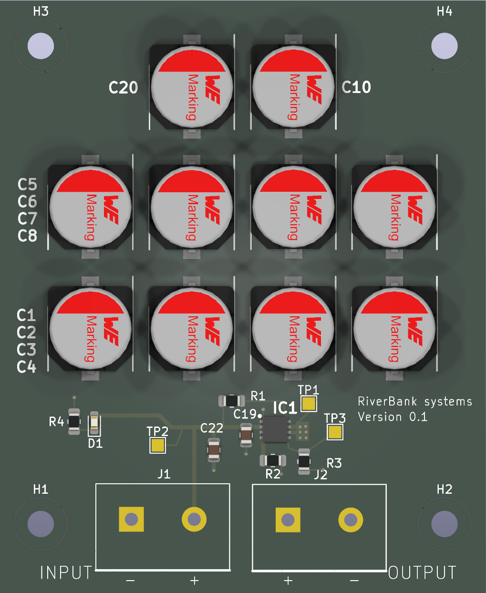
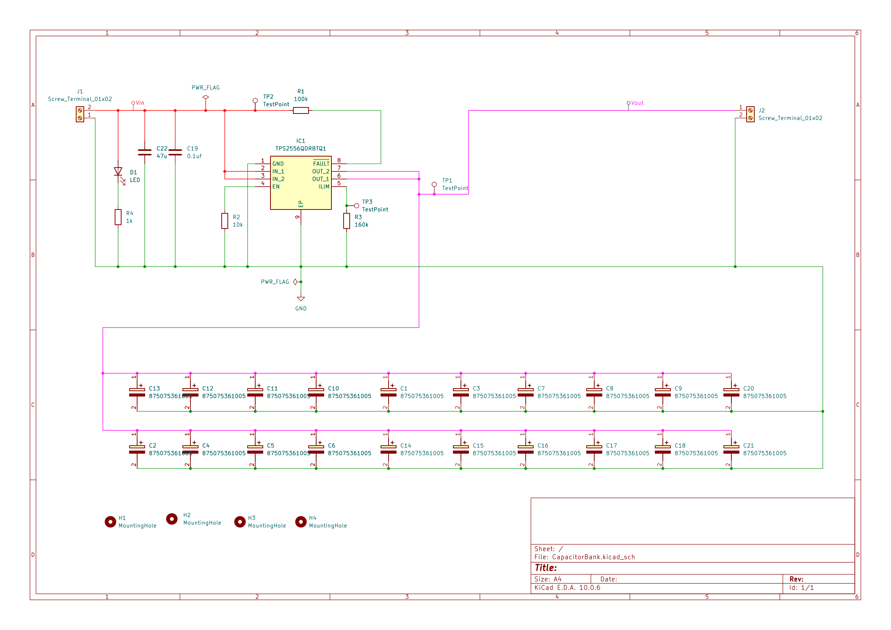

# Capacitor Bank

**Top View**

**Bottom View**

## Overview

| Item                | Details                                                                                                                                                                                  |
| ------------------- | ---------------------------------------------------------------------------------------------------------------------------------------------------------------------------------------- |
| MCU / main IC       | No MCU. IC1 is a TPS2556QDRBTQ1 power-distribution switch; its two outputs are connected together in the schematic.                                                                      |
| Supply              | J1 pin 2 is the `Vin` input; J1 pin 1 is GND. See [Operating limits](#operating-limits) for the input range and output current limit.                                                   |
| Programming / debug | None shown. TP1-TP3 are test points; there is no programming interface.                                                                                                                  |
| Source files        | `CapacitorBank.kicad_pro`, `CapacitorBank.kicad_sch`, `CapacitorBank.kicad_pcb`, and the supplied `CapacitorBank.csv` BOM. A second production BOM is at `production/bom.csv`. |

## Operating limits

| Parameter         | Limit / value                                                    |
| ----------------- | ---------------------------------------------------------------- |
| Input voltage     | 2.5-7 V; designed for a nominal 5 V supply.                      |
| Output current    | Limited to approximately 700 mA.                                 |
| Capacitor bank    | 9,400 µF nominal (20 × 470 µF capacitors).                    |
| Bank ESR          | Approximately 0.5 mΩ (20 capacitors, each 10 mΩ, in parallel). |
| Startup rise time | Approximately 50 ms.                                             |
| Discharge time    | Approximately 200 ms observed; varies with the connected load.   |

> [!WARNING]
> There is no reverse-polarity protection at the input. Reversing the supply can damage the power switch and polarized capacitors. A series protection diode is not fitted because its forward-voltage drop would reduce the voltage available at the output.

## Schematic

The project contains one schematic sheet. Open the exported [PDF](schematic/CapacitorBank.pdf) or [SVG](schematic/CapacitorBank.svg).

## Functional blocks

The schematic has no explicit functional-block titles or labeled frames. The following groupings are inferred from its components and connections.

| Block                             | Parts                         | Description                                                                                                                                                                         |
| --------------------------------- | ----------------------------- | ----------------------------------------------------------------------------------------------------------------------------------------------------------------------------------- |
| Input and power switch            | J1, IC1, R2, R3, TP2, TP3     | J1 supplies the annotated `Vin` input and GND. IC1's IN_1 and IN_2 connect to `Vin`; its EN pin has a 10 kOhm resistor to GND, and its ILIM pin has a 160 kOhm resistor to GND. |
| Output and capacitor bank         | IC1, J2, C1-C18, C20-C21, TP1 | IC1 OUT_1 and OUT_2 are tied together and routed to J2 pin 1, the wire annotated `Vout`. Twenty 875075361005 capacitors connect from this rail to GND.                            |
| Input bypass                      | C19, C22                      | A 0.1 uF capacitor and a 47 uF capacitor connect from the `Vin` input rail to GND.                                                                                                |
| Power indicator and fault pull-up | D1, R1, R4                    | D1 and R4 form the input-to-GND indicator branch. R1 (100 kOhm) connects `Vin` to IC1 FAULT.                                                                                      |
| Mounting                          | H1-H4                         | Four 3.2 mm M3 mounting-hole footprints.                                                                                                                                            |

## Connector pinouts

Pin numbers and net connections are taken from the schematic and cross-checked against the PCB pads. Physical orientation is not implied; confirm pin 1 against the board before wiring.

### J1 — input, 2-position screw terminal

| Pin | Schematic annotation / net                            | Function      |
| --: | ----------------------------------------------------- | ------------- |
|   1 | `GND`                                               | Ground return |
|   2 | `Vin` (`Net-(D1-A)` in the KiCad netlist and PCB) | Power input   |

### J2 — output, 2-position screw terminal

| Pin | Schematic annotation / net                             | Function                                       |
| --: | ------------------------------------------------------ | ---------------------------------------------- |
|   1 | `Vout` (`Net-(C1-+)` in the KiCad netlist and PCB) | Switched output / capacitor-bank positive rail |
|   2 | `GND`                                                | Ground return                                  |

## MCU pin assignments

Not applicable: no MCU or module is present. IC1 is a power switch, not a microcontroller.

## Peripheral details

- **Power switch (IC1):** TPS2556QDRBTQ1. Schematic pin connections: pin 1 GND; pins 2 (IN_1) and 3 (IN_2) to `Vin`; pin 4 EN to R2 (10 kOhm) and then GND; pin 5 ILIM to R3 (160 kOhm) and TP3; pins 6 (OUT_1) and 7 (OUT_2) tied to `Vout`; pin 8 FAULT to R1 (100 kOhm) and `Vin`; pin 9 exposed pad to GND. The output current limit is approximately 700 mA; confirm enable and FAULT behavior against the IC datasheet.
- **Capacitor bank:** C1-C18, C20, and C21 are twenty [875075361005](https://www.mouser.co.uk/en/ProductDetail/Wurth-Elektronik/875075361005) 470 µF, 16 VDC aluminum polymer capacitors between `Vout` and GND. Each has a specified ESR of 10 mΩ; observe the polarity markings during assembly.
- **Input capacitors:** C19 is 0.1 uF and C22 is 47 uF, both between `Vin` and GND.
- **Indicator:** D1 and R4 (1 kOhm) are in series between `Vin` and GND. R1 (100 kOhm) pulls the FAULT connection toward `Vin`.
- **Test points:** TP1 is on `Vout`; TP2 is on `Vin`; TP3 is on the ILIM/R3 connection.
- **Connectivity naming:** The schematic visually annotates the input and output wires as `Vin` and `Vout`. The exported schematic netlist and PCB use KiCad-generated names `Net-(D1-A)` and `Net-(C1-+)` for those same respective connections. This document uses the schematic annotations and gives the generated names alongside them.
- **Programming, expanders, and level shifting:** None shown.

## BOM

Transcribed from the supplied `CapacitorBank.csv`. The source contains no separate supplier part-number values for most generic components; `—` means no supplier PN was listed.

| Ref             | Qty | Value / part                     | Footprint                                                | Supplier PN                                                                                                              |
| --------------- | --: | -------------------------------- | -------------------------------------------------------- | ------------------------------------------------------------------------------------------------------------------------ |
| C1-C18, C20-C21 |  20 | 470 µF, 16 VDC aluminum polymer | CAPAE1030X1270N                                          | [875075361005](https://www.mouser.co.uk/en/ProductDetail/Wurth-Elektronik/875075361005)                                   |
| C19             |   1 | 0.1uf                            | Capacitor_SMD:C_0805_2012Metric                          | Standard Ceramic                                                                                                         |
| C22             |   1 | 47u                              | Capacitor_SMD:C_0805_2012Metric                          | Standard Ceramic                                                                                                         |
| D1              |   1 | LED                              | LED_SMD:LED_0603_1608Metric_Pad1.05x0.95mm_HandSolder    | Standard Led                                                                                                             |
| H1-H4           |   4 | MountingHole                     | MountingHole:MountingHole_3.2mm_M3                       | —                                                                                                                       |
| IC1             |   1 | TPS2556QDRBTQ1                   | SON65P300X300X100-9N-D                                   | TPS2556QDRBTQ1                                                                                                           |
| J1-J2           |   2 | Screw_Terminal_01x02             | TerminalBlock:TerminalBlock_483132_2P_P7.62mm            | [Link](https://www.switchelectronics.co.uk/products/2-way-pcb-terminal-block-connector-7-62mm-20a?variant=45367523508533) |
| R1              |   1 | 100k                             | Resistor_SMD:R_0805_2012Metric_Pad1.20x1.40mm_HandSolder | Standard                                                                                                                 |
| R2              |   1 | 10k                              | Resistor_SMD:R_0805_2012Metric_Pad1.20x1.40mm_HandSolder | Standard                                                                                                                 |
| R3              |   1 | 160k                             | Resistor_SMD:R_0805_2012Metric_Pad1.20x1.40mm_HandSolder | Standard                                                                                                                 |
| R4              |   1 | 1k                               | Resistor_SMD:R_0805_2012Metric_Pad1.20x1.40mm_HandSolder | Standard                                                                                                                 |
| TP1-TP3         |   3 | TestPoint                        | TestPoint:TestPoint_Pad_1.5x1.5mm                        | —                                                                                                                       |

## Notes

- The `Edge.Cuts` rectangle measures 59.000 x 72.000 mm (X: 98-157 mm; Y: 98-170 mm).
- H1-H4 use 3.2 mm M3 mounting-hole footprints; verify mounting and component clearances in the enclosure.
- The PCB title block says `Cap Bank`, revision 0.1, dated 2026-10-03. Board silkscreen shows RiverBank Systems, version 0.1, and `INPUT` / `OUTPUT` polarity markings.
- Source files are `CapacitorBank.kicad_pro`, `CapacitorBank.kicad_sch`, and `CapacitorBank.kicad_pcb`; the supplied BOM is `CapacitorBank.csv` (with `production/bom.csv` also present).
- Operate within the documented 2.5-7 V input range and approximately 700 mA current limit.
- Verify the connector pin orientation against the PCB silkscreen and the intended cable wiring.

## Review for next version

Issues identified from the current design documentation and files:

1. **Switch is always enabled; no external control.** IC1's enable is active-low and EN is held low through R2 (10 kΩ), so the switch turns on whenever `Vin` is present. This is intended, but there is no way to disable the output. Consider exposing an enable input (for example a header or jumper) for a future version.
2. **No reverse-polarity or over-voltage protection** on J1; a miswired supply can damage IC1 and the polarised capacitors. The reverse-polarity risk is called out above.
3. **No visible output / fault indication.** D1 only shows `Vin`. Add an LED on `Vout` and/or the FAULT pin, which is currently only pulled up through R1 and not brought out.
4. **Generic net names.** `Vin` and `Vout` appear only as wire annotations; the netlist and PCB use `Net-(D1-A)` / `Net-(C1-+)`. Add real net labels.
5. **Housekeeping.** Two BOMs exist (`CapacitorBank.csv` and `production/bom.csv`), most BOM rows lack supplier part numbers, and the title-block date (2026-10-03) should be checked and kept in step with the revision.
