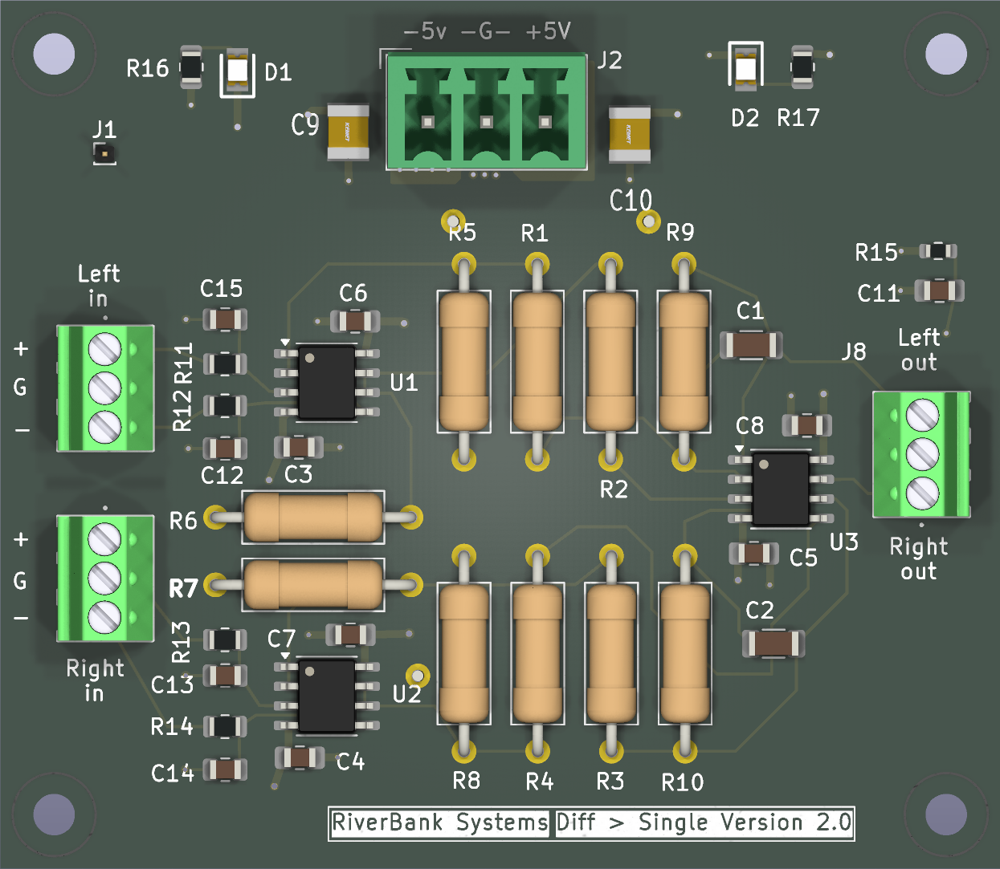
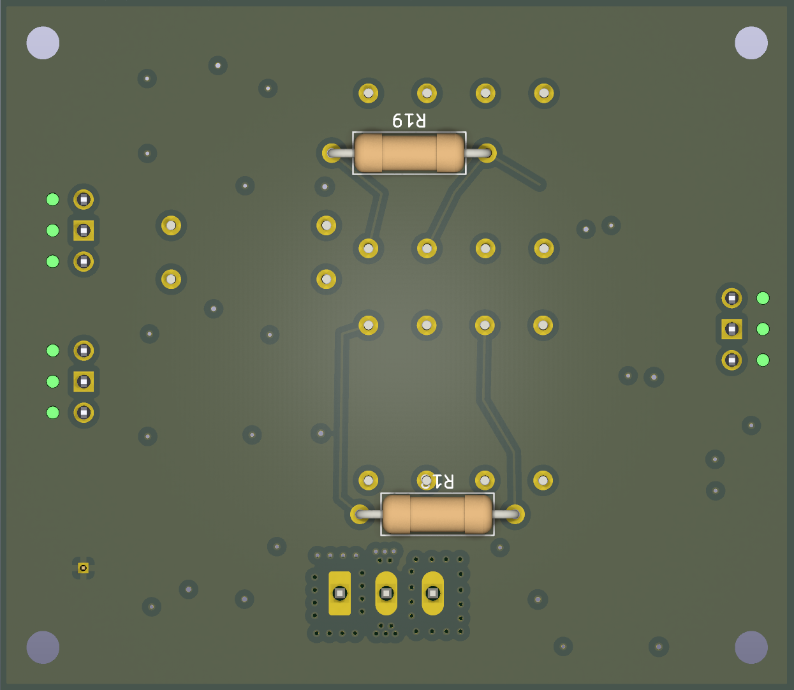
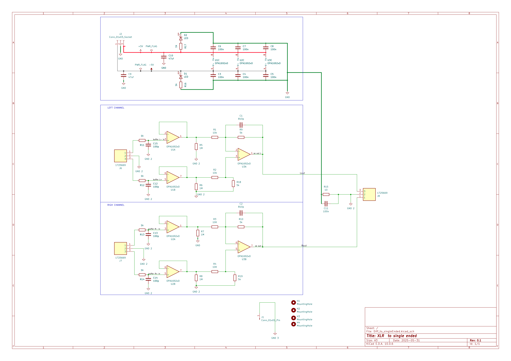

# Differentia_to_SingleEnded — Differential to Single-Ended Audio Board

## Top View##

## Bottom View ##

## Overview

| Item | Details |
|---|---|
| MCU / main IC | No MCU. Three OPA1692xD dual op-amps (U1–U3) provide the analog signal stages. |
| Supply | J2: +5 V, GND, and -5 V; verify the external supply and grounding scheme before powering. |
| Programming / debug | Not applicable; no programming or debug interface is shown. |
| Source files | `Diff_to_singleEnded.kicad_pro`, `Diff_to_singleEnded.kicad_sch`, `Diff_to_singleEnded.kicad_pcb`, `Diff_to_singleEnded.csv` |

## Schematic

One schematic page was found and rendered at 200 dpi.

- [Schematic PDF](schematic/Diff_to_singleEnded.pdf)
- [Schematic SVG](schematic/Diff_to_singleEnded.svg)

## Functional blocks

| Block | Parts | Description |
|---|---|---|
| Power (no explicit block title) | J2, C3–C10, D1–D2, R16–R17, U1–U3 | Accepts ±5 V and ground; bulk and local decoupling support the op-amps. D1/D2 and 1 kΩ resistors are shown on the supply rails. |
| LEFT CHANNEL | J6, U1, U3A, R1–R2, R5, R6, R9, R11–R12, R18, C1, C12, C15 | Left differential input is buffered by U1 and converted to the single-ended `/Lout` signal by U3A. |
| RIGH CHANNEL | J7, U2, U3B, R3–R4, R7–R8, R10, R13–R14, R19, C2, C13–C14 | Right differential input is buffered by U2 and converted to the single-ended `/Rout` signal by U3B. The source schematic spells this block title “RIGH CHANNEL.” |
| Output connection | J8, R15, C11 | Carries the left and right outputs and signal return to the output connector. |

## Connector pinouts

Pin/net assignments below are taken from the schematic netlist and cross-checked against the PCB footprint pads. `GND 2` and `GND 3` are the exact net names shown by KiCad.

### J1 — single-pin ground

| Pin | Net | Function |
|---:|---|---|
| 1 | `GND 3` | Separate ground connection |

### J2 — ±5 V power input

| Pin | Net | Function |
|---:|---|---|
| 1 | `-5V` | Negative supply |
| 2 | `GND` | Power return |
| 3 | `+5V` | Positive supply |

### J6 — left differential input

| Pin | Net | Function |
|---:|---|---|
| 1 | `Net-(J6-Pad1)` | Left input, - |
| 2 | `GND 2` | Signal return |
| 3 | `Net-(J6-Pad3)` | Left input, + |

### J7 — right differential input

| Pin | Net | Function |
|---:|---|---|
| 1 | `Net-(J7-Pad1)` | Right input, - |
| 2 | `GND 2` | Signal return |
| 3 | `Net-(J7-Pad3)` | Right input, + |

### J8 — single-ended outputs

| Pin | Net | Function |
|---:|---|---|
| 1 | `/Rout` | Right output |
| 2 | `GND 2` | Signal return |
| 3 | `/Lout` | Left output |

## MCU pin assignment

Not applicable: no MCU or module is present in the schematic or PCB, so there are no GPIO assignments.

## Peripheral details

### OPA1692xD pad-to-net assignments

The PCB pad-net names match the schematic netlist for each listed IC pin.

| IC | Pin | Net |
|---|---:|---|
| U1 | 1 | `Net-(U1A--)` |
| U1 | 2 | `Net-(U1A--)` |
| U1 | 3 | `/buffer L- in` |
| U1 | 4 | `-5V` |
| U1 | 5 | `/buffer L+` |
| U1 | 6 | `Net-(U1B--)` |
| U1 | 7 | `Net-(U1B--)` |
| U1 | 8 | `+5V` |
| U2 | 1 | `Net-(U2A--)` |
| U2 | 2 | `Net-(U2A--)` |
| U2 | 3 | `/buffer R- in` |
| U2 | 4 | `-5V` |
| U2 | 5 | `/buffer R+ in` |
| U2 | 6 | `Net-(U2B--)` |
| U2 | 7 | `Net-(U2B--)` |
| U2 | 8 | `+5V` |
| U3 | 1 | `/Lout` |
| U3 | 2 | `Net-(U3A--)` |
| U3 | 3 | `Net-(U3A-+)` |
| U3 | 4 | `-5V` |
| U3 | 5 | `Net-(U3B-+)` |
| U3 | 6 | `Net-(U3B--)` |
| U3 | 7 | `/Rout` |
| U3 | 8 | `+5V` |

U1 and U2 buffer the two differential inputs; the two halves of U3 generate the single-ended outputs. C3–C8 are 100 nF local supply capacitors, and C9–C10 are 47 µF bulk capacitors. The project has no MCU, digital expanders, or level shifters.

## BOM

The BOM has 48 total units across these grouped reference rows. Its columns do not include a separate supplier part-number field; supplier PNs are therefore marked “Not listed” rather than inferred from values or datasheet links.

| Ref | Qty | Value / part | Footprint | Supplier PN |
|---|---:|---|---|---|
| C1, C2 | 2 | 810p | `Capacitor_SMD:C_1206_3216Metric` | Not listed |
| C3–C8, C11 | 7 | 100n | `Capacitor_SMD:C_0805_2012Metric_Pad1.18x1.45mm_HandSolder` | Not listed |
| C9, C10 | 2 | 47uf | `samsys:CAPC3225X280N` | Not listed |
| C12–C15 | 4 | 100p | `Capacitor_SMD:C_0805_2012Metric` | Not listed |
| D1, D2 | 2 | LED | `samsys:LEDC2012X40N` | Not listed |
| H1–H4 | 4 | MountingHole | `MountingHole:MountingHole_2.7mm_M2.5` | Not listed |
| J1 | 1 | Conn_01x01_Pin | `Connector_PinHeader_1.00mm:PinHeader_1x01_P1.00mm_Vertical` | Not listed |
| J2 | 1 | Conn_01x03_Socket | `Connector_Phoenix_MC:PhoenixContact_MCV_1,5_3-G-3.81_1x03_P3.81mm_Vertical` | Not listed |
| J6–J8 | 3 | 1725669 | `1725669` | Not listed separately; BOM value is 1725669 |
| R1, R2 | 2 | 10k | `Resistor_THT:R_Axial_DIN0309_L9.0mm_D3.2mm_P12.70mm_Horizontal` | Not listed |
| R3, R4 | 2 | 10K | `Resistor_THT:R_Axial_DIN0309_L9.0mm_D3.2mm_P12.70mm_Horizontal` | Not listed |
| R5–R8 | 4 | 1M | `Resistor_THT:R_Axial_DIN0309_L9.0mm_D3.2mm_P12.70mm_Horizontal` | Not listed |
| R9, R10, R18, R19 | 4 | 5k | `Resistor_THT:R_Axial_DIN0309_L9.0mm_D3.2mm_P12.70mm_Horizontal` | Not listed |
| R11–R14, R16, R17 | 6 | 1k | `Resistor_SMD:R_0805_2012Metric` | Not listed |
| R15 | 1 | 10 | `Resistor_SMD:R_0603_1608Metric` | Not listed |
| U1–U3 | 3 | OPA1692xD | `Package_SO:SOIC-8_3.9x4.9mm_P1.27mm` | Not listed |

## Notes

- KiCad board statistics report a rectangular outline of 65.0 × 56.5 mm and 1.6 mm board thickness.
- H1–H4 are 2.7 mm non-plated mounting holes, specified with M2.5 mounting-hole footprints.
- The board render silkscreen reads “RiverBank Systems” and “Diff > Single Version 2.0.” The schematic title block says “XLR to single ended,” revision 0.1, dated 2025-05-31.
- Source filenames: `Diff_to_singleEnded.kicad_pro`, `Diff_to_singleEnded.kicad_sch`, `Diff_to_singleEnded.kicad_pcb`, and `Diff_to_singleEnded.csv`. The source folder also contains front and back board render PNGs.
- The schematic and PCB net names matched for J1, J2, J6–J8, and U1–U3; no naming discrepancy was found in those connector and IC pad nets.
- **Verify grounding:** `GND`, `GND 2`, and `GND 3` are separate nets in both design files. Confirm how they should be connected in the finished system.
- **Verify BOM sourcing:** the supplied CSV has datasheet links but no supplier-PN field. In particular, `1725669` is the listed value for J6–J8, not a separately identified supplier PN.
- No MCU pin assignments or firmware/debug details apply to this board.
