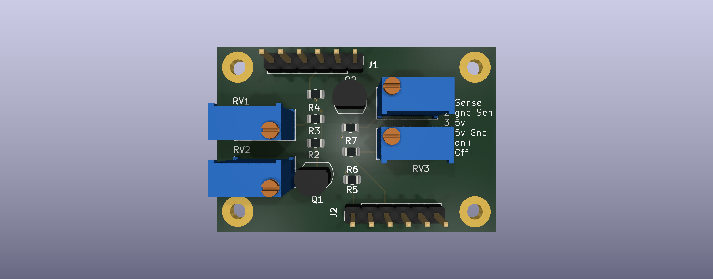
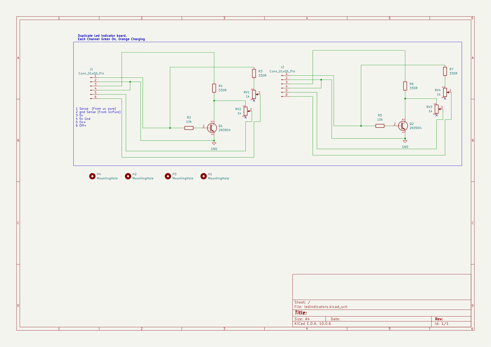

# PowerSupplyUCIndicators

## Overview

| Item | Details |
|---|---|
| MCU / main IC | No MCU or main IC. The two channels use 2N3904 transistors and adjustable resistor networks. |
| Supply | The schematic connector note specifies 5 V on pin 3 and 5 V GND on pin 4 of each connector. Pin 2 is also on the common `GND` net. Supply source/current requirements are not stated. |
| Programming / debug | None shown. |
| Source files | `ledindicators.kicad_pro`, `ledindicators.kicad_sch`, `ledindicators.kicad_pcb`; [BOM.csv](BOM.csv) was regenerated from the updated schematic, with mounting holes included from the PCB. |

## Schematic

The project has one schematic sheet. Open the exported [PDF](schematic/ledindicators.pdf) or [SVG](schematic/ledindicators.svg).

## Functional blocks

The schematic annotation reads “Duplicate Led Indicator board, Each Channel Green On, Orange Charging.” It does not show separate framed functional blocks.

| Block | Parts | Description |
|---|---|---|
| Indicator channel 1 | J1, Q1, R2-R4, RV1-RV2 | Sense input, 2N3904 transistor stage, and two 1k trimmers/resistor paths for the channel's indicator signals. |
| Indicator channel 2 | J2, Q2, R5-R7, RV3-RV4 | Duplicate channel with the same circuit pattern as channel 1. |

## Connector pinouts

The schematic note describes J1's six pins. J2 repeats the same channel topology, so its function descriptions below follow the J1 note; confirm the intended external wiring. Net names shown are taken from the schematic. Its autogenerated connector nets are not given functional labels.

| Connector | Pin | Schematic net | Function / connection |
|---|---:|---|---|
| J1 | 1 | `Net-(J1-Pin_1)` | Sense input, “From uc pure” per schematic note |
| J1 | 2 | `GND` | Sense ground, per schematic note |
| J1 | 3 | `Net-(J1-Pin_3)` | 5 V supply, per schematic note |
| J1 | 4 | `GND` | 5 V ground, per schematic note |
| J1 | 5 | `Net-(J1-Pin_5)` | `On+`, per schematic note |
| J1 | 6 | `Net-(J1-Pin_6)` | `Off+`, per schematic note |
| J2 | 1 | `Net-(J2-Pin_1)` | Sense input; inferred from the duplicate channel |
| J2 | 2 | `GND` | Sense ground |
| J2 | 3 | `Net-(J2-Pin_3)` | 5 V supply |
| J2 | 4 | `GND` | 5 V ground |
| J2 | 5 | `Net-(J2-Pin_5)` | `On+` |
| J2 | 6 | `Net-(J2-Pin_6)` | `Off+` |

## MCU pin assignments

Not applicable: no MCU or module is shown.

## Peripheral details

- **Transistor stages:** Q1 and Q2 are 2N3904 NPN transistors. Their bases are driven through R2 and R5 (10k); their emitters connect to `GND`.
- **Resistor and adjustment networks:** R3, R4, R6, and R7 are 330R. RV1-RV4 are 1k trimmers; their third pins are marked unconnected in the schematic. Each channel routes `On+`/`Off+` through the corresponding adjustable networks.
- **Supply and grounding:** J1 and J2 have separate, autogenerated pin-3 nets. The schematic's text annotation identifies each as 5 V. Both pin 2 and pin 4 on each connector connect to the common `GND` net.
- **Connectivity check:** All schematic pin nets match the corresponding PCB pad nets, including connector and transistor pins. No schematic/PCB net-name discrepancies were found.

## BOM

The populated parts below are from the current schematic BOM export. H1-H4 are included as mechanical items from the PCB because their schematic symbols are excluded from BOM export. Supplier part numbers are not assigned.

| Ref | Qty | Value / part | Footprint | Supplier PN |
|---|---:|---|---|---|
| J1, J2 | 2 | `Conn_01x06_Pin` | `Connector_PinHeader_2.54mm:PinHeader_1x06_P2.54mm_Vertical` | — |
| Q1, Q2 | 2 | `2N3904` | `Package_TO_SOT_THT:TO-92_Inline` | — |
| R2, R5 | 2 | `10k` | `Resistor_SMD:R_0805_2012Metric` | — |
| R3, R4, R6, R7 | 4 | `330R` | `Resistor_SMD:R_0805_2012Metric` | — |
| RV1-RV4 | 4 | `1k` | `Potentiometer_THT:Potentiometer_Bourns_3296W_Vertical` | — |
| H1-H4 | 4 | `MountingHole` | `MountingHole:MountingHole_2.5mm_Pad` | — |

## Notes

- The Edge.Cuts outline is a rectangle from X=77.680 to 122.450 mm and Y=56.025 to 85.650 mm, measuring 44.770 x 29.625 mm.
- Four 2.5 mm mounting-hole pads are positioned near the board corners; verify hardware and enclosure clearance.
- The schematic title block is blank. Its free-text note describes the duplicate two-channel board and intended indicator behavior.
- Confirm J2's pin descriptions against the host wiring; they are inferred from the duplicated channel topology and the J1 annotation.
- Confirm the voltage/current limits and source for each connector's 5 V input.
