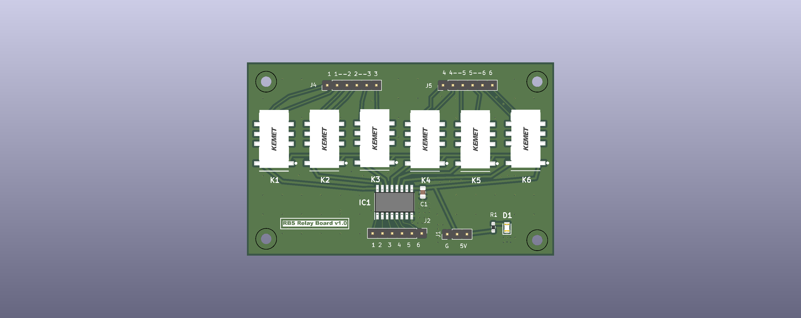
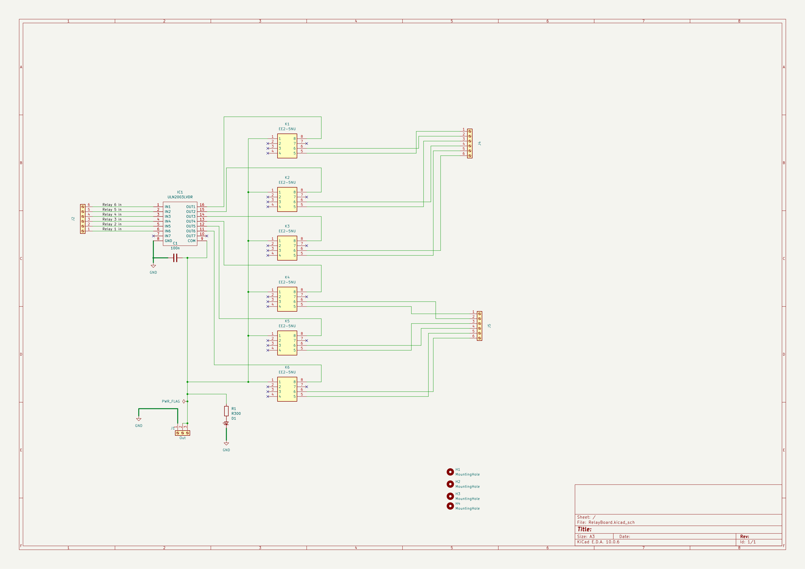

# Power_Relay_Board

## Overview

| Item | Details |
|---|---|
| MCU / main IC | No MCU. IC1 is a ULN2003LVDR seven-channel low-side driver controlling six EE2-5NU relays. |
| Supply | J1 pin 1 is GND; pins 2 and 3 share `Net-(IC1-COM)`. The board render shows `G` and `5V` silkscreen near the power header, but the schematic does not assign a voltage name to the COM net. Verify the supply pin orientation and voltage before powering. |
| Programming / debug | None shown. J2 is a six-channel relay-input header; no MCU or programming interface is present. |
| Source files | `RelayBoard.kicad_pro`, `RelayBoard.kicad_sch`, `RelayBoard.kicad_pcb`, and `production/bom.csv`. The BOM is included as [BOM.csv](BOM.csv). |

## Schematic

The project contains one schematic sheet. Open the exported [PDF](schematic/RelayBoard.pdf) or [SVG](schematic/RelayBoard.svg).

## Functional blocks

The schematic has no explicit functional-block titles or labeled section frames. These groupings are inferred from the parts and wiring.

| Block | Parts | Description |
|---|---|---|
| Relay inputs and driver | J2, IC1, C1 | J2 carries six relay-input signals to IC1 channels 1-6. C1 is the driver's 100 nF bypass capacitor. |
| Relay coil and supply connection | J1, IC1, K1-K6 | IC1 outputs 1-6 drive the six relay coils; IC1 COM and the relays' coil-common pins connect to J1's shared `Net-(IC1-COM)` net. |
| Relay contact outputs, channels 1-3 | K1-K3, J4 | J4 routes a pair of contact terminals from each of the first three relays. |
| Relay contact outputs, channels 4-6 | K4-K6, J5 | J5 routes a pair of contact terminals from each of the last three relays. |
| Power indicator | R1, D1 | R1 (`R300`) and D1 (`LS_R976`) form the schematic's indicator branch. |
| Mounting | H1-H4 | Four M2.5 mounting-hole footprints. |

## Connector pinouts

Pin/net mappings below are from the schematic netlist and agree with the corresponding PCB pad nets. The output nets are KiCad-generated names, not functional labels. Connector orientation is not implied; confirm pin 1 from the PCB silkscreen before wiring.

### J1 — `Out`, 1x3

| Pin | Schematic net | Function / connection |
|---:|---|---|
| 1 | `GND` | Ground |
| 2 | `Net-(IC1-COM)` | Shared relay coil-common / driver COM net; same net as pin 3 |
| 3 | `Net-(IC1-COM)` | Shared relay coil-common / driver COM net; same net as pin 2 |

### J2 — `Buffer`, 1x6 relay inputs

| Pin | Schematic net | Function |
|---:|---|---|
| 1 | `/Relay 1 in` | Relay 1 control input, IC1 IN1 |
| 2 | `/Relay 2 in` | Relay 2 control input, IC1 IN2 |
| 3 | `/Relay 3 in` | Relay 3 control input, IC1 IN3 |
| 4 | `/Relay 4 in` | Relay 4 control input, IC1 IN4 |
| 5 | `/Relay 5 in` | Relay 5 control input, IC1 IN5 |
| 6 | `/Relay 6 in` | Relay 6 control input, IC1 IN6 |

### J4 — `Buffer`, 1x6 relay contacts 1-3

| Pin | Schematic net | Relay contact connection |
|---:|---|---|
| 1 | `Net-(J4-Pin_1)` | K1 pin 5 |
| 2 | `Net-(J4-Pin_2)` | K1 pin 6 |
| 3 | `Net-(J4-Pin_3)` | K2 pin 5 |
| 4 | `Net-(J4-Pin_4)` | K2 pin 6 |
| 5 | `Net-(J4-Pin_5)` | K3 pin 5 |
| 6 | `Net-(J4-Pin_6)` | K3 pin 6 |

### J5 — `Buffer`, 1x6 relay contacts 4-6

| Pin | Schematic net | Relay contact connection |
|---:|---|---|
| 1 | `Net-(J5-Pin_1)` | K4 pin 5 |
| 2 | `Net-(J5-Pin_2)` | K4 pin 6 |
| 3 | `Net-(J5-Pin_3)` | K5 pin 5 |
| 4 | `Net-(J5-Pin_4)` | K5 pin 6 |
| 5 | `Net-(J5-Pin_5)` | K6 pin 5 |
| 6 | `Net-(J5-Pin_6)` | K6 pin 6 |

The schematic does not label the contact pairs as normally open or normally closed. Verify the switching state against the EE2-5NU datasheet before assigning those functions.

## MCU pin assignments

Not applicable: no MCU or module is shown. J2's input signals are listed above; no GPIO numbers are assigned in this design.

## Peripheral details

- **Relay driver:** IC1 is a ULN2003LVDR. Schematic input pins 6, 5, 4, 3, 2, and 1 carry `/Relay 1 in` through `/Relay 6 in`, respectively; pin 7 (IN7) is unconnected. Output pins 16 through 11 (OUT1 through OUT6) drive K1 through K6 at relay pin 8; output pin 10 (OUT7) is unconnected. Pin 8 is GND and pin 9 is COM.
- **Relays:** K1-K6 are EE2-5NU parts. Each relay's pin 1 is connected to `Net-(IC1-COM)`, pin 8 is driven by its corresponding IC1 output, and pins 5 and 6 route to an output connector. Relay pins 2, 3, 4, and 7 are marked unconnected in the design.
- **Power and indicator:** C1 is 100 nF. R1 is `R300` and is in series with D1 (`LS_R976`) between the COM net and GND, as drawn. The schematic does not specify the COM-net voltage.
- **Connectivity check:** The schematic net names and PCB pad net names match for J1, J2, J4, J5, IC1, and K1-K6. No pin/net discrepancies were found in those components.

## BOM

Transcribed from the supplied `production/bom.csv` (copied here as [BOM.csv](BOM.csv)). LCSC part-number cells are empty in the source BOM.

| Ref | Qty | Value / part | Footprint | Supplier PN (LCSC) |
|---|---:|---|---|---|
| C1 | 1 | 100n | 0805 | — |
| D1 | 1 | LS_R976 | LEDC2012X40N | — |
| H1, H2, H3, H4 | 4 | MountingHole | MountingHole_2.7mm_M2.5 | — |
| IC1 | 1 | ULN2003LVDR | SOIC127P780X200-16N | — |
| J1 | 1 | Out | PinHeader_1x03_P2.54mm_Vertical | — |
| J2, J4, J5 | 3 | Buffer | PinHeader_1x06_P2.54mm_Vertical | — |
| K1, K2, K3, K4, K5, K6 | 6 | EE2-5NU | EE2-5NU | — |
| R1 | 1 | R300 | 0603 | — |

## Notes

- The Edge.Cuts outline measures 79.375 x 50.000 mm (X: 80.000-159.375 mm; Y: 40.000-90.000 mm).
- H1-H4 use the `MountingHole_2.7mm_M2.5` footprint. The footprint indicates a 2.7 mm hole for M2.5 hardware; verify mechanical clearances for the enclosure.
- Source project files are `RelayBoard.kicad_pro`, `RelayBoard.kicad_sch`, and `RelayBoard.kicad_pcb`; the supplied BOM is `production/bom.csv`.
- The schematic title block has no populated title and contains no explicit functional-block titles.
- Verify J1's pin-to-silkscreen orientation and the voltage on `Net-(IC1-COM)`. The board render includes `G` and `5V` markings, while the schematic uses only the autogenerated COM net name.
- Verify the J4/J5 contact states (NO/NC) against the EE2-5NU datasheet; this document records only the schematic pin-to-net mapping.
