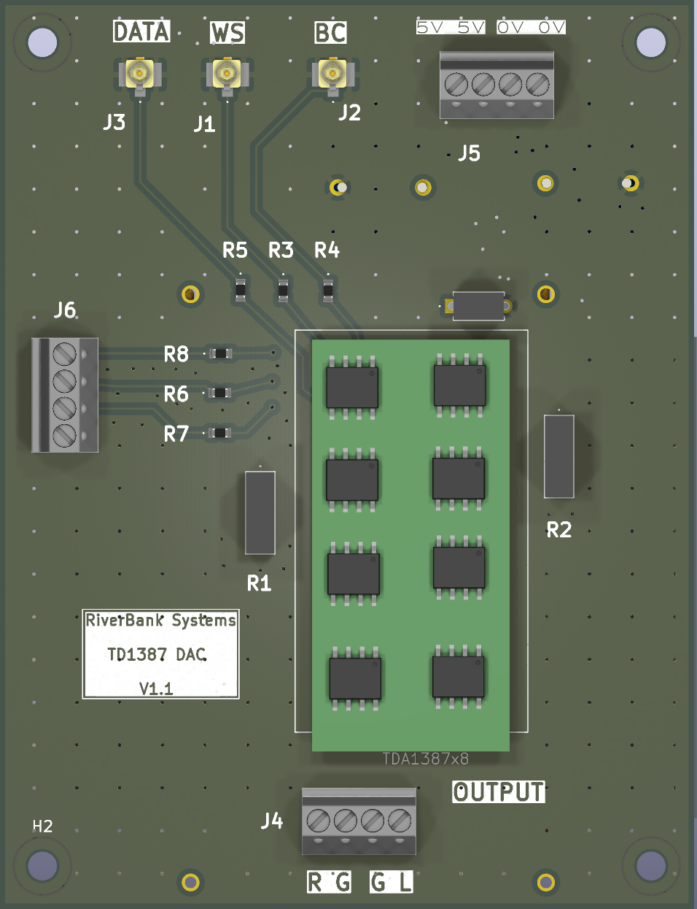
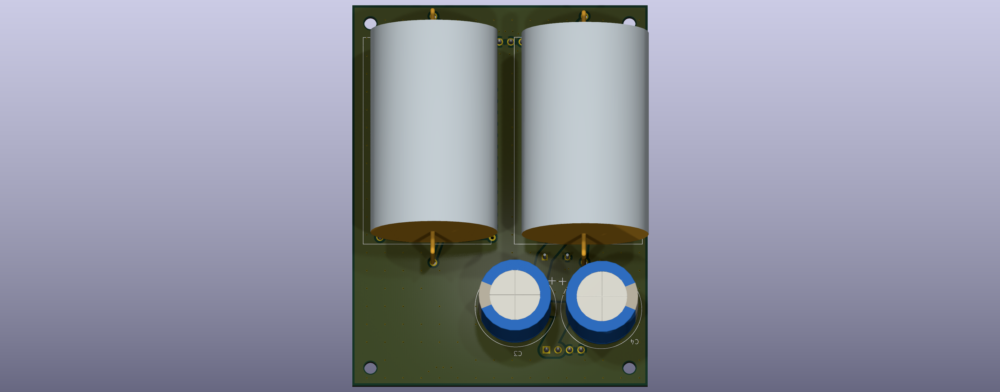
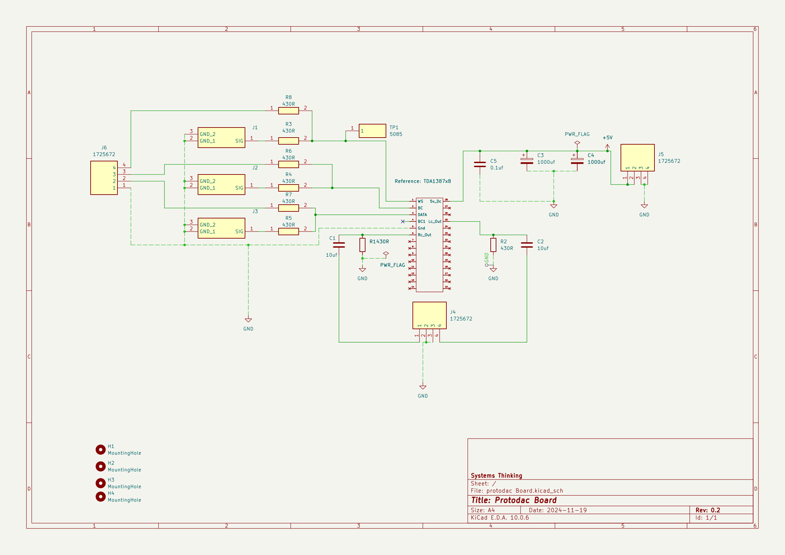

# ProtoDac

## Top View ##

## Bottom View ##

An eight-channel TDA1387 DAC module carrier with digital audio inputs and stereo analog output terminals.

## Overview

| Item                | Details                                                                                           |
| ------------------- | ------------------------------------------------------------------------------------------------- |
| MCU / main IC       | No MCU. Main device is the TDA1387x8 DAC module/footprint.                                        |
| Supply              | +5 V DC at J5; J5 also exposes two GND pins. The schematic does not specify current requirements. |
| Programming / debug | None shown. TP1 is connected to WS, not a programming/debug interface.                            |
| Schematic           | `protodac Board.kicad_sch` (one sheet; revision 0.2, dated 2024-11-19)                          |
| PCB                 | `protodac Board.kicad_pcb`                                                                      |
| Project             | `protodac Board.kicad_pro`                                                                      |
| BOM source          | `protodac Board.csv`                                                                            |
| Other project files | `protodac Board.kicad_dru`, `protodac Board.step`; top/back render PNGs are included below.   |

## Schematic

- [Schematic PDF](schematic/ProtoDac.pdf)
- [Schematic SVG](<schematic/protodac%20Board.svg>)

## Functional blocks

The schematic is one sheet and does not define titled functional blocks. These groupings summarize the circuit connections and board markings.

| Block                  | Parts              | Description                                                                                                                                 |
| ---------------------- | ------------------ | ------------------------------------------------------------------------------------------------------------------------------------------- |
| Digital audio inputs   | J1–J3, J6, R3–R8 | Three U.FL inputs are silk-labeled WS, BC, and DATA. J6 is a four-pin input exposing GND, DATA, BC, and WS through 430 Ω series resistors. |
| DAC module             | TDA1387x8          | Main DAC module; schematic pins 1, 2, 3, 5, 6, 25, and 28 are used for WS, BC, DATA, GND, right output, left output, and +5 V respectively. |
| Analog output          | C1, C2, R1, R2, J4 | AC-coupled left/right outputs with 430 Ω resistors to GND and a four-pin terminal block.                                                   |
| Power entry and bypass | J5, C3–C5         | +5 V input and GND, with two 1000 µF capacitors and a 0.1 µF capacitor across the supply.                                                 |
| Mounting               | H1–H4             | Four M2.5 mounting-hole footprints.                                                                                                         |

## Connector pinouts

### J1 — U.FL, silk-labeled WS

| Pin | Schematic net    | Function                     |
| --: | ---------------- | ---------------------------- |
|   1 | `Net-(J1-SIG)` | WS signal (board silkscreen) |
|   2 | GND              | Ground                       |
|   3 | GND              | Ground                       |

### J2 — U.FL, silk-labeled BC

| Pin | Schematic net    | Function                     |
| --: | ---------------- | ---------------------------- |
|   1 | `Net-(J2-SIG)` | BC signal (board silkscreen) |
|   2 | GND              | Ground                       |
|   3 | GND              | Ground                       |

### J3 — U.FL, silk-labeled DATA

| Pin | Schematic net    | Function                       |
| --: | ---------------- | ------------------------------ |
|   1 | `Net-(J3-SIG)` | DATA signal (board silkscreen) |
|   2 | GND              | Ground                         |
|   3 | GND              | Ground                         |

### J4 — 4-position analog output terminal

Board silkscreen reads R, G, G, L from pin 1 through pin 4.

| Pin | Schematic net     | Function                              |
| --: | ----------------- | ------------------------------------- |
|   1 | `Net-(C1-Pad2)` | Right analog output, AC-coupled by C1 |
|   2 | GND               | Ground                                |
|   3 | GND               | Ground                                |
|   4 | `Net-(C2-Pad2)` | Left analog output, AC-coupled by C2  |

### J5 — 4-position power input terminal

| Pin | Schematic net | Function    |
| --: | ------------- | ----------- |
|   1 | +5V           | +5 V supply |
|   2 | +5V           | +5 V supply |
|   3 | GND           | Ground      |
|   4 | GND           | Ground      |

### J6 — 4-position digital input terminal

| Pin | Schematic net     | Function                      |
| --: | ----------------- | ----------------------------- |
|   1 | GND               | Ground                        |
|   2 | `Net-(J6-Pad2)` | DATA, through R7 to DAC pin 3 |
|   3 | `Net-(J6-Pad3)` | BC, through R6 to DAC pin 2   |
|   4 | `Net-(J6-Pad4)` | WS, through R8 to DAC pin 1   |

## MCU pin assignments

There is no MCU in this design, so there are no MCU GPIO assignments. The following are the schematic pin numbers for the TDA1387x8 module. Functions are taken from the schematic symbol; GPIO numbers are not applicable.

|    Module pin | GPIO | Schematic net                        | Function                                                  |
| ------------: | ---- | ------------------------------------ | --------------------------------------------------------- |
|             1 | N/A  | `Net-(TDA1387x8-WS)`               | WS input; also connects to TP1 and the WS input resistors |
|             2 | N/A  | `Net-(TDA1387x8-BC)`               | BC input                                                  |
|             3 | N/A  | `Net-(TDA1387x8-DATA)`             | DATA input                                                |
|             4 | N/A  | `unconnected-(TDA1387x8-BC1-Pad4)` | Not connected                                             |
|             5 | N/A  | GND                                  | Ground                                                    |
|             6 | N/A  | `Net-(TDA1387x8-Rc_Out)`           | Right channel output before C1                            |
|            25 | N/A  | `Net-(TDA1387x8-Lc_Out)`           | Left channel output before C2                             |
|            28 | N/A  | +5V                                  | +5 V supply                                               |
| 7–24, 26–27 | N/A  | Unconnected                          | No schematic connections shown                            |

## Peripheral details

- **Input conditioning:** R3–R8 are 430 Ω resistors between the U.FL/J6 digital inputs and the DAC's WS, BC, and DATA pins. The three U.FL signal nets use KiCad-generated names in the schematic.
- **Analog outputs:** DAC pins 6 (Rc_Out) and 25 (Lc_Out) feed C1 and C2 (10 µF) in series to J4. R1 and R2 (430 Ω) connect the pre-capacitor output nets to GND.
- **Power:** J5 connects +5 V to DAC pin 28. C3 and C4 (1000 µF each) and C5 (0.1 µF) are connected between +5 V and GND.
- **Other support:** TP1 is on the WS net. No separate driver, expander, level shifter, regulator, or programming circuit is shown.

## Bill of materials

The supplied CSV has no supplier part-number field. Supplier part numbers are therefore shown as not specified; datasheet/product links are retained where supplied. R1/R2 and R3–R8 are separated because their PCB footprints differ.

| Ref       | Qty | Value / part                            | Footprint                                | Supplier PN   | Datasheet / product reference                                                                                                                                                                                           |
| --------- | --: | --------------------------------------- | ---------------------------------------- | ------------- | ----------------------------------------------------------------------------------------------------------------------------------------------------------------------------------------------------------------------- |
| C1, C2    |   2 | 10 µF                                  | `Audio_Module:Clarity Cap`             | Not specified | [Datasheet](https://www.hificollective.co.uk/sites/default/files/2021-08/clarity-cap-esa-datasheet.pdf)                                                                                                                  |
| C3, C4    |   2 | 1000 µF                                | `Audio_Module:Audio Note Kaisei POLAR` | Not specified | [Product](https://www.hificollective.co.uk/catalog/1000uf-25v-audio-note-kaisei-electrolytic-capacitor.html); [product range](https://www.hificollective.co.uk/components/audio-note-kaisei-electrolytic-capacitors.html) |
| C5        |   1 | 0.1 µF                                 | `samsys:K104K20X7RK53H5G`              | Not specified | [Datasheet](https://www.vishay.com/docs/45250/kgseries.pdf)                                                                                                                                                              |
| H1–H4    |   4 | MountingHole                            | `MountingHole:MountingHole_2.7mm_M2.5` | Not specified | —                                                                                                                                                                                                                      |
| J1–J3    |   3 | `U.FL-R-SMT-1_80_` (U.FL-R-SMT-1(80)) | `UFLRSMT180`                           | Not specified | [Drawing](https://www.hirose.com/en/product/document?clcode=CL0331-0472-2-80&productname=U.FL-R-SMT-1(80)&series=U.FL&documenttype=2DDrawing&lang=en&documentid=0001257922)                                              |
| J4–J6    |   3 | 1725672                                 | `samsys:1725672`                       | Not specified | [Datasheet](https://datasheet.datasheetarchive.com/originals/distributors/SFDatasheet-2/sf-00050602.pdf)                                                                                                                 |
| R1, R2    |   2 | 430 Ω                                  | `samsys:Y0007400R000V0L`               | Not specified | [Panasonic reference](http://industrial.panasonic.com/cdbs/www-data/pdf/RDQ0000/ast-ind-151033.pdf); [Charcroft reference](https://www.hificollective.co.uk/sites/default/files/charcroft_datasheet.pdf)                  |
| R3–R8    |   6 | 430 Ω                                  | `ERJH3`                                | Not specified | [Panasonic reference](http://industrial.panasonic.com/cdbs/www-data/pdf/RDQ0000/ast-ind-151033.pdf); [Charcroft reference](https://www.hificollective.co.uk/sites/default/files/charcroft_datasheet.pdf)                  |
| TDA1387x8 |   1 | TDA1387x8 module (BOM value blank)      | `Audio_Module:TDA1387`                 | Not specified | [Schematic reference](https://github.com/moode-player/protodac/blob/main/images/protodac_schematic_v2.jpg)                                                                                                               |
| TP1       |   1 | 5085                                    | `5085`                                 | Not specified | [Product](https://www.keyelco.com/product-pdf.cfm?p=14604)                                                                                                                                                               |

## Notes

- Board outline is a rectangular 65 mm × 85 mm Edge.Cuts shape. Four M2.5 mounting-hole footprints are present; verify the final mechanical clearances against the enclosure.
- The PCB render files supplied with the project are included here: [top view](board-render.png) and [back view](board-back.png).
- Project source filenames are `protodac Board.kicad_pro`, `protodac Board.kicad_sch`, `protodac Board.kicad_pcb`, `protodac Board.csv`, and `protodac Board.step`.
- Source inventory also found `protodac Board.kicad_dru`, `protodac Board.kicad_prl`, a schematic backup, a log, and lock files; transient/backup files were not treated as source-of-truth inputs.
- The schematic uses generated nets such as `Net-(J1-SIG)` rather than named signal labels. WS/BC/DATA identification for J1–J3 follows the PCB silkscreen; confirm the intended external connector mapping against the system interface before wiring.
- Extracted PCB and schematic net names match; the board's WS/BC/DATA markings are silk text, not explicit schematic net labels.
- The schematic drawing has no named functional-block titles, explicit supply-current requirement, or MCU/programming interface.
- The BOM does not specify supplier part numbers. Confirm exact ordered parts and footprints with the BOM owner before purchasing.

## Review for next version

Issues identified from the current design documentation and files:

1. **Unnamed signal nets.** WS, BC and DATA are identified only by silkscreen; the schematic uses `Net-(Jx-SIG)` names. Add proper net labels.
2. **Duplicate input paths.** U.FL connectors J1–J3 and terminal J6 appear to feed the same WS/BC/DATA nets. Document that only one source may be connected at a time, or add a selection jumper.
3. **Digital input conditioning.** All six inputs use 430 Ω series resistors with no termination or pull-downs. Check signal integrity at I2S clock rates on the U.FL coax runs and the DAC's logic-high threshold when driven from 3.3 V logic.
4. **Power input.** 5 V connects directly to the DAC module with no regulator, reverse-polarity protection, fuse or per-channel filtering. The current requirement is not documented.
5. **Large inrush.** Two 1000 µF capacitors (C3/C4) are fed directly from the terminal; consider soft-start or a series resistor/ferrite.
6. **Output stage unspecified.** The 10 µF AC-coupling capacitors and 430 Ω resistors to ground set load and cutoff behaviour that is not documented; the R, G, G, L terminal has duplicated ground pins.
7. **Unused module pins.** TDA1387x8 pins 4, 7–24 and 26–27 are unconnected; confirm that the module footprint is only partly used.
8. **Specialty and unsourced parts.** Audio-grade components (Clarity Cap, Kaisei, Charcroft) have no supplier part numbers and are single-source; the BOM TDA1387x8 value is blank, and the schematic is dated 2024-11-19 (rev 0.2).
