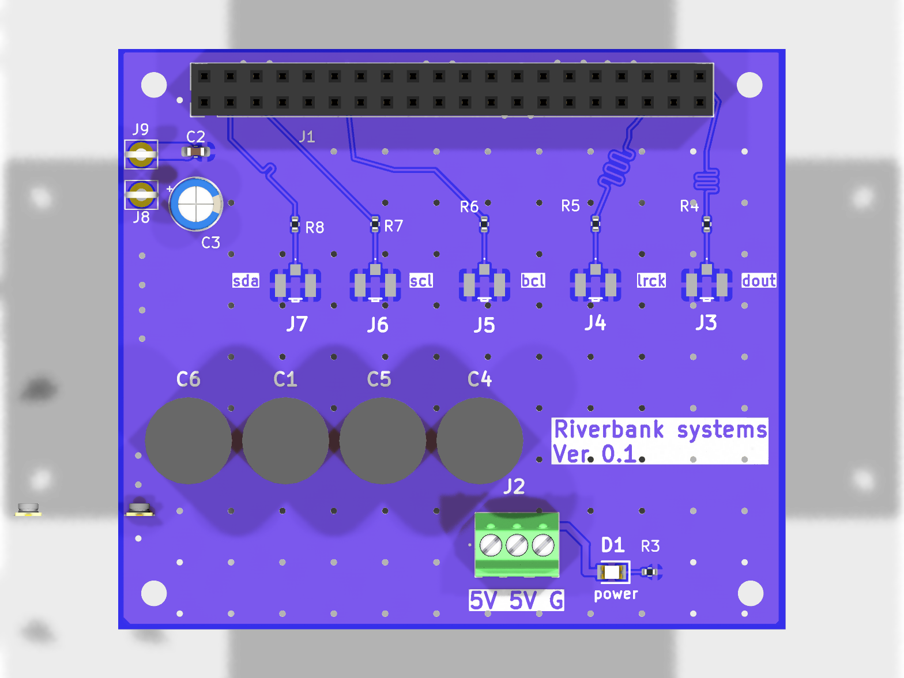
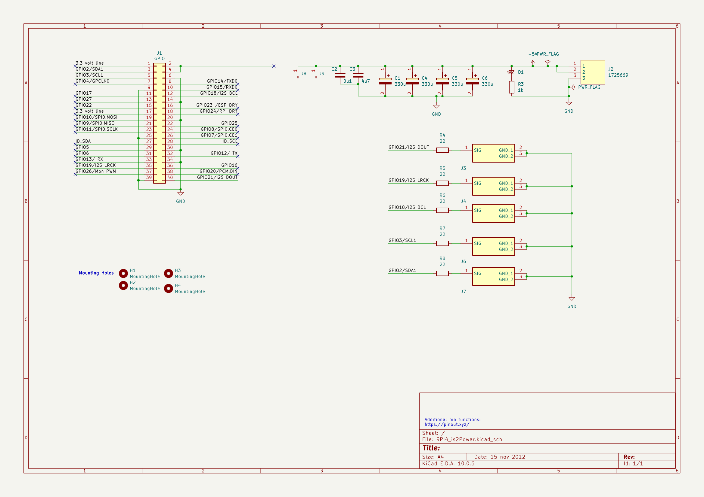

# RPI-Power-I2s-Connector

## Overview

| Item | Details |
|---|---|
| MCU / main IC | No active IC on this board. J1 is a 2x20 Raspberry Pi GPIO header. |
| Supply | +5 V on J2 pins 1 and 2; J8 and J9 are also connected to +5 V. No regulator is shown. The 3.3 V pins on J1 are the Raspberry Pi header rail. |
| Programming / debug | No onboard programmer or debug interface. Raspberry Pi UART signals are present on J1 pins 8 (GPIO14/TXD0) and 10 (GPIO15/RXD0). |
| Source files | `RPI4_is2Power.kicad_pro`, `RPI4_is2Power.kicad_sch`, `RPI4_is2Power.kicad_pcb` |
| Generated files | [BOM.csv](./BOM.csv), [schematic PDF](./schematic/RPI4_is2Power.pdf), [schematic SVG](./schematic/RPI4_is2Power.svg) |

## Schematic

Exports: [PDF](./schematic/RPI4_is2Power.pdf) · [SVG](./schematic/RPI4_is2Power.svg)

## Functional blocks

The schematic has no formal functional-block titles; these groups are identified from its labels and connectivity. “Mounting Holes” is the explicit mechanical note on the sheet.

| Block | Parts | Description |
|---|---|---|
| Raspberry Pi GPIO header | J1 | 2x20 header carrying the labeled GPIO, 3.3 V, GND, and ID signals. |
| I2S and control signal outputs | R4–R8, J3–J7 | Five signal outputs on U.FL connectors. Each signal has a 22 Ω series resistor; connector grounds share GND. |
| 5 V input and distribution | J2, J8, J9 | J2 is a three-pin terminal block with two +5 V pins and one GND pin. J8 and J9 are single-pin +5 V connections. |
| Supply filtering | C1–C6 | Four 330 µF capacitors, one 4.7 µF capacitor, and one 0.1 µF capacitor are connected across +5 V and GND. |
| Power indicator | D1, R3 | LED and 1 kΩ series resistor across the 5 V rail. |
| Mounting | H1–H4 | Four 2.5 mm mounting-hole footprints. |

## Connector pinouts

Pin numbers and net names below are taken from the schematic and checked against PCB pad nets. J1 is shown as a 2x20 header; odd-numbered pins are one row and even-numbered pins the other.

### J1 — Raspberry Pi GPIO header

| Pin | Net / label | Pin | Net / label |
|---:|---|---:|---|
| 1 | 3.3 volt line | 2 | NC (unconnected) |
| 3 | GPIO2/SDA1 | 4 | NC (unconnected) |
| 5 | GPIO3/SCL1 | 6 | GND |
| 7 | GPIO4/GPCLK0 | 8 | GPIO14/TXD0 |
| 9 | GND | 10 | GPIO15/RXD0 |
| 11 | GPIO17 | 12 | GPIO18/I2S BCL |
| 13 | GPIO27 | 14 | GND |
| 15 | GPIO22 | 16 | GPIO23 /ESP DRY |
| 17 | 3.3 volt line | 18 | GPIO24/RPI DRY |
| 19 | GPIO10/SPI0.MOSI | 20 | GND |
| 21 | GPIO9/SPI0.MISO | 22 | GPIO25 |
| 23 | GPIO11/SPI0.SCLK | 24 | GPIO8/SPI0.CE0 |
| 25 | GND | 26 | GPIO7/SPI0.CE1 |
| 27 | ID_SDA | 28 | ID_SCL |
| 29 | GPIO5 | 30 | GND |
| 31 | GPIO6 | 32 | GPIO12/ TX |
| 33 | GPIO13/ RX | 34 | GND |
| 35 | GPIO19/I2S LRCK | 36 | GPIO16 |
| 37 | GPIO26/Mon PWM | 38 | GPIO20/PCM.DIN |
| 39 | GND | 40 | GPIO21/I2S DOUT |

### Power and signal connectors

| Connector | Pin | Net / function |
|---|---:|---|
| J2 (1725669, 3-pin terminal) | 1 | +5V |
| J2 | 2 | +5V |
| J2 | 3 | GND |
| J3 (U.FL) | 1 | SIG; `Net-(J3-SIG)`, through R4 (22 Ω) to GPIO21/I2S DOUT |
| J3 | 2 | GND_1 |
| J3 | 3 | GND_2 |
| J4 (U.FL) | 1 | SIG; `Net-(J4-SIG)`, through R5 (22 Ω) to GPIO19/I2S LRCK |
| J4 | 2 | GND_1 |
| J4 | 3 | GND_2 |
| J5 (U.FL) | 1 | SIG; `Net-(J5-SIG)`, through R6 (22 Ω) to GPIO18/I2S BCL |
| J5 | 2 | GND_1 |
| J5 | 3 | GND_2 |
| J6 (U.FL) | 1 | SIG; `Net-(J6-SIG)`, through R7 (22 Ω) to GPIO3/SCL1 |
| J6 | 2 | GND_1 |
| J6 | 3 | GND_2 |
| J7 (U.FL) | 1 | SIG; `Net-(J7-SIG)`, through R8 (22 Ω) to GPIO2/SDA1 |
| J7 | 2 | GND_1 |
| J7 | 3 | GND_2 |
| J8 (single pin) | 1 | +5V |
| J9 (single pin) | 1 | +5V |

## MCU pin assignments

There is no MCU on the PCB. This table records the Raspberry Pi header signal assignments exactly as labeled in the schematic; GPIO identifiers are not inferred.

| Module pin (J1) | GPIO | Net label | Function / connection shown |
|---:|---|---|---|
| 3 | GPIO2 | GPIO2/SDA1 | SDA1; via R8 to J7 SIG |
| 5 | GPIO3 | GPIO3/SCL1 | SCL1; via R7 to J6 SIG |
| 7 | GPIO4 | GPIO4/GPCLK0 | GPCLK0 |
| 8 | GPIO14 | GPIO14/TXD0 | UART TXD0 |
| 10 | GPIO15 | GPIO15/RXD0 | UART RXD0 |
| 11 | GPIO17 | GPIO17 | Labeled GPIO |
| 12 | GPIO18 | GPIO18/I2S BCL | I2S BCL; via R6 to J5 SIG |
| 13 | GPIO27 | GPIO27 | Labeled GPIO |
| 15 | GPIO22 | GPIO22 | Labeled GPIO |
| 16 | GPIO23 | GPIO23 /ESP DRY | Labeled ESP DRY |
| 18 | GPIO24 | GPIO24/RPI DRY | Labeled RPI DRY |
| 19 | GPIO10 | GPIO10/SPI0.MOSI | SPI0 MOSI |
| 21 | GPIO9 | GPIO9/SPI0.MISO | SPI0 MISO |
| 22 | GPIO25 | GPIO25 | Labeled GPIO |
| 23 | GPIO11 | GPIO11/SPI0.SCLK | SPI0 SCLK |
| 24 | GPIO8 | GPIO8/SPI0.CE0 | SPI0 CE0 |
| 26 | GPIO7 | GPIO7/SPI0.CE1 | SPI0 CE1 |
| 27 | — | ID_SDA | ID signal; interface details unverified |
| 28 | — | ID_SCL | ID signal; interface details unverified |
| 29 | GPIO5 | GPIO5 | Labeled GPIO |
| 31 | GPIO6 | GPIO6 | Labeled GPIO |
| 32 | GPIO12 | GPIO12/ TX | Labeled TX |
| 33 | GPIO13 | GPIO13/ RX | Labeled RX |
| 35 | GPIO19 | GPIO19/I2S LRCK | I2S LRCK; via R5 to J4 SIG |
| 36 | GPIO16 | GPIO16 | Labeled GPIO |
| 37 | GPIO26 | GPIO26/Mon PWM | Labeled Mon PWM |
| 38 | GPIO20 | GPIO20/PCM.DIN | PCM DIN |
| 40 | GPIO21 | GPIO21/I2S DOUT | I2S DOUT; via R4 to J3 SIG |

## Peripheral details

| Area | Details |
|---|---|
| Signal conditioning | R4–R8 are 22 Ω series resistors between the Raspberry Pi signals and U.FL signal pins. |
| Expanders / drivers / level shifting | None shown; there are no active ICs, GPIO expanders, drivers, or level shifters in the BOM. |
| Power | +5 V enters at J2 and is commoned with J8/J9. C1/C4/C5/C6 are 330 µF each, C3 is 4.7 µF, and C2 is 0.1 µF across the rail. D1 and R3 (1 kΩ) provide a 5 V indicator. No voltage regulator is shown. |
| Raspberry Pi rails | J1 pins 1 and 17 are labeled 3.3 volt line; pins 6, 9, 14, 20, 25, 30, 34, and 39 are GND. |

## BOM

One row per reference; quantities, values, footprints, and part-number fields come from the schematic BOM export. “—” means no corresponding part number was populated in the source.

| Ref | Qty | Value / part | Footprint | Supplier PN (Mouser) | Manufacturer PN |
|---|---:|---|---|---|---|
| C1 | 1 | 330u | `CAPPRD350W60D800H1300` | 647-RNU1C331MDN1KX | RNU1C331MDN1KX |
| C2 | 1 | 0u1 | `Capacitor_SMD:C_0603_1608Metric_Pad1.08x0.95mm_HandSolder` | — | — |
| C3 | 1 | 4u7 | `Capacitor_THT:CP_Radial_D5.0mm_P2.00mm` | — | — |
| C4 | 1 | 330u | `CAPPRD350W60D800H1300` | 647-RNU1C331MDN1KX | RNU1C331MDN1KX |
| C5 | 1 | 330u | `CAPPRD350W60D800H1300` | 647-RNU1C331MDN1KX | RNU1C331MDN1KX |
| C6 | 1 | 330u | `CAPPRD350W60D800H1300` | 647-RNU1C331MDN1KX | RNU1C331MDN1KX |
| D1 | 1 | LS_R976 | `samsys:LEDC2012X40N` | 720-LSR976D5178 | LS R976 |
| H1 | 1 | MountingHole | `MountingHole:MountingHole_2.5mm` | — | — |
| H2 | 1 | MountingHole | `MountingHole:MountingHole_2.5mm` | — | — |
| H3 | 1 | MountingHole | `MountingHole:MountingHole_2.5mm` | — | — |
| H4 | 1 | MountingHole | `MountingHole:MountingHole_2.5mm` | — | — |
| J1 | 1 | GPIO | `Connector_PinSocket_2.54mm:PinSocket_2x20_P2.54mm_Vertical` | — | — |
| J2 | 1 | 1725669 | `1725669` | 651-1725669 | 1725669 |
| J3 | 1 | U.FL-R-SMT-1_80_ | `UFLRSMT180` | — | U.FL-R-SMT-1(80) |
| J4 | 1 | U.FL-R-SMT-1_80_ | `UFLRSMT180` | — | U.FL-R-SMT-1(80) |
| J5 | 1 | U.FL-R-SMT-1_80_ | `UFLRSMT180` | — | U.FL-R-SMT-1(80) |
| J6 | 1 | U.FL-R-SMT-1_80_ | `UFLRSMT180` | — | U.FL-R-SMT-1(80) |
| J7 | 1 | U.FL-R-SMT-1_80_ | `UFLRSMT180` | — | U.FL-R-SMT-1(80) |
| J8 | 1 | Conn_01x01_Pin | `Connector_Pin:Pin_D1.2mm_L11.3mm_W3.0mm_Flat` | — | — |
| J9 | 1 | Conn_01x01_Pin | `Connector_Pin:Pin_D1.2mm_L11.3mm_W3.0mm_Flat` | — | — |
| R3 | 1 | 1k | `Resistor_SMD:R_0402_1005Metric` | — | — |
| R4 | 1 | 22 | `Resistor_SMD:R_0402_1005Metric` | — | — |
| R5 | 1 | 22 | `Resistor_SMD:R_0402_1005Metric` | — | — |
| R6 | 1 | 22 | `Resistor_SMD:R_0402_1005Metric` | — | — |
| R7 | 1 | 22 | `Resistor_SMD:R_0402_1005Metric` | — | — |
| R8 | 1 | 22 | `Resistor_SMD:R_0402_1005Metric` | — | — |

## Notes

- The PCB Edge.Cuts rectangle measures 65 x 56.5 mm. H1–H4 use 2.5 mm mounting-hole footprints; their centers are approximately 58 x 49.5 mm apart.
- Source file names are `RPI4_is2Power.kicad_pro`, `RPI4_is2Power.kicad_sch`, and `RPI4_is2Power.kicad_pcb`; generated exports are in this document folder.
- The schematic title is blank and its title block date is `15 nov 2012`; verify the intended title/date and the relationship between the source project name and this document’s board name.
- J1 pins 2 and 4 are explicitly unconnected in the schematic.
- No BOM CSV or board render was present in the inventoried project files; [BOM.csv](./BOM.csv) and the board render above were generated from the schematic and PCB.
- Schematic and PCB connector pad nets agree after normalizing KiCad’s escaped slash notation. No net-name discrepancy was found.
- Verify the intended external 5 V input wiring: J2 pins 1 and 2 are both +5 V, while pin 3 is GND.

## Review for next version

Issues identified from the current design documentation and files:

1. **Pi power path not explicit.** J1 pins 2 and 4 (5 V on a Raspberry Pi) are unconnected, so the Pi is powered through J2/J8/J9. This bypasses the Pi's protection circuitry; add input protection (fuse, reverse-polarity, TVS) and make the power path and back-feed behaviour clear.
2. **Large unmanaged inrush.** Four 330 µF capacitors (C1, C4–C6) sit directly on the 5 V rail with no soft-start or current limiting.
3. **I²C routed to U.FL.** SDA/SCL (J6/J7) go through 22 Ω series resistors to U.FL coax connectors with no pull-ups or buffering, which is unsuitable for I²C. Consider a proper connector or documenting pull-up location.
4. **Inconsistent labels.** Net labels such as `GPIO23 /ESP DRY`, `GPIO12/ TX` and `GPIO13/ RX` contain stray spaces. ID_SDA/ID_SCL are not documented.
5. **Many GPIOs are not broken out.** Only five signals reach connectors; the remaining labeled GPIOs have no connector.
6. **Mixed component types.** 0402 resistors, a 0603 capacitor and THT parts are mixed, and Mouser numbers are given only for some parts.
7. **Metadata.** Schematic title is blank, the title block date is `15 nov 2012`, and the project name (`RPI4_is2Power`) does not match the board name.
