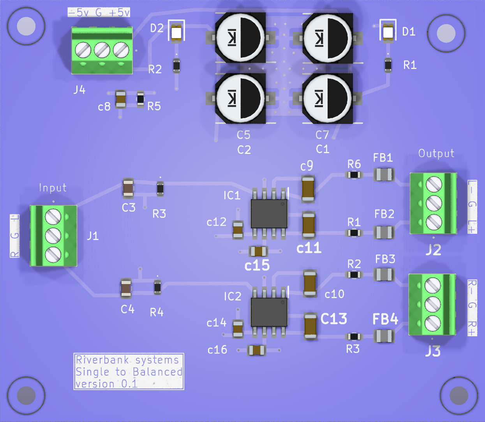
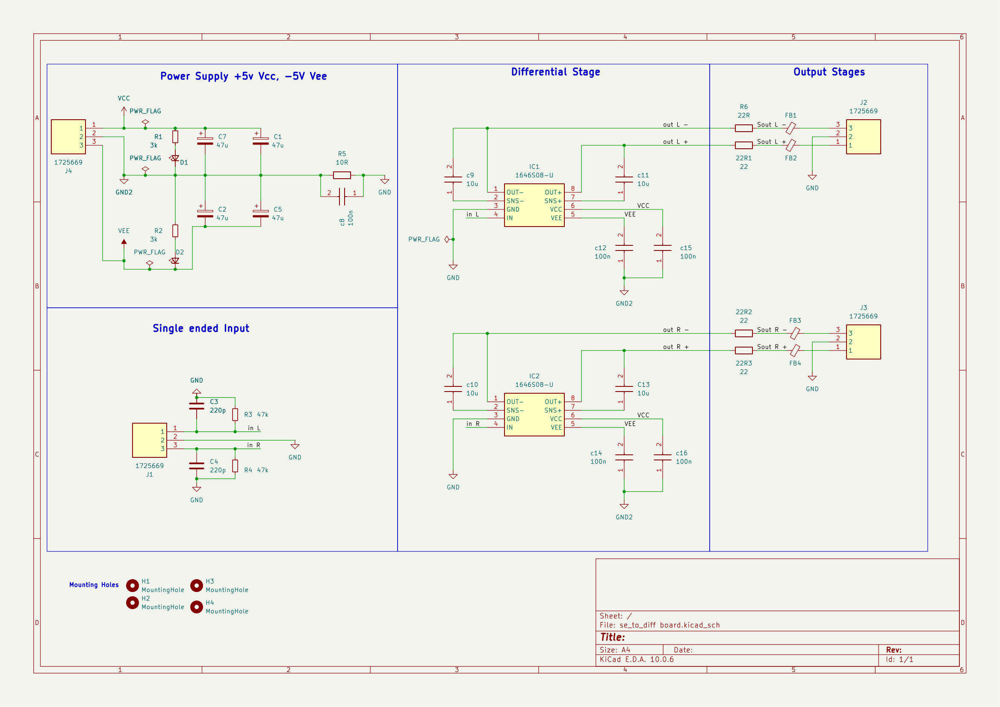

# Single_ended_to_Diff

## Overview

| Item | Details |
|---|---|
| MCU / main IC | No MCU. Two 1646S08-U devices (IC1, IC2) form the differential output stages. |
| Supply | Schematic block specifies +5 V (VCC) and -5 V (VEE); J4 also carries GND2. |
| Programming / debug | None shown. |
| Source files | `se_to_diff board.kicad_pro`, `se_to_diff board.kicad_sch`, `se_to_diff board.kicad_pcb`, `bom.csv`. |

## Schematic

One schematic sheet was found. Open the exported [PDF](schematic/se_to_diff_board.pdf) or [SVG](<schematic/se_to_diff board.svg>).

## Functional blocks

| Block (schematic title) | Parts | Description |
|---|---|---|
| Power Supply +5v Vcc, -5V Vee | J4, D1-D2, R1-R2, C1-C2, C5, C7, R5, c8 | Brings in VCC, GND2, and VEE; includes rail indicator components, bulk capacitors, and the GND/GND2 link. |
| Single ended Input | J1, C3-C4, R3-R4 | Two single-ended signal inputs, labeled `in L` and `in R`, with associated passive components. |
| Differential Stage | IC1-IC2, c9-c16, C13 | Two 1646S08-U stages with local capacitors. |
| Output Stages | 22R1-22R3, R6, FB1-FB4, J2-J3 | Series resistors and ferrite beads feed the left and right differential output connectors. |
| Mounting Holes | H1-H4 | Four mounting-hole footprints. |

## Connector pinouts

Pin numbers and net assignments below follow the schematic and were checked against the PCB pad nets. Connector orientation is not implied by this table.

### J1 — single-ended input

| Pin | Schematic signal | PCB net |
|---:|---|---|
| 1 | Left input | `/in L` |
| 2 | Signal ground | `GND` |
| 3 | Right input | `/in R` |

### J2 — left output

| Pin | Schematic signal | PCB net |
|---:|---|---|
| 1 | Left output +, after FB2 | `Net-(FB2-Pad2)` |
| 2 | Ground | `GND` |
| 3 | Left output -, after FB1 | `Net-(FB1-Pad2)` |

### J3 — right output

| Pin | Schematic signal | PCB net |
|---:|---|---|
| 1 | Right output +, after FB4 | `Net-(FB4-Pad2)` |
| 2 | Ground | `GND` |
| 3 | Right output -, after FB3 | `Net-(FB3-Pad2)` |

### J4 — power input

| Pin | Schematic signal | PCB net |
|---:|---|---|
| 1 | +5 V rail | `VCC` |
| 2 | Supply return | `GND2` |
| 3 | -5 V rail | `VEE` |

The output connector wires have no explicit labels after their ferrite beads; their signal functions above are traced from the schematic wiring. The PCB uses the corresponding auto-generated `Net-(FBx-Pad2)` names.

## MCU pin assignments

Not applicable: no MCU or module appears in the schematic or PCB.

## Peripheral details

- **Differential drivers:** IC1 and IC2 are marked `1646S08-U`. The schematic symbol assigns pins 1-8 as OUT-, SNS-, GND, IN, VEE, VCC, SNS+, and OUT+, respectively. IC1 receives `in L`; IC2 receives `in R`.
- **Output paths:** Each driver output passes through 22-ohm series resistance and one of FB1-FB4 before reaching J2/J3. The connector-side nets are auto-named in the design files.
- **Input network:** J1 carries left and right single-ended inputs with C3/C4 (220 pF) and R3/R4 (47 kOhm) shown around the input lines.
- **Power and ground:** J4 supplies VCC, GND2, and VEE. The schematic title specifies +5 V and -5 V rails. R5 (10 ohm) and c8 (100 nF) connect GND2 to signal ground GND; C1/C2/C5/C7 provide rail capacitors, with additional driver-local capacitors.
- **Indicators:** D1/D2 and R1/R2 are in the supply section. Their exact LED color/polarity is not documented here beyond the schematic symbol and connectivity.

## BOM

Transcribed from the updated BOM export (KiCad CSV with Datasheet and DNP columns). No supplier part-number field exists; datasheet links are given where supplied. No parts are marked DNP.

| Reference(s) | Qty | Value / part | Footprint | Datasheet |
|---|---:|---|---|---|
| 22R1, 22R2, 22R3 | 3 | 22 | `Resistor_SMD:R_0603_1608Metric` | — |
| C1, C2, C5, C7 | 4 | 47u | `CAPAE660X800N` | — |
| C3, C4 | 2 | 220p (KGM21BCG2A221JM) | `Capacitor_SMD:C_0805_2012Metric` | [Mouser](https://www.mouser.co.uk/ProductDetail/KYOCERA-AVX/KGM21BCG2A221JM?qs=Jm2GQyTW%2FbhetNzMNqmO3g%3D%3D) |
| c8, c12, c14, c15, c16 | 5 | 100n | `CAPC2012X94N` | [KYOCERA AVX](https://spicat.kyocera-avx.com/product/mlcc/chartview/0805YC104M4T2A/DataSheet/X7R) |
| c9, c10, c11, C13 | 4 | 10u | `CAPC3216X229N` | [KYOCERA AVX](https://spicat.kyocera-avx.com/product/mlcc/chartview/12063C106KAT2A/DataSheet/X7R) |
| D1, D2 | 2 | LS_R976 | `samsys:LEDC2012X40N` | [Datasheet](https://www.mouser.co.uk/datasheet/2/588/asset_pdf_5057921-3418987.pdf) |
| FB1, FB2, FB3, FB4 | 4 | NFZ2MSD101SZ10L | `BEADC2016X120N` | — |
| H1, H2, H3, H4 | 4 | MountingHole | `MountingHole:MountingHole_2.5mm` | — |
| IC1, IC2 | 2 | 1646S08-U | `SOIC127P602X173-8N` | [THAT Corp](http://www.thatcorp.com/datashts/1600data.pdf) |
| J1, J2, J3, J4 | 4 | 1725669 | `1725669` | [Phoenix Contact](https://www.phoenixcontact.com/online/portal/us?uri=pxc-oc-itemdetail:pid=1725669&library=usen&tab=1) |
| R1, R2 | 2 | 3k | `samsys:ERJH3` | [Panasonic](http://industrial.panasonic.com/cdbs/www-data/pdf/RDQ0000/ast-ind-151033.pdf) |
| R3, R4 | 2 | 47k | `samsys:ERJH3` | [Panasonic](http://industrial.panasonic.com/cdbs/www-data/pdf/RDQ0000/ast-ind-151033.pdf) |
| R5 | 1 | 10R | `Resistor_SMD:R_0603_1608Metric` | — |
| R6 | 1 | 22R | `Resistor_SMD:R_0603_1608Metric` | — |

## Notes

- The Edge.Cuts outline is a 65 mm x 56.5 mm rectangle (PCB coordinates 100,50 to 165,106.5).
- H1-H4 use the `MountingHole_2.5mm` footprint. The exact drilled-hole and clearance dimensions have not been independently verified.
- Source project filenames contain spaces: `se_to_diff board.kicad_pro`, `se_to_diff board.kicad_sch`, and `se_to_diff board.kicad_pcb`.
- The updated BOM now uses the schematic designators `22R1`–`22R3` for the 22 Ω resistors and `R1`/`R2` for the 3 kΩ resistors; the earlier `R1_2`, `R2`, `R3_2` and `R2_2` mismatches are resolved.
- The checked pad-to-net mappings for J1-J4 and IC1-IC2 agree between the schematic and PCB. The J2/J3 connector-side names are autogenerated PCB net names rather than explicit schematic labels.
- No explicit programming/debug interface or MCU is shown.

## Review for next version

Issues identified from the current design documentation and files:

1. **Resistor designators in the schematic.** The 22 Ω parts are named `22R1`–`22R3` and the BOM now matches, but these names (and the separate `R6` 22 Ω part) are non-standard; rename to consecutive `Rn` designators.
2. **Inconsistent reference naming.** Lower-case designators (`c8`–`c12`, `c14`–`c16`) sit alongside upper-case `C13`, which breaks KiCad conventions and makes the BOM harder to read.
3. **Output nets are unlabeled.** J2/J3 use auto-generated `Net-(FBx-Pad2)` names; add explicit `OUT_L+`, `OUT_L-`, and similar labels.
4. **Ground/return handling.** GND2 is linked to signal GND via R5 (10 Ω) and c8, with J4 pin 2 as the only return. Document the intended single-point grounding and consider a documented jumper option.
5. **No supply protection.** ±5 V enters J4 with no reverse-polarity or over-voltage protection; only LEDs and bulk capacitors are shown.
6. **Undocumented behaviour.** Gain, input impedance, and output drive limits for the 1646S08-U stages are not documented. The input has no documented DC-blocking.
7. **Unverified mechanics and sourcing.** Mounting-hole dimensions have not been checked, and the BOM has no supplier part numbers. Several parts (C1/C2/C5/C7, the ferrite beads, R5, R6, 22R1–22R3) have no datasheet link.
