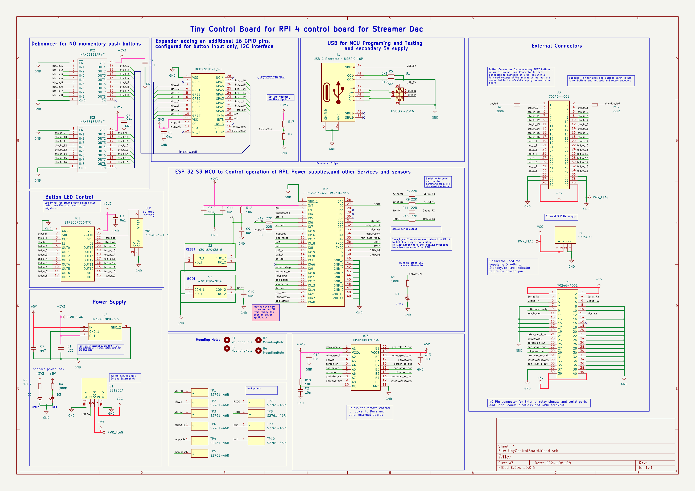

# TinyControlBoard (River Bank Systems v1.0)

## 1. Overview

TinyControlBoard is a compact ESP32-S3 based controller. It scans a 16-button front panel, drives 16 constant-current LEDs, switches/level-shifts control lines to external equipment (DAC, screen, mains/relay controls) and talks to a Raspberry Pi over a 40-pin header. It is powered from 5 V (USB-C, screw terminal or the 40-pin headers) and runs the logic at 3.3 V.

| Item | Value |
|---|---|
| Board silkscreen | River Bank Systems v1.0 |
| MCU module | ESP32-S3-WROOM-1U-N16 (16 MB flash, external antenna connector) |
| Supply | 5 V in, 3.3 V on-board LDO |
| Programming / debug | USB-C (native USB D+/D-), Reset and Boot buttons, UART0 (TXDO/RXDO) |
| Source | KiCad project `tinyControlBoard` (schematic print, BOM, 3D render) |

## Schematic

Vector versions exported from `tinyControlBoard.kicad_sch`: [PDF](schematic/tinyControlBoard.pdf), [SVG](schematic/tinyControlBoard.svg).

## 2. Functional blocks

| Block | Parts | Description |
|---|---|---|
| Power | J1, J8, S1, IC4, D3, D2 | 5 V from USB-C (`USB_5V`), screw terminal J8 or headers, selected by slide switch S1 (USB / Board). IC4 LM3940-3.3 converts 5 V to 3.3 V. D3 = 5 V LED, D2 = 3.3 V LED. |
| USB | J1, U1, R5, R10 | USB-C receptacle with USBLC6-2SC6 ESD protection; 5.1 k CC pull-downs (R5, R10); D+/D- to ESP32-S3 IO20/IO19. |
| MCU | IC6, S2, S3, R3/R8/R9/R11/R16/R19 | ESP32-S3-WROOM-1U-N16. S2 = Reset (EN), S3 = Boot (IO0). 22 R series resistors on signal lines. |
| LED driver | IC1 (STP16CPC26), VR1, R7/R17 | 16-channel constant-current driver, SPI-like (SDI/CLK/LE) with PWM/OE. Output current set via R-EXT; the "Led Current Adj" trimmer VR1 (10 k) adjusts it. |
| Button inputs | IC2, IC3 (MAX6818), IC5 (MCP23018) | Two MAX6818 8-channel switch debouncers/ESD-protected inputs feed a MCP23018 16-bit I2C GPIO expander, which reports to the ESP32 via IntA/IntB. |
| Level shifter | IC7 (TXS0108E) | 3.3 V -> 5 V translation of the control outputs (relay/DAC/screen/mains), output on J6. |
| Status LEDs | D1, R1 | `on_led` indicator LED. |
| Test points | TP1-TP10 | Harwin S2761-46R test pads. |
| Mounting | H1-H4 | 2.5 mm holes. |

## 3. Connectors

### J1 - USB-C
USB 2.0 receptacle (GCT USB4105). VBUS = `USB_5V`, D+/D- to ESP32-S3 native USB, CC1/CC2 5.1 k to GND.

### J8 - Power terminal (4-way screw)
| Pin | Net |
|---|---|
| 1, 2 | VCC (5 V) |
| 3, 4 | GND |

### J3 - 2x20 header (front panel: buttons + LEDs)
Molex 70246-4001. Odd pins on one row, even on the other.

| Pins | Signals |
|---|---|
| 1, 2 | Not assigned (isolated pads) |
| 3-18 | Button inputs `btn_in_9`/`btn_in_1`, `btn_in_10`/`btn_in_2` ... `btn_in_16`/`btn_in_8` (odd pins = 9-16, even pins = 1-8) |
| 19-34 | LED outputs `led_o_1`/`led_o_9`, `led_o_2`/`led_o_10` ... (pin 19 = led_o_1, 20 = led_o_9, 21 = led_o_2, 22 = led_o_10, 23 = led_o_3, 24 = led_o_11, 25 = led_o_4, 26 = led_o_12, 27 = led_o_5, 28 = led_o_13, 29 = led_o_6, 30 = led_o_14, 31 = led_o_7, 32 = led_o_16, 33 = led_o_8, 34 = led_o_15) |
| 35-38 | GND |
| 39, 40 | +5 V |

### J6 - 2x20 header (Raspberry Pi / equipment interface)
| Pin | Net | Pin | Net |
|---|---|---|---|
| 1, 2 | +5 V | 21 | `gen_relay_4_out` |
| 3 | Serial Tx | 23 | `dac_on_out` |
| 4 | Serial Rx | 25 | `screen_on_out` |
| 5 | Debug TX | 27 | `switch_dac_out` |
| 6 | Debug RX | 29 | `mains_power_out` |
| 9 | `rpi4_data_ready` | 31 | `gen_relay_2_out` |
| 11 | `esp_ir_sent` | 33 | `gen_relay_3_out` |
| 12 | `rpi_state` | 35 | `gen_relay_1_out` |
| 39, 40 | +5 V | 7, 8, 10, 13-15, 17-20, 22, 24, 26, 28, 30, 32, 34, 36-38 | GND |

Pin 16 is not connected. Outputs 21-35 (odd) are the 5 V level-shifted control lines.

## 4. ESP32-S3 (IC6) pin assignment

| Module pin | GPIO | Net | Function |
|---|---|---|---|
| 3 | EN | EN | Reset button |
| 4 | IO4 | `standby_led` | Standby LED |
| 5 | IO5 | `stp_le` | STP16 latch |
| 6 | IO6 | (R-network) | STP16 clock (`stp_clk`) via series resistor |
| 7 | IO7 | `stp_sdi` | STP16 data in |
| 8 | IO15 | (R-network) | MCP23018 clock (`mcp_clk`) via series resistor |
| 9 | IO16 | `mcp_sda` | I2C SDA |
| 10 | IO17 | `mcp_reset` | MCP23018 reset |
| 11 | IO18 | `IntA` | MCP23018 interrupt A |
| 12 | IO8 | `Intb` | MCP23018 interrupt B |
| 13 | IO19 | `USB_N` | USB D- |
| 14 | IO20 | `USB_P` | USB D+ |
| 15 | IO3 | `on_led` | On LED |
| 17 | IO9 | `gen_relay_3` | Output (via IC7) |
| 18 | IO10 | `gen_relay_2` | Output (via IC7) |
| 19 | IO11 | `mains_power` | Output (via IC7) |
| 20 | IO12 | `switch_dac` | Output (via IC7) |
| 21 | IO13 | `screen_on` | Output (via IC7) |
| 22 | IO14 | `dac_on` | Output (via IC7) |
| 23 | IO21 | `stp_pwm` | STP16 output-enable / PWM (LED brightness) |
| 24 | IO47 | `gen_relay_4` | Output (via IC7) |
| 25 | IO48 | `app_active` | Application-active signal |
| 27 | IO0 | `BOOT` | Boot button |
| 31 | IO38 | `stp_sdo` | STP16 serial out |
| 32 | IO39 | `GPIO_39` | Spare / IC7 input (`gen_relay_1`) |
| 33 | IO40 | `rpi_state` | State from Raspberry Pi (J6-12) |
| 34 | IO41 | `esp_ir_sent` | IR-sent signal (J6-11) |
| 35 | IO42 | `rpi4_data_ready` | Data ready from Pi (J6-9) |
| 36 | RXD0 | `RXDO` | UART0 RX |
| 37 | TXD0 | `TXDO` | UART0 TX |
| 38 | IO2 | `GPIO_02` | Spare |
| 39 | IO1 | `GPIO_01` | Spare |
| 16, 26, 28-30 | IO46, IO45, IO35-37 | - | Not connected |

> Pin-to-GPIO mapping follows the ESP32-S3-WROOM-1 datasheet. Items marked "via series resistor" go through a 22 R resistor in the schematic; verify the exact net names (`stp_clk`, `mcp_clk`) in the KiCad project before relying on them.

## 5. Peripheral details

### STP16CPC26 LED driver (IC1)
SDI = `stp_sdi`, CLK = `stp_clk`, LE = `stp_le`, OE/PWM = `stp_pwm`, SDO = `stp_sdo`; outputs OUT0-15 = `led_o_1`..`led_o_16` to J3. Powered from 3.3 V. R-EXT is set by R7/R17 and trimmer VR1.

### MCP23018 I/O expander (IC5)
I2C (SDA `mcp_sda`, SCL `mcp_clk`), reset `mcp_reset`, address select `addr_exp`, interrupts `IntA` / `Intb`. Port pins GPA/GPB map to `btn_l_1`..`btn_l_16`, which are the debounced outputs of IC2 and IC3.

### MAX6818 debouncers (IC2, IC3)
IC2 handles `btn_in_1`..`8` -> `btn_l_1`..`8`; IC3 handles `btn_in_9`..`16` -> `btn_l_9`..`16`. 3.3 V supply, CH (pin 11) not connected.

### TXS0108E level shifter (IC7)
VCCA = 3.3 V, VCCB = 5 V. A-side (ESP32): `gen_relay_2/3/4`, `dac_on`, `screen_on`, `switch_dac`, `mains_power`, `GPIO_39`; B-side outputs: `*_out` nets to J6. OE (pin 10) is tied via a net (`Net-(IC7-OE)`).

### Power
- IC4 LM3940IMPX-3.3: 5 V -> 3.3 V LDO with C7 (0.47 uF) and C1 (0.33 uF).
- 10 uF bulk capacitors C2, C8; 100 nF decoupling C3-C6, C9-C13.

## 6. Bill of materials

| Ref | Qty | Value / Part | Footprint | Mouser PN |
|---|---|---|---|---|
| C1 | 1 | 0.33 uF, 0603YC334JAT2A | 0603 | 581-0603YC334JAT2A |
| C2, C8 | 2 | 10 uF, 0603YD106MAT2A | 0603 | 581-0603YD106MAT2A |
| C3-C6, C9-C13 | 9 | 100 nF, C0603C104K4RAC3190 | 0603 | - |
| C7 | 1 | 0.47 uF, GCM188R71C474KA55J | 0603 | 81-GCM188R71C474KA5J |
| D1, D2 | 2 | LED LG R971-KN-1 | 0805 | 720-LGR971-KN-1 |
| D3 | 1 | LED LS R976 | 0805 | 720-LSR976D5178 |
| H1-H4 | 4 | Mounting hole 2.5 mm | - | - |
| IC1 | 1 | STP16CPC26MTR | SOIC-24 | 511-STP16CPC26MTR |
| IC2, IC3 | 2 | MAX6818EAP+T | SSOP-20 | 700-MAX6818EAPT |
| IC4 | 1 | LM3940IMPX-3.3 | SOT-223 | 926-LM3940IMPX-33 |
| IC5 | 1 | MCP23018-E/SO | SOIC-28 | 579-MCP23018-E/SO |
| IC6 | 1 | ESP32-S3-WROOM-1U-N16 | module | 356-ESP32S3WROM1UN16 |
| IC7 | 1 | TXS0108EPWRG4 | TSSOP-20 | 595-TXS0108EPWRG4 |
| J1 | 1 | USB-C receptacle USB4105-GF-A-120 | GCT USB4105 | 640-USB4105-GF-A-120 |
| J3, J6 | 2 | Molex 70246-4001 (2x20 header) | THT | 538-70246-4001 |
| J8 | 1 | 1725672 (4-way screw terminal) | THT | 651-1725672 |
| R1, R2 | 2 | 100 R (ERJ-H3EF1200V) | 0805 | 667-ERJ-H3EF1200V |
| R3, R8, R9, R11, R16, R19 | 6 | 22 R (ERJ-P03F22R0V) | 0603 | 667-ERJ-P03F22R0V |
| R4, R6, R13 | 3 | 300 R (ERJ-H3ED3000V) | 0805 | 667-ERJ-H3ED3000V |
| R5, R10 | 2 | 5.1 k (ESR03EZPJ512) | 0603 | 755-ESR03EZPJ512 |
| R7 | 1 | 1 k (MCT0603PD1001DP500) | 0603 | 594-MCT0603PD1001DP5 |
| R12, R14 | 2 | 10 k (CRCW060310K0FKEI) | 0603 | 71-CRCW060310K0FKEI |
| R17 | 1 | 15 k (TNPW060315K0BEEA) | 0603 | 71-TNPW060315K0BEEA |
| S1 | 1 | EG1206A slide switch | THT | 612-EG1206A |
| S2, S3 | 2 | 430182043816 tact switch (Reset / Boot) | SMD | 710-430182043816 |
| TP1-TP10 | 10 | Harwin S2761-46R test point | SMD | 855-S2761-46R |
| U1 | 1 | USBLC6-2SC6 | SOT-23-6 | 511-USBLC6-2SC6 |
| VR1 | 1 | 3214G-1-103E (10 k trimmer) | SMD | 652-3214G-1-103E |

## 7. Notes

- Board outline is roughly a square card with four M2.5 mounting holes; J3 runs along the right edge and J6 along the bottom edge (pin 1 / 40 / 39 labelled on silkscreen).
- Source files: `tinyControlBoard.kicad_sch`, `.kicad_pcb`, `Bom.csv`, `schematic drawing.prn` in the KiCad project folder.
- The 3.3 V LED (D2) and 5 V LED (D3) designators on the silkscreen sit next to R2/R4 respectively.

## 8. Review for next version

Issues identified from the current design documentation and files:

1. **LDO output capacitance.** IC4 (LM3940-3.3) uses C7 = 0.47 µF and C1 = 0.33 µF, with only 10 µF bulk capacitors elsewhere. The LM3940 datasheet requires a larger output capacitor (about 33 µF) for stability, and the ESP32-S3 has high peak current demand. Verify and increase the output capacitance; also consider a regulator with more headroom.
2. **Power-source selection and protection.** S1 selects between `USB_5V` and the board rail with no diode OR-ing, fuse or reverse-polarity protection on J8; the 5 V on J3/J6 and USB could back-feed one another.
3. **Level shifter suitability.** The TXS0108E is intended for open-drain/low-drive signals and is a poor fit for driving relay or mains-control lines. Its OE net (`Net-(IC7-OE)`) and unused channel inputs should be defined. Consider buffers (for example 74AHCT) and/or transistor drivers.
4. **Mains control lines have no isolation.** `mains_power_out` and `dac_on_out` are logic-level 5 V signals on the same header as power; add isolation or a dedicated driver stage.
5. **BOM discrepancies.** R1/R2 are described as 100 Ω but the Panasonic part number `ERJ-H3EF1200V` is a 120 Ω part; confirm the intended value. D1/D2 use a different LED type from D3, and the silkscreen position of D2/D3 next to R2/R4 is confusing.
6. **Strapping pins and spare GPIOs.** `on_led` is on IO3 (a strapping pin). GPIO_01, GPIO_02 and GPIO_39 are not broken out; `GPIO_39` is labelled both "spare" and `gen_relay_1` input, which should be resolved. Naming typos include `TXDO`/`RXDO` and the inconsistent `Intb`.
7. **LED header mapping.** J3 LED outputs are out of sequence at the end (pin 32 = `led_o_16`, pin 34 = `led_o_15`), which is error-prone; the button and LED rows are interleaved.
8. **Identical J3/J6 connectors.** Both are Molex 70246-4001 2x20 headers, so a front-panel or Pi/equipment ribbon cable can be plugged into the wrong one. Use different connector types or keying.
9. **Debug access.** Programming is via USB-C or UART0 only; add a dedicated tag-connect/JTAG header, and expose spare GPIOs on test points.
10. **Documentation gaps.** The `stp_clk`/`mcp_clk` net names need verifying, the LED current range set by R7/R17/VR1 is not documented, and the MAX6818 CH pin is left unconnected without explanation.
