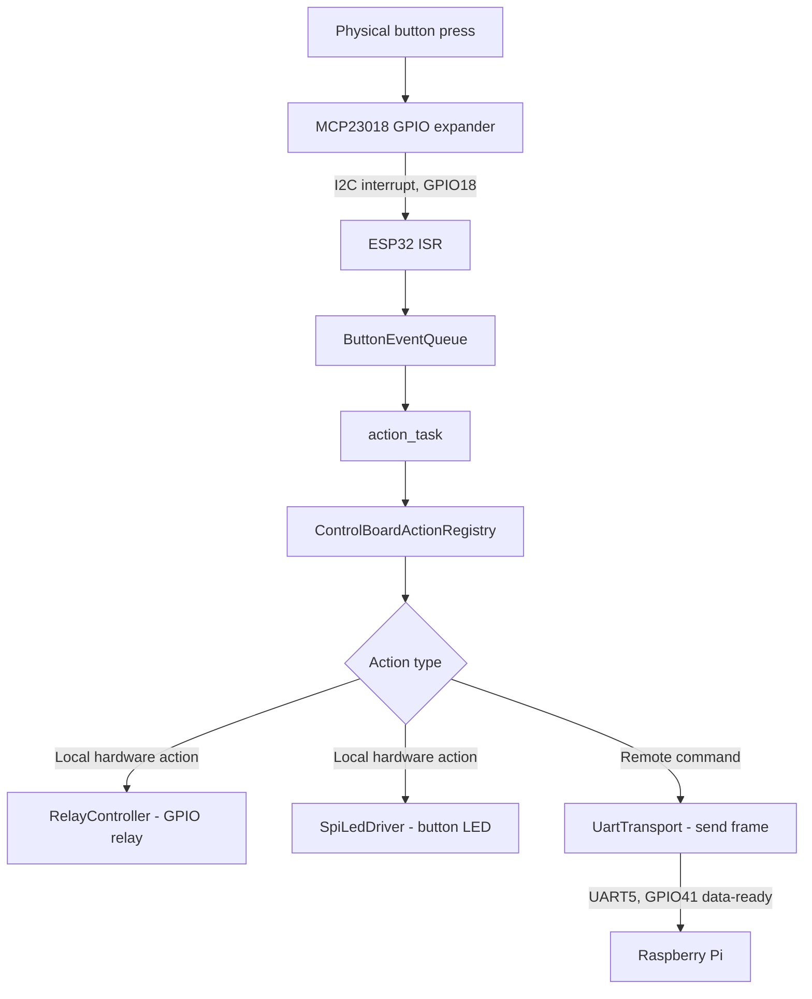
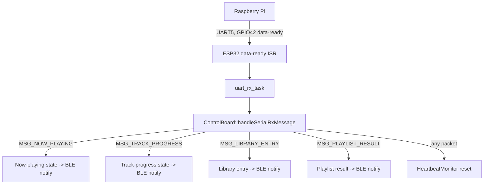

# 06 — Hardware Interface Reference

Document version 1.0 — 2026-09-18 — describes commit `402f526` on branch `feature/library-improvements`.

1. Scope

This document is the single reference for every GPIO, bus, and physical connector the
ESP32-S3 firmware touches. See [03-esp32-developer-guide.md](03-esp32-developer-guide.md)
§10 for the same table framed from the firmware-module perspective; this document is
organized by physical function instead.

## 2. Timing Constants

| Constant                       | Value | Purpose                                                  |
| ------------------------------ | ----: | -------------------------------------------------------- |
| `k_heartbeatTimeoutMs`       | 30000 | Max silence from the Pi before forced SLEEP              |
| `k_initDelayMs`              |  5000 | Startup power-stabilization delay                        |
| `k_powerSettleDelayMs`       |  1500 | Delay after enabling DAC / output-stage relays on power-on |
| `k_vcc3v3OnDelayMs`          |  1000 | Settle time after the 3.3V rail relay turns on           |
| `k_rpiOnDelayMs`             |  1000 | Settle time after the Pi power relay turns on            |
| `k_rpiBootTimeoutMs`         | 60000 | Max wait for first Pi heartbeat during power-on          |
| `k_rpiShutdownTimeoutMs`     | 60000 | Max wait for Pi shutdown to complete                     |
| `k_rpiShutdownSettleDelayMs` |  5500 | Settle time after cutting Pi power during shutdown       |
| `k_vcc3v3PowerOffDelayMs`    |  5000 | Defined for 3.3V rail power-off; currently unused         |

## 3. UART / Handshake

| Function                |            Pin | Notes                                           |
| ----------------------- | -------------: | ----------------------------------------------- |
| UART peripheral         | `UART_NUM_2` |                                                 |
| Baud rate               |         921600 |                                                 |
| TX                      |      `GPIO2` | ESP32 → Pi                                     |
| RX                      |      `GPIO1` | Pi → ESP32                                     |
| RX buffer size          |     1024 bytes |                                                 |
| ESP32 data-ready output |     `GPIO41` | Pulsed high ~10ms when a frame is ready to send |
| Pi data-ready input     |     `GPIO42` | ESP32 reads this to know the Pi has data ready  |

## 4. I2C Bus

| Function           | Pin / Value |
| ------------------ | ----------: |
| SCL                |  `GPIO15` |
| SDA                |  `GPIO16` |
| MCP23018 interrupt |  `GPIO18` |
| MCP23018 enable    |  `GPIO17` |
| MCP23018 address   |    `0x20` |
| MCP timeout        |       10 ms |
| Clock speed        |      50 kHz |

## 5. SPI Bus (Front-Panel LED Shift Register)

| Function    |       Pin |
| ----------- | --------: |
| Data (MOSI) | `GPIO7` |
| Clock       | `GPIO6` |
| Latch       | `GPIO5` |

16-bit register, shifted low-byte-first then high-byte-first; one bit per front-panel push
button (bit 0 unused — the power button has no LED).

## 6. Relay Outputs

| Relay                                   |        Pin | Active state | Sequenced by power state machine                                                                              |
| --------------------------------------- | ---------: | ------------ | ------------------------------------------------------------------------------------------------------------- |
| 3.3V rail power                         | `GPIO13` | High = ON    | Yes (power-on stage 1)                                                                                        |
| DAC power                               | `GPIO12` | High = ON    | Yes (stage 2); OFF only on Deep Sleep                                                                         |
| Output-stage power                      |  `GPIO9` | High = ON    | Yes (stage 3); OFF on Sleep and Deep Sleep                                                                    |
| Raspberry Pi power                      | `GPIO11` | High = ON    | Yes (stage 4)                                                                                                 |
| DAC signal-select (`ESS_DAC_ENABLED`) | `GPIO10` | High = ON    | No — user toggle; forced OFF on Sleep/Deep Sleep and restored from NVS (`dac_en`) when power returns to ON |
| General relay 1                         | `GPIO47` | High = ON    | No — unused by any action in inspected source                                                                |
| General relay 2                         | `GPIO39` | High = ON    | No — dead output, never referenced                                                                           |

The table's `High = ON` describes the firmware convention in
`StandardRelay::setRelayState()` (`true` writes the GPIO high); it does not
confirm the electrical polarity or contact behavior of the physical relay
assembly. During startup, `setupRelays()` calls `StandardRelay::init(pin,
false)` for each relay-control GPIO. If GPIO configuration succeeds, `init()`
configures the pin as an output with a pull-down and drives it low. If
configuration fails, `init()` logs the error and returns, but `setupRelays()`
does not check for that failure and still reports success. Therefore firmware
alone does not guarantee that every relay control reached its intended startup
state.

## 7. Indicator Outputs

| Function           |        Pin | Notes                                                                       |
| ------------------ | ---------: | --------------------------------------------------------------------------- |
| App active LED     |  `GPIO3` | Power-state LED, "on" color                                                 |
| App standby LED    |  `GPIO4` | Power-state LED, "sleep" color                                              |
| Working-status LED | `GPIO48` | Board activity indicator                                                    |
| Button LED PWM     | `GPIO21` | Overall brightness for all 16 SPI button LEDs; default duty `(8191*8)/10` |
| Monitor brightness | `GPIO43` | Drives display/monitor brightness control                                   |

## 8. BLE

| Property        | Value                                                                                                                                                                     |
| --------------- | ------------------------------------------------------------------------------------------------------------------------------------------------------------------------- |
| Device name     | `TinyControlBoard`                                                                                                                                                      |
| Max connections | 1                                                                                                                                                                         |
| Service UUID    | `4a5c6e7d-8f9a-4b2c-1d3e-5f6a7b8c9d0e`                                                                                                                                  |
| Characteristics | 8, UUIDs `...9d01`–`...9d08` (see [05-communication-protocol.md](05-communication-protocol.md) and [02-android-developer-guide.md](02-android-developer-guide.md) §9) |
| ATT MTU         | `CONFIG_BT_NIMBLE_ATT_PREFERRED_MTU = 256` (usable payload ≤253 bytes after ATT overhead)                                                                              |

## 9. Full GPIO Table

| GPIO | Function                 | Direction |
| ---: | ------------------------ | --------- |
|    1 | UART2 RX                 | in        |
|    2 | UART2 TX                 | out       |
|    3 | App active LED           | out       |
|    4 | App standby LED          | out       |
|    5 | SPI LED latch            | out       |
|    6 | SPI LED clock            | out       |
|    7 | SPI LED data             | out       |
|    9 | Output-stage power relay | out       |
|   10 | DAC signal-select relay  | out       |
|   11 | Raspberry Pi power relay | out       |
|   12 | DAC power relay          | out       |
|   13 | 3.3V rail power relay    | out       |
|   15 | I2C SCL                  | out       |
|   16 | I2C SDA                  | in/out    |
|   17 | MCP23018 enable          | out       |
|   18 | MCP23018 interrupt       | in        |
|   21 | Button LED PWM           | out       |
|   39 | General relay 2 (unused) | out       |
|   41 | ESP32→Pi data-ready     | out       |
|   42 | Pi→ESP32 data-ready     | in        |
|   43 | Monitor brightness PWM   | out       |
|   47 | General relay 1          | out       |
|   48 | Working-status LED       | out       |

## 10. Signal Path — Button Press to Hardware Action

## 11. Signal Path — UART Command In (from Pi)

## 12. Physical Interfaces Table

| Interface                             | Type                                                            | Connector/Location                                                      |
| ------------------------------------- | --------------------------------------------------------------- | ----------------------------------------------------------------------- |
| Front-panel button/rotary/LED harness | 40-pin Molex                                                    | See [03-esp32-developer-guide.md](03-esp32-developer-guide.md) §10      |
| Raspberry Pi UART link                | Wired point-to-point, ESP32 GPIO1/2/41/42 ↔ Pi GPIO12/13/23/24 | Per [01-Rpi4_SETUP.md](01-Rpi4_SETUP.md)                                 |
| Power and signal relay controls       | Seven firmware GPIO control signals                            | Four used in the power sequence; three auxiliary controls               |
| USB (firmware flashing)               | ESP32-S3 native USB / UART bootloader                           | Development only                                                        |

## 13. Bill of Materials (as inferred from source)

| Part                                      | Role                                             | Source of inference                                                        |
| ----------------------------------------- | ------------------------------------------------ | -------------------------------------------------------------------------- |
| ESP32-S3 (16MB flash variant)             | Main controller                                  | `boards/esp32-s3-devkitc-1-16mb.json`, `platformio.ini`                |
| MCP23018                                  | 16-bit I2C GPIO expander for button/rotary input | `board::i2c::mcpAddress = 0x20`, `lib/hal/buttons/mcpInputHandler.cpp` |
| 16-bit SPI shift register (STP16CPC26MTR) | Front-panel button LED driver                    | [TinyControlBoard BOM](../Custom%20boards/tinyControlBoard/TinyControlboard.md#6-bill-of-materials) |
| Raspberry Pi 4                            | Audio playback host (moOde Audio)                | [01-Rpi4_SETUP.md](01-Rpi4_SETUP.md) and repo-wide references             |
| Relay control outputs ×7                  | Power-rail and signal control                    | `lib/board/boardConfig.hpp::relays`; physical relay count and ratings are not established by these GPIO definitions |

## 14. Safety Notes

- **Startup state is not guaranteed by firmware alone.** The firmware attempts
  to configure all seven relay-control GPIOs as outputs and drive them low, but
  a GPIO configuration error is logged and not propagated by `setupRelays()`.
  The hardware's behavior before firmware configures the pins, during reset, or
  after a configuration failure must be verified on the actual board.
- **Shutdown order:** both Sleep and Deep Sleep request Raspberry Pi shutdown,
  switch off the Pi power relay, and wait 5.5 seconds before suspending the DAC
  signal-select relay and switching off the output-stage relay. Deep Sleep also
  switches off the DAC power relay; Sleep leaves that relay on. Verify that
  this sequence is appropriate for the connected hardware.
- **Still requires hardware verification:** physical relay count and part
  numbers, coil voltage/current, relay-driver circuitry and polarity, PSU rail
  voltage/current ratings, protective-earth and signal-ground arrangement, and
  fuse/overcurrent protection. Firmware GPIO definitions describe logic
  signals; they do not establish these electrical ratings or protections.
