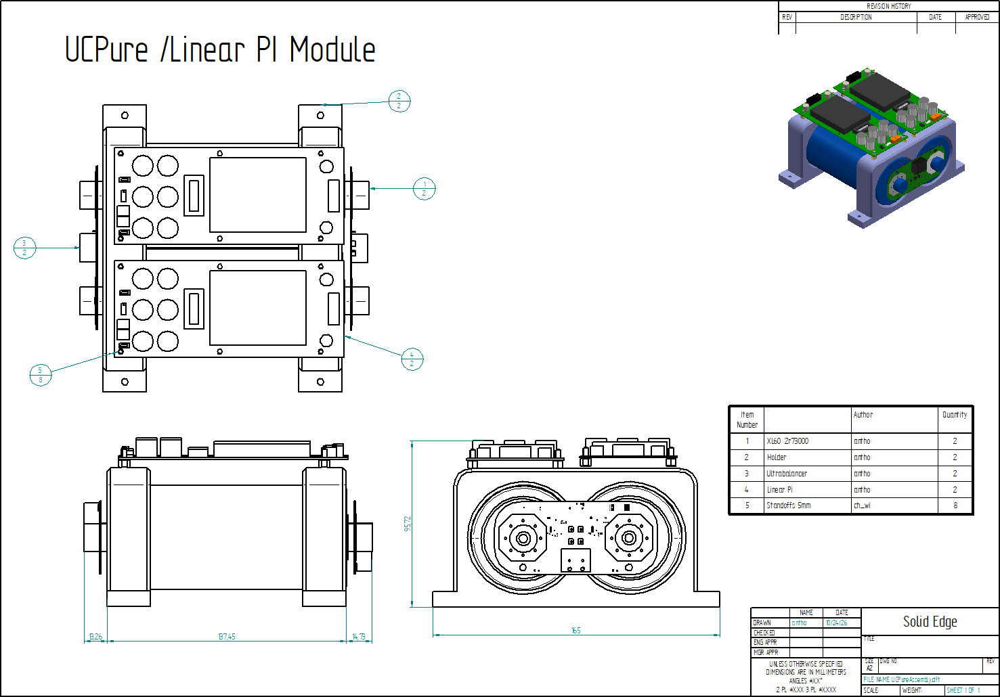

# Internal Components and Panel Assemblies

This document shows how the internal components are fitted to the panels and cases of the Streamer DAC and its power supply. Panel dimensions and drawings are in [Dac-Case.md](Dac-Case.md). Parts lists for each assembly are still to be added.

## Streamer DAC

The assemblies below are shown in the order they are built: front panel, rear panel, then the inner case that is fitted into the enclosure.

### Front Panel Assembly

Exploded view of the components fitted to the front panel.

### Front Panel Assembly with Copper Shield

Rear view of the front panel showing the copper shield.

### Rear Panel Assembly

### Inserting the Inner Case into the DAC Enclosure

### Inner Case Component Assembly

### Station Pi Pro Assembly

## Power Supply Components

### Rear Panel Assembly

### Front Panel Assembly

### Transformer and Stand Assembly

### UCPure / Linear Pi Module

Two UCPure modules and two Linear Pi boards mounted on holders with 5 mm standoffs.

### Internal Power Supply Full Assembly on Base

