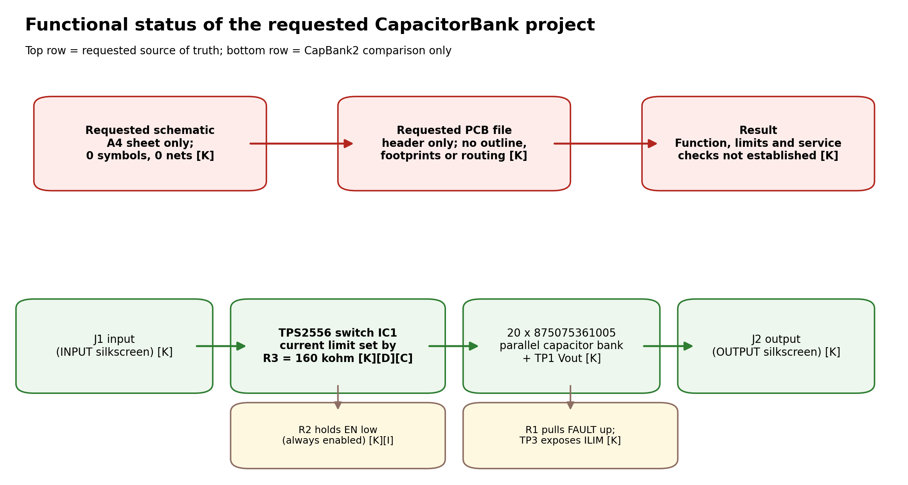
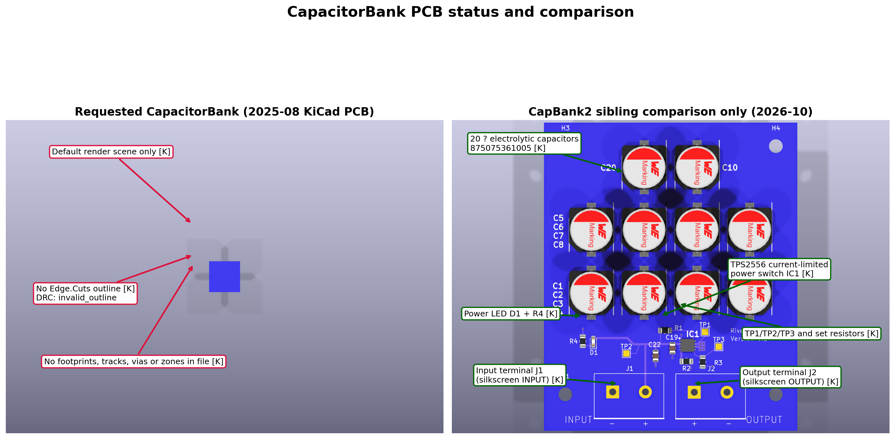
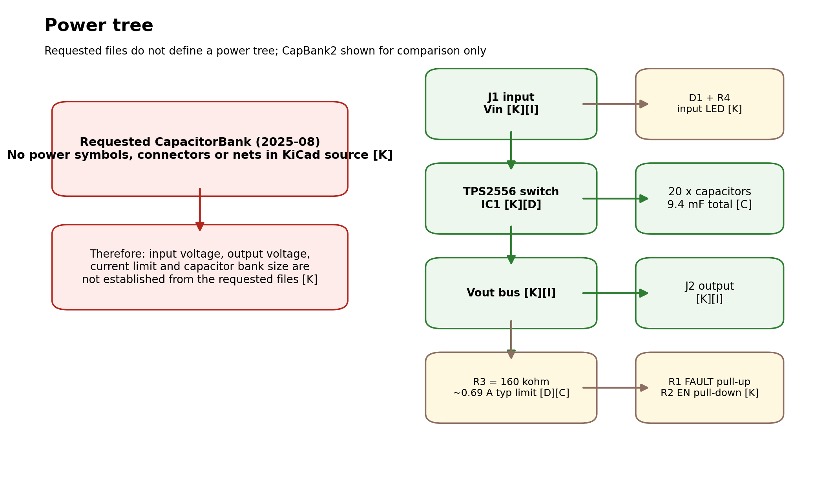

# 1. Document information

| Item | Value | Evidence |
|---|---|---|
| Board / document scope | `CapacitorBank` in `...\tinyControlBoard\CapacitorBank` | [K] |
| Requested source files used | `CapacitorBank.kicad_sch` and `CapacitorBank.kicad_pcb`, both dated 2025-08-11; `CapacitorBank.kicad_pro` dated 2026-09-28 | [K] |
| Comparison-only source | `...\tinyControlBoard\CapBank2\CapacitorBank`, schematic dated 2026-10-03 and PCB dated 2026-10-04 | [K] |
| Analysis tools | KiCad CLI 10.0.6, Python, pandoc, Edge headless PDF print | [K] |
| Existing older summary checked | [`..\..\PowerSupplySubsystem.md`](../../PowerSupplySubsystem.md) | [K] |
| Intended readers | Engineers, assemblers and service technicians | [I] |

**Evidence labels used throughout**

| Label | Meaning |
|---|---|
| **[K]** | Established from the KiCad schematic, PCB, BOM export or file metadata |
| **[D]** | Verified from a manufacturer datasheet downloaded for this work |
| **[C]** | Calculated from [K] and/or [D] data |
| **[I]** | Inferred from context; plausible but not proven |
| **[M]** | Needs measurement or confirmation on physical hardware |

> **Scope and limits.** No hardware was inspected or measured. Nothing in this document is a test result. The requested KiCad source files are effectively empty; where the design cannot be established from those files, this document says so explicitly. Comparison with the newer sibling project is included because the older service-guide summary appears to describe that newer design rather than the requested one.

# 2. Overview

The requested `CapacitorBank` KiCad project is **not a complete board definition**. The schematic file contains only the KiCad sheet boilerplate and no symbols or nets [K]. The PCB file contains only the KiCad file header, with no board outline, footprints, tracks, vias or zones [K]. KiCad CLI therefore exports an empty netlist and an empty BOM header, and DRC reports a malformed outline because no `Edge.Cuts` geometry exists [K].

Accordingly, the requested project does **not** establish:

- the intended circuit topology [K];
- any input/output connector details [K];
- component values, ratings or part numbers [K];
- test points, indicators or service checks [K].

The only technically useful context outside the empty requested files is:

1. the older service-guide section in [`PowerSupplySubsystem.md`](../../PowerSupplySubsystem.md), which describes a **TPS2556 current-limited switch feeding a capacitor bank** [K]; and
2. the newer sibling project `CapBank2\CapacitorBank`, which actually contains that topology, with 37 components, 7 nets, a populated PCB and October 2026 timestamps [K].

The most likely interpretation is that the requested August 2025 `CapacitorBank` folder is a placeholder or abandoned draft, while `CapBank2\CapacitorBank` is the current working revision [I].

# 3. Specifications

## 3.1 Requested `CapacitorBank` source (authoritative for this document)

| Parameter | Value | Evidence |
|---|---|---|
| Schematic sheet size | A4 | [K] |
| Schematic symbols | 0 | [K] |
| Netlist components | 0 | [K] |
| Netlist nets | 0 | [K] |
| PCB board items | No outline, no footprints, no tracks, no vias, no zones | [K] |
| ERC result | 0 errors, 0 warnings | [K] |
| DRC result | 1 violation: `invalid_outline` because no `Edge.Cuts` outline exists | [K] |
| BOM export | Header row only; no populated items | [K] |
| Input voltage | Not established from these files | [K] |
| Output voltage | Not established from these files | [K] |
| Current limit / inrush control | Not established from these files | [K] |
| Total capacitance | Not established from these files | [K] |
| Temperature, ripple, ESR, bleed time | Not established from these files | [K] |

## 3.2 Comparison-only figures from `CapBank2\CapacitorBank`

These values are **not** part of the requested source of truth. They are included only because the older summary and the newer sibling project agree with each other.

| Parameter | Value | Evidence |
|---|---|---|
| Component count | 37 references total: 20 capacitor-bank parts, 1 current-limit IC, 2 terminal blocks, 4 resistors, 1 LED, 3 test points, 4 mounting holes, 2 extra capacitors | [K] |
| Main switch IC | TPS2556QDRBTQ1 | [K] |
| Capacitor-bank parts | 20 × `875075361005` | [K] |
| Input decoupling | C19 = `0.1uf`, C22 = `47u` | [K] |
| Set / support parts | R1 = 100 kohm, R2 = 10 kohm, R3 = 160 kohm, R4 = 1 kohm | [K] |
| Declared IC operating range | 2.5 V to 6.5 V | [D] |
| TPS2556 programmable limit range | 500 mA to 5 A typical | [D] |
| Capacitor-bank part data carried in KiCad fields | `PSEF124471M016DVCTFB000`, 16 V DC, ESR 10 mΩ, 5100 mA ripple at 100 kHz, -55 C to +105 C | [K] |

**Important limitation.** The TI TPS2556 datasheet was downloaded and read [D]. Direct download of the Würth capacitor PDF was blocked by the vendor site during this task, so the capacitor ratings above are taken from the KiCad component fields rather than independently re-verified from the original manufacturer PDF [K].

# 4. Connectors, controls, indicators and test points

## 4.1 Requested `CapacitorBank`

No connectors, controls, indicators or test points exist in the requested schematic or PCB files [K]. No servicing pinout can therefore be established from the requested KiCad source [K].

## 4.2 Comparison-only: `CapBank2\CapacitorBank`

The newer sibling project contains the following items, which are useful only as a reference for the apparent later design:

| Ref | Item | Comparison-only function | Evidence |
|---|---|---|---|
| J1 | 2-way screw terminal footprint | Silkscreen `INPUT`; likely Vin and GND | [K][I] |
| J2 | 2-way screw terminal footprint | Silkscreen `OUTPUT`; likely protected Vout and GND | [K][I] |
| D1 + R4 | LED + 1 kohm | Input-power indicator | [K][I] |
| TP1 | Test point | On output bus (`Net-(C1-+)`) | [K] |
| TP2 | Test point | On input bus (`Net-(D1-A)`) | [K] |
| TP3 | Test point | On ILIM node (`Net-(IC1-ILIM)`) | [K] |

The older summary in [`PowerSupplySubsystem.md`](../../PowerSupplySubsystem.md) also describes `J1` as input, `J2` as output, `TP1` as Vout, `TP2` as Vin and `TP3` as ILIM [K]. That older text does **not** match the requested empty August 2025 project.

# 5. Functional description

## 5.1 Requested `CapacitorBank`

No functional description can be derived from the requested KiCad files because:

- the schematic has no symbols, wires or labels [K];
- the netlist contains no components or nets [K];
- the PCB contains no routed design objects [K].

The requested PCB render is only KiCad’s default scene, with no board content [K]. The requested schematic SVG/PDF exports likewise contain only the drawing frame [K].

## 5.2 Comparison-only: apparent later design in `CapBank2`

The newer sibling project, and the older service-guide summary, describe a simple power-conditioning board [K]:

1. J1 brings power in [K][I].
2. IC1 (TPS2556-Q1) provides current-limited high-side switching [K][D].
3. R3 sets the current limit via the ILIM pin [K][D].
4. R2 ties EN low; for the TPS2556 this means the switch is enabled because EN is active-low [K][D].
5. R1 pulls the open-drain `FAULT` node up [K][D].
6. Twenty parallel polarised capacitors sit on the output bus [K].
7. J2 provides the output connection [K][I].

# 6. Assembly and commissioning

## 6.1 Requested `CapacitorBank`

No assembly or commissioning procedure can be defined from the requested source files because there is no actual circuit or PCB content to inspect [K].

Before using this documentation on any physical hardware:

1. identify whether the hardware matches the **empty requested project** or the **populated CapBank2 comparison board** [M];
2. if the hardware has a TPS2556, super-capacitor-style can array, input and output screw terminals, it does **not** match the requested August 2025 KiCad source [K][I];
3. treat the requested project as unsuitable for manufacturing release, spare-parts control or service tracing until the correct source set is confirmed [I].

## 6.2 Comparison-only engineering checks for `CapBank2`

These checks apply only to the newer sibling design.

| Check | Result | Evidence |
|---|---|---|
| Total capacitance | 20 × 470 uF = 9400 uF = 9.4 mF, assuming the KiCad field description is correct | [K][C] |
| Stored energy at 5 V | 0.5 × 9.4 mF × 5^2 = about 0.118 J | [C] |
| Capacitor voltage margin at 5 V | 16 V / 5 V = 3.2:1 rating ratio | [K][C] |
| TPS2556 limit for R3 = 160 kohm | About 0.69 A typical by extrapolating the TI table (24.9 kohm → 4.5 A typ, 61.9 kohm → 1.805 A typ, 100 kohm → 1.11 A typ) | [D][C] |
| Ideal no-load charge time to 5 V at 0.69 A | 9.4 mF × 5 V / 0.69 A = about 68 ms | [C] |
| Capacitor-bank ideal ESR in parallel | 10 mΩ / 20 = about 0.5 mΩ, if the KiCad field value is correct and current shares evenly | [K][C][I] |
| Ideal ripple-current sum | 20 × 5.1 A = 102 A at 100 kHz, again assuming the KiCad field value is correct and current shares evenly | [K][C][I] |
| Bleed / discharge path | No explicit bleed resistor is present; passive discharge time therefore depends on leakage and external load and is not established | [K][I][M] |
| Series balancing | Not applicable; the later design uses a parallel bank, not series capacitors | [K] |
| Reverse-polarity protection | None visible in the later design; wrong input polarity would directly stress the switch IC and capacitors | [K][I] |

Direct capacitor-polarity verification on a populated board still needs visual inspection or continuity checking against the actual manufactured PCB [M].

# 7. Testing and troubleshooting

## 7.1 Requested `CapacitorBank`

| Symptom | Likely cause | Action |
|---|---|---|
| BOM export is empty | The requested schematic contains no components | Use the requested files only as evidence that the project is incomplete [K] |
| PCB render shows no board | The requested PCB file contains no actual PCB objects | Do not use it for manufacture or repair planning [K] |
| DRC reports `invalid_outline` | No `Edge.Cuts` geometry exists in the requested file | Treat as an incomplete PCB source, not a finished board [K] |
| Physical board has connectors, capacitors and ICs | Hardware does not match the requested KiCad source | Compare with `CapBank2\CapacitorBank` and confirm the intended release [K][I] |

## 7.2 Comparison-only checks if the hardware matches `CapBank2`

| Symptom | Likely cause | Check |
|---|---|---|
| No output from J2 | No input at J1, TPS2556 disabled or failed, or output overloaded | Confirm input bus at TP2, output bus at TP1, EN node state and `FAULT` pull-up node [K][D][M] |
| Output rises slowly or cycles | Capacitor bank charging at current limit or thermal cycling | Check TP3 / R3 value and input supply capability [K][D][M] |
| `FAULT` low | Overcurrent, short circuit or thermal shutdown | Remove load, then inspect IC1 and downstream wiring [D][M] |
| Board keeps charge after power-off | No dedicated bleed path in later design | Wait for natural discharge or use an external controlled discharge method [K][I][M] |
| Reverse polarity suspected | No visible reverse-polarity protection in later design | Inspect TPS2556 and capacitor polarity before repowering [K][I][M] |

# 8. Repair and rework

## 8.1 Requested `CapacitorBank`

No repair or rework instruction can be based on the requested KiCad files because the files do not define a serviceable circuit or PCB [K].

The correct first repair action is **document control**:

1. confirm which physical board exists [M];
2. recover the correct released KiCad source set [M];
3. only then issue parts replacement or rework instructions [I].

## 8.2 Comparison-only notes for `CapBank2`

If the real hardware matches the newer sibling design:

- IC1 is a SON package TPS2556QDRBTQ1 current-limit switch [K];
- the capacitor bank uses 20 polarised aluminium-polymer capacitors with the same part number [K];
- no reverse-polarity protection is evident, so polarity must be checked before any bench power is applied [K][I];
- because no deliberate bleed resistor is shown, treat the output as potentially charged after power-off until measured safe [K][I][M].

# 9. BOM reference

## 9.1 Requested `CapacitorBank`

KiCad BOM export from the requested schematic:

| Export result | Evidence |
|---|---|
| Header only: `Refs, Value, Footprint, Qty, DNP` | [K] |
| No populated rows | [K] |

## 9.2 Comparison-only `CapBank2` BOM summary

| Refs | Value | Qty | Evidence |
|---|---|---|---|
| C1-C18, C20, C21 | `875075361005` | 20 | [K] |
| C19 | `0.1uf` | 1 | [K] |
| C22 | `47u` | 1 | [K] |
| IC1 | `TPS2556QDRBTQ1` | 1 | [K] |
| J1, J2 | `Screw_Terminal_01x02` | 2 | [K] |
| R1 | `100k` | 1 | [K] |
| R2 | `10k` | 1 | [K] |
| R3 | `160k` | 1 | [K] |
| R4 | `1k` | 1 | [K] |
| D1 | `LED` | 1 | [K] |
| TP1-TP3 | `TestPoint` | 3 | [K] |
| H1-H4 | `MountingHole` | 4 | [K] |

# 10. Limitations, risks and open points

## 10.1 Findings on the requested source

1. **The requested KiCad project is empty.** It does not define a usable board for manufacture, repair or commissioning [K].
2. **The requested PCB has no outline.** DRC reports `invalid_outline`, so fabrication geometry is missing [K].
3. **No electrical design values can be responsibly claimed for the requested board.** Input voltage, output voltage, current limit, capacitance, ESR, ripple current and discharge time are all unestablished from the requested files [K].
4. **The older service-guide summary does not match the requested source.** It describes a populated current-limited capacitor-bank board that is absent from the requested KiCad files [K].

## 10.2 Short comparison with `CapBank2\CapacitorBank`

| Topic | Requested `CapacitorBank` (Aug 2025) | `CapBank2\CapacitorBank` (Oct 2026) | Evidence |
|---|---|---|---|
| Schematic content | Empty | Populated design with 37 components | [K] |
| BOM export | Empty header only | 37 populated references | [K] |
| Netlist nets | 0 | 7 (`GND`, input bus, output bus, LED cathode, EN, ILIM, `FAULT`) | [K] |
| PCB content | Empty header only | Populated PCB with silkscreen `INPUT`, `OUTPUT`, `RiverBank systems`, `Version 0.1` | [K] |
| ERC | 0 errors, 0 warnings | 24 warnings, all library / footprint-link related | [K] |
| DRC | 1 error (`invalid_outline`) | 9 DRC warnings plus 21 footprint/symbol mismatch warnings, largely library-artefact style items | [K] |
| Functional intent | Not established | Current-limited input to capacitor bank to output | [K][I] |

### Parts, values and nets present only in `CapBank2`

- **Parts / values:** `TPS2556QDRBTQ1`; 20 × `875075361005`; `47u`; `0.1uf`; `100k`; `10k`; `160k`; `1k`; `LED`; `TestPoint`; `Screw_Terminal_01x02` [K].
- **Nets:** `GND`, `Net-(D1-A)` (input bus) [I], `Net-(C1-+)` (output bus) [I], `Net-(D1-K)`, `Net-(IC1-EN)`, `Net-(IC1-ILIM)`, `Net-(IC1-~{FAULT})` [K].

### Recommendation on which project is current

The **newer sibling `CapBank2\CapacitorBank` should be treated as the current design candidate** unless there is explicit project-management evidence to the contrary [I]. Reasons:

- its schematic and PCB were both edited in October 2026, later than the requested August 2025 schematic and PCB [K];
- it contains a complete circuit and populated PCB [K];
- it matches the older narrative already present in the service guide [K].

The requested `CapacitorBank` folder should be treated as an obsolete placeholder, abandoned draft or incomplete migration until proven otherwise [I].

# 11. References and revision history

## 11.1 References

- Requested source: `C:\Users\antho\Documents\StreamerDac Project\Documents\kicad\Streamer schematic\ControlBoardTiny\tinyControlBoard\CapacitorBank`
- Comparison source: `C:\Users\antho\Documents\StreamerDac Project\Documents\kicad\Streamer schematic\ControlBoardTiny\tinyControlBoard\CapBank2\CapacitorBank`
- Older summary: [`..\..\PowerSupplySubsystem.md`](../../PowerSupplySubsystem.md)
- TI datasheet used: `https://www.ti.com/lit/ds/symlink/tps2556-q1.pdf` [D]
- Capacitor manufacturer PDF URL recorded in KiCad fields but direct download was blocked during this task: `https://www.we-online.com/catalog/datasheet/875075361005.pdf` [K]

## 11.2 Revision history

| Revision | Date | Change |
|---|---|---|
| A | 2026-10-11 | Initial engineering and service document for the requested `CapacitorBank` folder, with controlled comparison to `CapBank2` |
