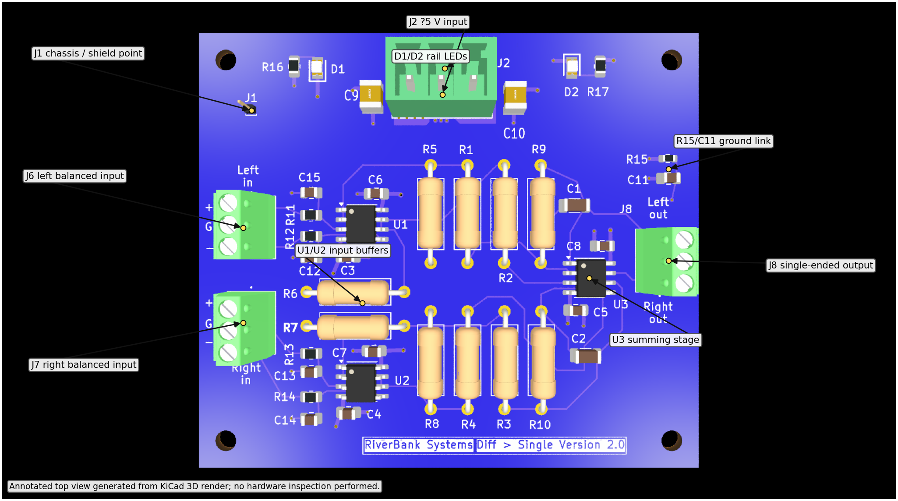
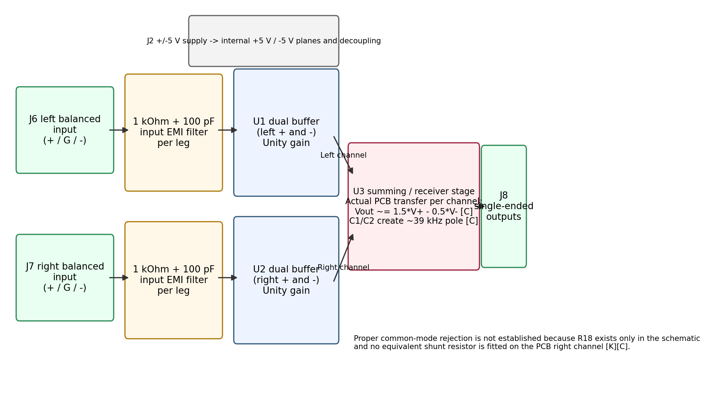
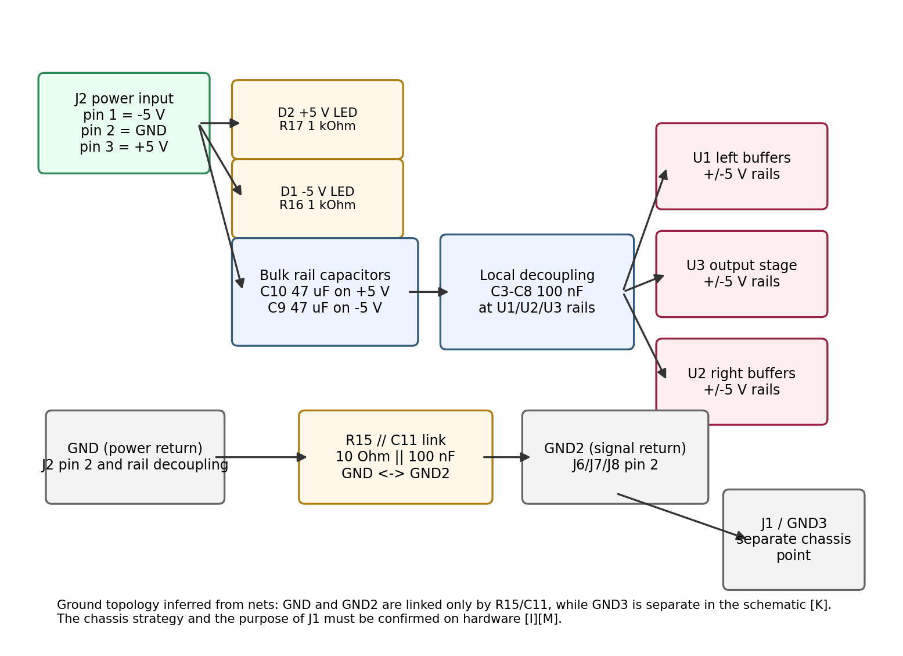

# DiffToSingleEndedBoard - Engineering and Service Document

**Evidence tags:** [K] taken from the KiCad schematic, PCB, BOM or production outputs; [D] verified from a manufacturer datasheet read for this document; [C] calculated from [K]/[D] values; [I] inferred and not fully confirmed; [M] needs measurement on hardware. **Nothing in this document was measured on a physical board.**

## 1. Document information

| Item | Value |
|---|---|
| Board name used here | DiffToSingleEndedBoard [I] |
| Schematic title block | `XLR to single ended`, rev `0.1`, dated `2025-05-31` [K] |
| PCB silkscreen | `RiverBank Systems Diff > Single Version 2.0` [K] |
| Legacy service-guide name | `Differential-to-Single-Ended Output Board` [K] |
| KiCad source | `C:\\Users\\antho\\Documents\\StreamerDac Project\\Documents\\kicad\\Streamer schematic\\ControlBoardTiny\\tinyControlBoard\\Diff_to_singleEnded\\Diff_to_singleEnded.kicad_sch` and `.kicad_pcb` [K] |
| Supporting production files read | `production\\bom.csv`, `production\\positions.csv`, `production\\designators.csv` [K] |
| KiCad file format | KiCad 8.0 schematic and PCB files [K] |
| KiCad CLI used for checks | `kicad-cli 10.0.6` [K] |
| Scope of this document | Engineering description, service guidance, CAD-check findings and unresolved issues from the project files only [K][I] |

**Naming discrepancy.** The legacy document name, the schematic title and the PCB silkscreen do not match exactly [K]. This document uses **DiffToSingleEndedBoard** for the folder and file names requested by the task, while recording the original KiCad names above [I].

## 2. Overview

This board is a two-channel balanced-to-single-ended audio interface built around three **OPA1692** dual audio op-amps (U1-U3) [K][D]. J6 accepts the left balanced input, J7 the right balanced input, and J8 provides the single-ended outputs with a separate signal-return pin [K]. J2 brings in **+5 V, GND and -5 V** rails [K].

Per channel, the first dual op-amp stage buffers the `+` and `-` input legs individually, after a **1 kOhm / 100 pF** input filter on each leg [K][C]. The final op-amp stage then combines the buffered legs and applies an **approximately 39.3 kHz** feedback pole through **5 kOhm** and **810 pF** parts [K][C].

However, the KiCad files do **not** show a clean, symmetrical differential receiver implementation on the assembled PCB [K]. The left-channel schematic includes **R18 = 5 kOhm** to ground at U3A+, but that resistor is absent from the PCB and production outputs [K]. The right channel has no equivalent resistor in the schematic or PCB [K]. As built in the PCB file, both channels therefore implement approximately:

`Vout ~= 1.5 * V(+) - 0.5 * V(-)` [C]

rather than a conventional common-mode-rejecting subtractor [C][I]. This is the most important technical finding from the source files.

## 3. Specifications

| Parameter | Value |
|---|---|
| PCB outline | **65.0 mm x 56.5 mm** from `Edge.Cuts` rectangle `(100,50)` to `(165,106.5)` [K] |
| PCB stack-up | **6 copper layers**, **1.6 mm** overall thickness: F.Cu, In1 signal ground, In2 power ground, In3 +5V, In4 -5V, B.Cu chassis ground [K] |
| Mounting | **4 x M2.5** mounting holes, **2.7 mm** hole size [K] |
| Assembly side | All fitted electrical components are on the top side [K] |
| Active devices | **3 x OPA1692** dual low-power audio op-amp, SOIC-8 [K][D] |
| External supplies | **+5 V, GND, -5 V** on J2 [K] |
| OPA1692 supply range | **+/-1.75 V to +/-18 V** recommended, **40 V** absolute maximum total supply [D] |
| OPA1692 common-mode range | **(V-) + 1.5 V** to **(V+) - 0.5 V** [D] |
| Common-mode range on this board | With **+5 V / -5 V** rails, approximately **-3.5 V to +4.5 V** at each op-amp input [C][D] |
| OPA1692 output drive | Rail-to-rail output to within about **200 mV** of the rails with **2 kOhm** load, typical short-circuit current **+/-50 mA** [D] |
| OPA1692 noise and speed | **4.2 nV/sqrt(Hz)** input noise density at **1 kHz**, **5.1 MHz** GBW, **23 V/us** slew rate [D] |
| Input filter pole | **1 / (2*pi*1 kOhm*100 pF) ~= 1.59 MHz** per leg [C][K] |
| Feedback pole | **1 / (2*pi*5 kOhm*810 pF) ~= 39.3 kHz** per channel [C][K] |
| Buffer-stage input impedance | Approximately **1 MOhm** to signal ground per input leg, set mainly by **R5-R8 = 1 MOhm** [C][K][D] |
| Op-amp quiescent current | Approximately **6 channels x 650 uA = 3.9 mA** total for U1-U3 only [C][D] |
| Op-amp quiescent dissipation | Approximately **10 V x 3.9 mA = 39 mW** for all six amplifiers together, excluding LEDs and any signal load [C][D] |
| Signal transfer intended by left-channel schematic only | `Vout ~= 0.5 * (V+ - V-)` if **R18 = 5 kOhm** were actually fitted [C][K] |
| Signal transfer implemented by the PCB on both channels | `Vout ~= 1.5 * V+ - 0.5 * V-`; common-mode gain becomes approximately **+1** [C][K] |
| LED current, maximum unclipped output on hardware and thermal rise in use | Not established from these files [M] |

## 4. Connectors, controls, indicators and test points

### 4.1 Connectors

| Ref | Function | Pinout / notes |
|---|---|---|
| J2 | Power input | **Pin 1 = -5 V, pin 2 = GND, pin 3 = +5 V** [K]. The PCB silkscreen above J2 also reads `-5v -G- +5V` [K]. |
| J6 | Left balanced input | Top pin physically aligns with `+`, middle with `G`, bottom with `-` on the silkscreen [K]. Net assignment is **pin 3 = `buffer L+`**, **pin 2 = `GND 2`**, **pin 1 = `buffer L- in`** [K]. |
| J7 | Right balanced input | Top pin physically aligns with `+`, middle with `G`, bottom with `-` on the silkscreen [K]. Net assignment is **pin 3 = `buffer R+ in`**, **pin 2 = `GND 2`**, **pin 1 = `buffer R- in`** [K]. |
| J8 | Single-ended output | PCB net assignment is **top pin 1 = `Rout`**, **middle pin 2 = `GND 2`**, **bottom pin 3 = `Lout`** [K]. **Risk:** the silkscreen text places `Left out` above the connector and `Right out` below it, which appears opposite to the net assignment [K][I]. |
| J1 | Single-pin connector on `GND 3` | Only net on J1 is `GND 3` [K]. Likely a chassis or shield bond point [I]. Purpose is not established from the files [I]. |

The Phoenix-type connectors J2 and J6-J8 are **3-way, 3.81 mm pitch vertical terminal-block style footprints** [K]. Their manufacturer ratings were **not established from a readable manufacturer datasheet during this task** because the Phoenix Contact pages referenced in the KiCad files were access-blocked [M].

### 4.2 Controls

There are **no user controls, jumpers or switches** on this board [K].

### 4.3 Indicators

| Ref | Function |
|---|---|
| D2 + R17 | Positive-rail indicator: D2 is returned to GND and fed from **+5 V** through **1 kOhm** [K]. |
| D1 + R16 | Negative-rail indicator: D1 is returned towards GND through **1 kOhm** and tied to **-5 V** on the other side [K]. This is consistent with a negative-rail presence indicator [K][I]. |

LED colours and forward voltages are not established from the KiCad files [M].

### 4.4 Test points

There are **no dedicated labelled test points** in the KiCad project [K]. Service probing would therefore use connector pins, resistor leads and IC pins [I].

## 5. Functional description

### 5.1 Power distribution and grounding

J2 supplies **+5 V, GND and -5 V** [K]. Bulk capacitors **C10 = 47 uF** on the positive rail and **C9 = 47 uF** on the negative rail sit near the input connector [K]. Each op-amp package then has local **100 nF** decoupling on each rail: **C3/C6** for U1, **C4/C7** for U2 and **C5/C8** for U3 [K].

The board uses three ground-related nets [K]:

- **GND**: power-return net for the supply entry, rail decoupling and indicator LEDs [K]
- **GND 2**: signal return used by J6, J7 and J8 [K]
- **GND 3**: separate net taken only to J1 in the schematic [K]

**R15 = 10 Ohm** in parallel with **C11 = 100 nF** links **GND** and **GND 2** [K]. The corner where `|Zc| = 10 Ohm` is approximately **159 kHz** [C]. At DC, the two grounds are separated by **10 Ohm**; at high frequency they are increasingly tied together through **C11** [C][K]. `GND 3` remains separate in the schematic [K].

### 5.2 Input buffering

Each balanced input leg first sees **1 kOhm** series resistance (**R11/R12** left, **R13/R14** right) and a **100 pF** shunt capacitor (**C15/C12** left, **C13/C14** right) to `GND 2` [K]. This creates a first-order RF/EMI filter at approximately **1.59 MHz** [C].

U1 and U2 are wired as unity-gain buffers [K]:

- U1A buffers left `-` [K]
- U1B buffers left `+` [K]
- U2A buffers right `-` [K]
- U2B buffers right `+` [K]

**R5-R8 = 1 MOhm** provide a defined bias path to signal ground on the buffer outputs / following nodes [K].

### 5.3 Output summing stage as drawn in the schematic

The left-channel schematic around U3A contains **R1 = 10 kOhm**, **R9 = 5 kOhm** and **R18 = 5 kOhm** [K]. If that network were physically implemented, U3A would act as a conventional subtractor with gain:

`Vout_left_schematic ~= 0.5 * (Vplus - Vminus)` [C]

with **C1 = 810 pF** across **R9 = 5 kOhm**, giving the **39.3 kHz** pole [C][K].

The right-channel schematic around U3B contains **R3 = 10 kOhm**, **R4 = 10 kOhm**, **R10 = 5 kOhm** and **C2 = 810 pF**, but **no resistor equivalent to R18** from U3B+ to ground [K]. Therefore the right channel schematic already does **not** match the left channel topology [K].

### 5.4 Output summing stage actually implemented by the PCB

Cross-checking the PCB against the schematic shows that **R18 does not exist on the PCB at all** [K]. It is also absent from `bom.csv`, `positions.csv` and `designators.csv` [K]. On the PCB, the U3A+ net contains only **U3 pin 3** and **R2 pin 2** [K], with no fitted shunt resistor. The U3B+ net likewise contains only **U3 pin 5** and **R4 pin 2** [K].

So, for the assembled PCB described by the `.kicad_pcb` file, both output channels are effectively:

`Vout ~= (1 + 5k/10k) * Vplus - (5k/10k) * Vminus` [C]

therefore:

`Vout ~= 1.5 * Vplus - 0.5 * Vminus` [C]

Using `Vplus = Vcm + Vdiff/2` and `Vminus = Vcm - Vdiff/2`, this becomes approximately:

`Vout ~= 1.0 * Vcm + 1.0 * Vdiff` [C]

So the PCB file does **not** establish proper common-mode rejection [C][K]. Any common-mode signal appears at the output with roughly unity gain [C]. For a balanced line receiver this is a serious functional risk.

### 5.5 Outputs and reference ground

J8 provides the two single-ended outputs and one signal-return pin [K]. The intended channel mapping on the connector is unclear because the net assignment (`Rout` at top, `Lout` at bottom) appears opposite to the silkscreen text (`Left out` above, `Right out` below) [K][I]. This must be confirmed before harnessing or documentation release [M].

## 6. Assembly and commissioning

This section gives **recommended checks only**. No assembled board was inspected or powered during this task.

1. **Before population or release, resolve the R18 discrepancy** [K]. The schematic shows **R18 = 5 kOhm**, but the PCB and production files do not provide a footprint for it [K]. Building from the current production outputs will not reproduce the left-channel schematic [K].
2. Verify the intended connector mapping, especially **J8 left/right labelling** and the purpose of **J1 / GND3** [K][I].
3. Inspect polarity-sensitive parts: **C9, C10** footprints if polarised parts are intended [K][M], and LEDs **D1/D2** [K].
4. Check continuity between the three J2 power pins and the expected rails before applying power [M].
5. Power the board first from a current-limited split supply set to **+5 V / -5 V** [K][M]. The op-amp quiescent current alone should be around **3.9 mA** total [C][D]; total board idle current will be higher once LED current is included [I].
6. Confirm that both rail LEDs behave as intended and that each op-amp package sees the correct supply rails [M].
7. Inject a low-level balanced test signal into J6 and J7 and verify, with instrumentation, whether the output transfer matches the intended design or the as-routed PCB equation above [M].

Because the board is analogue and the core function is disputed by the files, commissioning should include a deliberate gain and common-mode rejection check on both channels [M].

## 7. Testing and troubleshooting

| Symptom | Likely cause from the files | What to check |
|---|---|---|
| No LEDs, no outputs | Missing `+5 V` / `-5 V` rails on J2 [K] | Measure J2 pin 1, 2 and 3 relative to the intended ground [M] |
| Positive LED works but negative LED does not | `-5 V` missing, D1 reversed, or R16 open [K][I] | Check D1 polarity, continuity of R16 and `-5 V` at U1/U2/U3 pin 4 [M] |
| Output present on one channel only | Wrong connector wiring, U3 fault, or one buffer path open [K][I] | Trace J6/J7 through R11-R14, U1/U2 and U3 pins [M] |
| Output level is higher than expected, or common-mode signal appears at the output | PCB implements `1.5*V+ - 0.5*V-` because the non-inverting shunt resistor is missing [K][C] | Review section 5.4 and compare the assembled board against the schematic intent [K][M] |
| Left and right outputs appear swapped | J8 silkscreen may not match the PCB net assignment [K][I] | Check continuity from U3 pin 1 and pin 7 to J8 pins 3 and 1 respectively [M] |
| Excessive hum or ground-loop sensitivity | Ground strategy uses `GND`, `GND 2` and `GND 3`, with only **R15 // C11** between power and signal return [K] | Confirm how J1, cable shields and external chassis are bonded in the system [M] |
| CAD checks fail during release | ERC has power-flag and net-name issues; DRC has dangling vias and isolated copper [K] | Resolve CAD warnings before manufacturing release [K][M] |

## 8. Repair and rework

- U1-U3 are **SOIC-8** devices and can be reworked with normal hot-air or fine-tip soldering methods suitable for audio op-amp replacement [I].
- The large-value resistors **R1-R10** are through-hole axial parts and are easy to replace mechanically [K].
- **Important design caveat:** if the intended circuit requires **R18** or an equivalent right-channel shunt resistor, this cannot be corrected by simple like-for-like replacement because **no PCB footprint is present in the KiCad PCB file** [K]. Any repair would need a bodge resistor and wiring, or a corrected PCB revision [I].
- After rework, verify continuity from U3 outputs to J8 and confirm the actual channel assignment at the connector [M].
- If J1 is intended as a chassis bond, verify insulation / bonding strategy after any mechanical work [M].

## 9. BOM reference

| Ref | Qty | Value / part | Footprint / note |
|---|---|---|---|
| U1-U3 | 3 | OPA1692xD [K] | SOIC-8 [K] |
| R1-R4 | 4 | 10 kOhm [K] | Axial THT, DIN0309 [K] |
| R5-R8 | 4 | 1 MOhm [K] | Axial THT, DIN0309 [K] |
| R9-R10 | 2 | 5 kOhm [K] | Axial THT, DIN0309 [K] |
| R18 | 1 in schematic only | 5 kOhm [K] | Present in schematic netlist only; absent from PCB and production outputs [K] |
| R11-R14, R16-R17 | 6 | 1 kOhm [K] | 0805 SMD [K] |
| R15 | 1 | 10 Ohm [K] | 0603 SMD [K] |
| C1-C2 | 2 | 810 pF [K] | 1206 SMD [K] |
| C3-C8, C11 | 7 | 100 nF [K] | 0805 SMD [K] |
| C9-C10 | 2 | 47 uF [K] | `CAPC3225X280N` footprint [K] |
| C12-C15 | 4 | 100 pF [K] | 0805 SMD [K] |
| D1-D2 | 2 | LED [K] | `LEDC2012X40N` footprint [K] |
| J1 | 1 | 1-pin connector [K] | 1.00 mm vertical pin header [K] |
| J2 | 1 | 3-way power connector [K] | Phoenix-style 3.81 mm vertical terminal-block footprint [K] |
| J6-J8 | 3 | `1725669` [K] | Phoenix-style 3.81 mm vertical terminal-block footprint [K] |
| H1-H4 | 4 | Mounting hole [K] | 2.7 mm for M2.5 [K] |

**Production-output discrepancy.** `bom.csv` and `positions.csv` do not include **R18** [K]. This is not a formatting issue; it reflects the fact that the PCB file contains no fitted R18 footprint [K].

## 10. Limitations, risks and open points

1. **Core analogue function risk:** the assembled PCB does not establish a proper differential receiver with common-mode rejection because the non-inverting shunt resistor is missing from both channels in the PCB, and from the right channel even in the schematic [K][C].
2. **Schematic/PCB/BOM mismatch:** **R18** exists in the schematic netlist only [K]. This is a release-blocking documentation and manufacturing issue [I].
3. **Possible channel labelling error:** J8 silkscreen text appears opposite to the net names `Lout` and `Rout` [K][I].
4. **Grounding strategy needs confirmation:** `GND`, `GND 2` and `GND 3` exist separately, with only **R15 // C11** linking power and signal return, and J1 sitting on its own net [K]. System bonding intent is not documented in the files [I].
5. **Legacy-document discrepancy:** the legacy service-guide page names this board `Differential-to-Single-Ended Output Board`, while KiCad uses `XLR to single ended` and the PCB says `Diff > Single Version 2.0` [K].
6. **CAD check results:** ERC reported **3 errors** and **8 warnings** [K]. The errors are `power_pin_not_driven` items caused by missing power-drive context / power-flagging on supply-related nets [K][I]. Warnings include one unconnected wire end, library-link warnings and multiple net names (`Lout` vs `se out L`, `Rout` vs `se out r`) [K].
7. **DRC results:** DRC reported **12 warnings**, **0 unconnected pads** and **0 footprint errors** [K]. The warnings are **10 dangling vias** and **2 isolated copper-fill** items on the chassis-ground area [K].
8. **Connector ratings not verified:** official Phoenix Contact product pages referenced in the KiCad files were not readable via the available tools in this session, so voltage/current ratings for J2 and J6-J8 were not verified from manufacturer documentation [M].

## 11. References and revision history

### 11.1 References

- KiCad schematic: `Diff_to_singleEnded.kicad_sch` [K]
- KiCad PCB: `Diff_to_singleEnded.kicad_pcb` [K]
- Production outputs: `production\\bom.csv`, `production\\positions.csv`, `production\\designators.csv` [K]
- TI **OPA1692** datasheet, SBOS566C, June 2017 revised October 2018 [D]
- Legacy summary file: `docs\\userDocumentation\\service-guide\\dac-subsystem\\DifferentialToSingleEndedOutputBoard.md` [K]

### 11.2 Revision history

| Revision | Date | Notes |
|---|---|---|
| 1.0 | 2026-10-11 [I] | First engineering and service document generated from KiCad files, CAD checks and datasheet review; no hardware measurements [K][D][M] |
