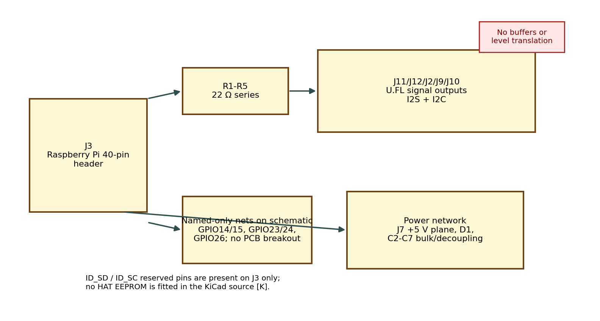
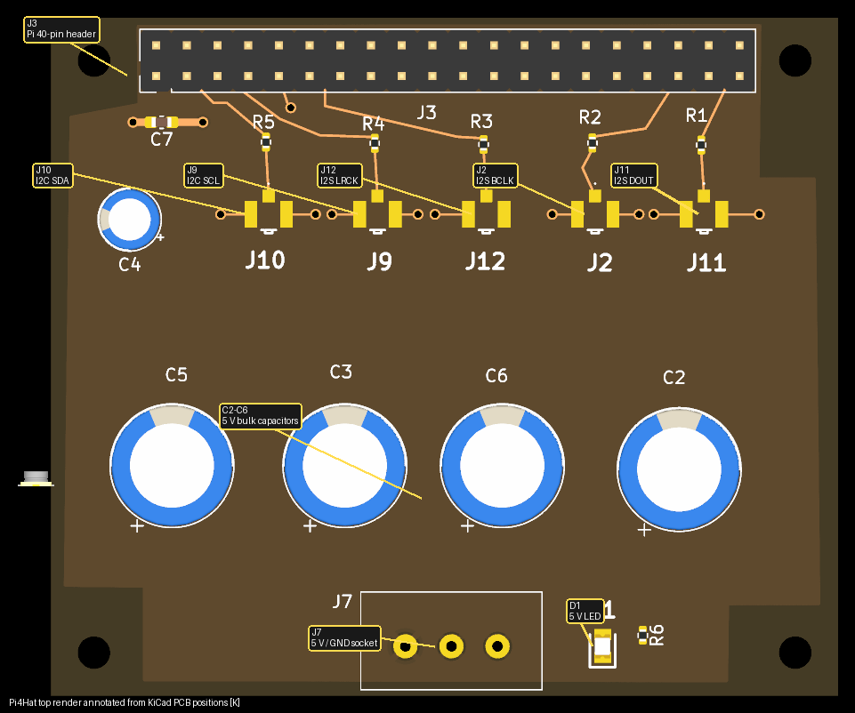
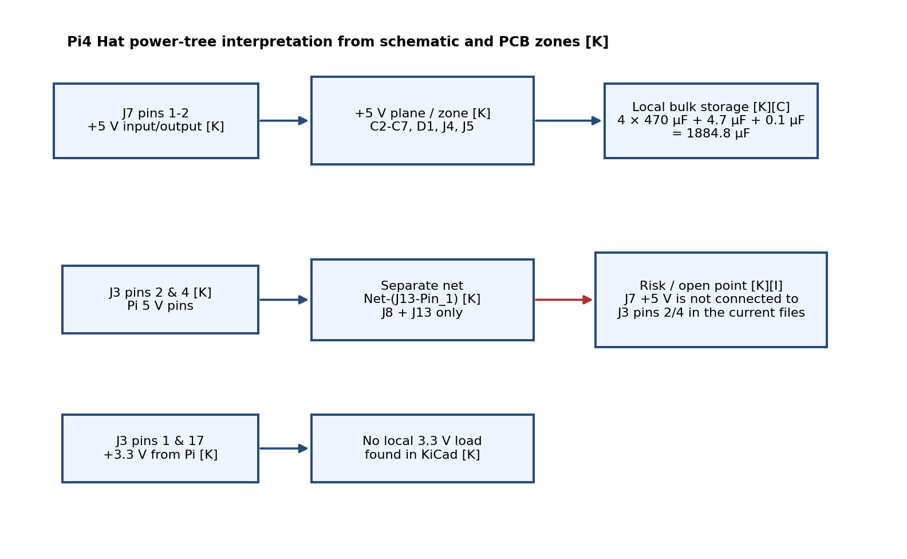

# 1. Document information

| Item | Value | Evidence |
|---|---|---|
| Product / board | Pi4 Hat (PiHat); KiCad project `Pi4Hat` inside `...\PIHat\Pi4Hat` | [K] |
| Function | Raspberry Pi 40-pin interface / HAT-style board for power distribution and signal break-out | [K]/[I] |
| KiCad title-block date | 15 Nov 2012 on both schematic and PCB title blocks | [K] |
| KiCad source format | KiCad 8.0 files, analysed with `kicad-cli` 10.0.6; sources not modified | [K] |
| Source files used | `Pi4Hat.kicad_sch` and `Pi4Hat.kicad_pcb` (newest non-backup files in the supplied folder tree) | [K] |
| Existing summary reviewed | `boards\RaspberryPiInterfaceBoard.md` | [K] |
| Intended readers | Engineers, assemblers and service technicians | [I] |

**Evidence labels used throughout**

| Label | Meaning |
|---|---|
| **[K]** | Established from the KiCad schematic, PCB or KiCad-generated netlist/reports |
| **[D]** | Verified from a manufacturer / platform datasheet or official documentation read for this document |
| **[C]** | Calculated from [K]/[D] values |
| **[I]** | Inferred; plausible but not proven from the available files |
| **[M]** | Needs measurement or continuity testing on a physical board |

> **Scope and limits.** No physical board was measured and no firmware or software configuration was inspected. Nothing in this document is a hardware test result. Where a value is not in the project files it is stated as *not established from these files*. Open points are collected in [OpenQuestions.md](OpenQuestions.md).

# 2. Overview

The Pi4 Hat is a passive Raspberry Pi 40-pin break-out board. In the KiCad source it does **not** contain logic ICs, regulators or level shifters [K]. Its main functions are:

- bring Raspberry Pi signals from the 40-pin header (J3) to five U.FL connectors through 22 Ω series resistors: I²S data, I²S frame-sync, I²S bit-clock, I²C SDA and I²C SCL [K];
- provide local 5 V bulk capacitance and a 5 V present LED on one +5 V net [K];
- provide a 3-pin socket (J7) for that +5 V net [K];
- carry several named GPIO nets on the schematic for UART, handshake and PWM monitor lines, although these named nets are **not routed to separate PCB connectors in the current board file** [K];
- mechanically fit the Raspberry Pi 4 connector envelope; the PCB outline and silkscreen mark USB, RJ45, USB and PoE keep-out regions [K].

A major finding is that the KiCad source defines **two separate 5 V domains**: J7/C2-C7/D1/J4/J5 on net `+5V`, and Raspberry Pi header pins 2/4 with J8/J13 on net `Net-(J13-Pin_1)` [K]. The older summary document says J7 powers the Pi header, but the current KiCad source does not show that connection [K].

# 3. Specifications

| Parameter | Value | Evidence |
|---|---|---|
| PCB | 4 layers, 1.6 mm FR-4 stack-up: F.Cu / In1.Cu / In2.Cu / B.Cu | [K] |
| Outline envelope | Approximately 65 mm × 56 mm, with non-rectangular Pi-clearance cut-outs | [K] |
| Mounting | 4 × 2.7 mm holes for M2.5 hardware; positions match the usual Raspberry Pi HAT pattern | [K]/[I] |
| Pi connector | 2 × 20, 2.54 mm header J3 (Molex 70246-4001 value in schematic) | [K] |
| External signal connectors | 5 × U.FL connectors (J10 SDA, J9 SCL, J2 BCLK, J12 LRCK, J11 DOUT) | [K] |
| Series impedance on signal outputs | 22 Ω in series with each exported signal (R1-R5) | [K] |
| Bulk capacitance on `+5V` | 4 × 470 µF + 4.7 µF + 0.1 µF = 1884.8 µF total | [K]/[C] |
| Power indicator | D1 with R6 = 1 kΩ, connected to `+5V` | [K] |
| Local regulation | None found | [K] |
| Host logic levels | Raspberry Pi GPIO outputs are 3.3 V; inputs are 3.3 V-tolerant | [D] |
| Fixed I²C pull-ups on Pi | GPIO2 and GPIO3 include fixed pull-ups to 3.3 V on the Pi | [D] |
| HAT ID EEPROM | Not fitted in these files | [K] |
| Operating current, temperature rise, cable loss | Not established from these files | – |

**Design checks**

| Check | Result | Evidence |
|---|---|---|
| Pi GPIO voltage compatibility | The U.FL signal outputs are direct Raspberry Pi GPIO nets through 22 Ω only. They are therefore 3.3 V logic outputs, **not 5 V tolerant interfaces**. External equipment must be high-impedance and 3.3 V compatible. | [K]/[D] |
| I²C assignment | J3 pin 3 = GPIO2/SDA1 and pin 5 = GPIO3/SCL1, matching Raspberry Pi I²C1 pins. | [K]/[D] |
| UART assignment | J3 pin 8 = GPIO14/TXD0 and pin 10 = GPIO15/RXD0, matching Raspberry Pi UART pins. | [K]/[D] |
| I²S assignment | J3 pin 12 = GPIO18 / PCM clock, pin 35 = GPIO19 / PCM frame-sync, pin 40 = GPIO21 / PCM data-out, consistent with Raspberry Pi PCM/I²S usage. | [K]/[D] |
| 5 V routing intent | The KiCad source separates J7 `+5V` from Pi header pins 2/4. J7 therefore cannot be assumed to power the Pi in the current source set. | [K] |
| 3.3 V usage | J3 pins 1 and 17 are both net `+3.3V`, but no local 3.3 V load is connected in the schematic. | [K] |
| Protection | No ESD, over-voltage or buffering is fitted between J3 and the exported signal connectors. | [K] |

# 4. Connectors, controls, indicators and test points

## 4.1 J3 – Raspberry Pi 40-pin header [K]

J3 is the main board-to-host connection. Only a subset of pins is actively used by the current design.

| J3 pin(s) | Net / function | Notes |
|---|---|---|
| 1, 17 | `+3.3V` | Present from the Pi only; no local 3.3 V load found [K] |
| 2, 4 | `Net-(J13-Pin_1)` | Pi 5 V pins; **not on the `+5V` net used by J7/C2-C7/D1** [K] |
| 3 | `GPIO2/SDA1` | Routed through R5 to J10 [K][D] |
| 5 | `GPIO3/SCL1` | Routed through R4 to J9 [K][D] |
| 6, 9, 14, 20, 25, 30, 34, 39 | GND | Main ground pins used in the design [K] |
| 8 | `GPIO14/TXD0` | Named on the schematic only; no separate PCB output found [K] |
| 10 | `GPIO15/RXD0` | Named on the schematic only; no separate PCB output found [K] |
| 12 | `GPIO18/I2S BCL` | Routed through R3 to J2 [K][D] |
| 16 | `GPIO23 /ESP DRY` | Named on the schematic only [K] |
| 18 | `GPIO24/RPI DRY` | Named on the schematic only [K] |
| 35 | `GPIO19/I2S LRCK` | Routed through R2 to J12 [K][D] |
| 37 | `GPIO26/Mon PWM` | Named on the schematic only [K] |
| 40 | `GPIO21/I2S DOUT` | Routed through R1 to J11 [K][D] |
| 27, 28 | `ID_SDA`, `ID_SCL` | Reserved HAT EEPROM pins; schematic note says do not use except for an I²C ID EEPROM [K] |

All remaining J3 pins are no-connect or have only symbolic labels in the schematic [K].

## 4.2 U.FL signal connectors [K]

Each U.FL connector exports one signal plus two ground pads. No active buffering is provided.

| Ref | Signal | Source pin |
|---|---|---|
| J10 | I²C SDA | J3 pin 3 / GPIO2 via R5 22 Ω |
| J9 | I²C SCL | J3 pin 5 / GPIO3 via R4 22 Ω |
| J2 | I²S BCLK / PCM clock | J3 pin 12 / GPIO18 via R3 22 Ω |
| J12 | I²S LRCK / PCM frame-sync | J3 pin 35 / GPIO19 via R2 22 Ω |
| J11 | I²S DOUT / PCM data-out | J3 pin 40 / GPIO21 via R1 22 Ω |

These connectors should be treated as 3.3 V logic-level outputs only [K][D]. Characteristic impedance, cable length limits and downstream terminations are *not established from these files*.

## 4.3 J7 – 5 V / GND socket [K]

| Pin | Net |
|---|---|
| 1 | `+5V` |
| 2 | `+5V` |
| 3 | GND |

The current KiCad source ties J7 to the local `+5V` plane with C2-C7 and D1, but **not** to J3 pins 2/4 [K]. Whether J7 is intended as an input, output or link point must be confirmed on hardware [M].

## 4.4 Controls, indicators and test points [K]

| Item | Function |
|---|---|
| D1 | 5 V present LED on local `+5V` net |
| R6 | 1 kΩ current-limit resistor for D1 |
| Test points / switches | None found |

## 4.5 Schematic-only connectors not present on the current PCB [K]

The schematic includes the following connectors, but the PCB file does not contain footprints for them:

| Ref | Schematic value | Net / purpose |
|---|---|---|
| J1 | `GPIO` | Unconnected 2 × 20 header placeholder |
| J4, J5 | `5v pin` | Single-pin connectors on local `+5V` |
| J6 | `1725672` | 4-pin ground terminal |
| J8, J13 | `5v pin` | Single-pin connectors on `Net-(J13-Pin_1)` |
| J14 | `5v pin` | Single-pin connector on isolated `GND2` |

This schematic/PCB mismatch must be resolved before the design can be treated as production-ready [K][I].

# 5. Functional description

## 5.1 Signal break-out

The board directly exports Raspberry Pi signals to coax connectors. R1-R5 (all 22 Ω) are the only components between the host header and the U.FL outputs [K]. Therefore:

- no level translation is present [K];
- no active buffering is present [K];
- no dedicated ESD protection is present [K];
- any downstream board must be 3.3 V compatible and should not force these nets above 3.3 V [D].

## 5.2 Power distribution

Two separate power networks are described in the KiCad source [K]:

1. **Local `+5V` plane** on In2.Cu feeding J7, C2-C7, D1 and schematic-only J4/J5.
2. **`Net-(J13-Pin_1)`** feeding J3 pins 2 and 4 and schematic-only J8/J13.

The old summary document states that J7 feeds the Raspberry Pi 5 V pins, but that is **not** what the present schematic/netlist says [K]. This is the single most important service ambiguity on the board.

## 5.3 Reserved and named-only nets

The schematic note explicitly warns not to use `ID_SD` and `ID_SC` for anything other than an I²C ID EEPROM [K]. No EEPROM is fitted in the current KiCad source [K], so automatic HAT identification is not implemented [I].

Several additional GPIO nets are named on J3 (`GPIO14/TXD0`, `GPIO15/RXD0`, `GPIO23/ESP DRY`, `GPIO24/RPI DRY`, `GPIO26/Mon PWM`) but have only one connection in the KiCad netlist and no dedicated PCB connector [K]. They should therefore be treated as documentation labels, not usable external interfaces, unless a later revision adds the missing footprints/routes [I].

## 5.4 Mechanical intent

The board outline is shaped around the Raspberry Pi connector envelope, and the silkscreen marks `USB`, `RJ45`, `USB` and `PoE` keep-out references [K]. This strongly suggests the board is intended to sit above a Raspberry Pi 4 [I]. The DRC nevertheless reports a malformed outline, so the mechanical definition should be checked before manufacture [K].

# 6. Assembly and commissioning

## 6.1 Before assembly / first fit

1. Confirm whether the current product to be built should follow the **schematic**, the **PCB**, or a later unpublished revision. Seven schematic connectors are absent from the PCB file [K].
2. Decide which 5 V net is intended to power the Raspberry Pi. In the current source J7 does **not** connect to J3 pins 2/4 [K].
3. Check that the chosen U.FL cables and downstream circuitry are compatible with 3.3 V GPIO signalling [K][D].
4. Verify electrolytic capacitor polarity (C2, C3, C5, C6) and LED polarity before soldering [K].
5. Check J3 orientation carefully; the board is keyed only by the 2 × 20 pin pattern and mounting holes [K].

## 6.2 Suggested continuity checks before power [M]

These are recommended checks, **not measured results**:

| Check | Expected from KiCad |
|---|---|
| J7 pin 1 to D1 anode | Continuity on local `+5V` |
| J7 pin 1 to J3 pin 2 | **Open circuit** if the present net split is real |
| J3 pin 3 to J10 SIG | 22 Ω through R5 |
| J3 pin 5 to J9 SIG | 22 Ω through R4 |
| J3 pin 12 to J2 SIG | 22 Ω through R3 |
| J3 pin 35 to J12 SIG | 22 Ω through R2 |
| J3 pin 40 to J11 SIG | 22 Ω through R1 |
| J14 to main GND | Open circuit in the current schematic (`GND2` is isolated) |

## 6.3 First power-up guidance [M]

1. If powering the board standalone through J7, verify 5 V at D1 and across the bulk capacitors.
2. **Do not assume this also powers the Raspberry Pi** until continuity from J7 to J3 pins 2/4 is confirmed.
3. When fitting to a Raspberry Pi, confirm the host still boots normally and that the exported GPIO nets idle at 3.3 V-compatible levels.
4. Enable and configure the Pi interfaces in software as needed (I²C, PCM/I²S, UART). No automatic HAT EEPROM configuration is present in the KiCad files.

# 7. Testing and troubleshooting

| Symptom | Likely cause | Check |
|---|---|---|
| Pi does not power from J7 | KiCad source splits J7 `+5V` from J3 pins 2/4 | Continuity J7 → J3 pin 2/4 [K][M] |
| D1 off but Pi still powered | Pi 5 V may be arriving on `Net-(J13-Pin_1)` rather than local `+5V` | Check which 5 V net is energised [K][M] |
| No I²C on J10/J9 | Pi I²C disabled, wrong cable, or damaged R4/R5 / U.FL joints | Check GPIO2/GPIO3 activity and 22 Ω continuity |
| No audio data on J11/J12/J2 | Pi PCM/I²S disabled or wrong device-tree configuration | Check GPIO18/19/21 at J3 first, then across R1-R3 |
| UART / handshake lines unavailable | These nets are named in the schematic only and not broken out on the PCB | Review §4.5 before fault-finding |
| Noise or damaged GPIO | External device is not 3.3 V compatible; no buffer or ESD protection fitted | Disconnect downstream cable and inspect Pi GPIO function |
| J14 has no usable voltage | `GND2` is isolated in the current schematic | Continuity J14 → GND should be open [K][M] |
| One U.FL ground shell not bonded as expected | DRC reports one unconnected ground item at J12 | Inspect J12 ground pads and copper around them [K][M] |

ERC summary: 41 errors and 12 warnings [K]. DRC summary: 23 rule violations plus 5 unconnected-pad items [K]. Many of the ERC errors are caused by the unconnected placeholder header J1 and by named nets with no second connection; they still indicate that the design files need cleanup before release [K][I].

# 8. Repair and rework

- U.FL connectors are delicate; use suitable hot-air or fine-tip rework tools and inspect pad lift afterwards [I].
- Replace R1-R5 only with the intended 22 Ω value unless signal-integrity testing justifies a change [K].
- Replace R6 only with a value that keeps LED current modest at 5 V; 1 kΩ is fitted in the KiCad source [K].
- Observe electrolytic polarity when replacing C2/C3/C5/C6 [K].
- If correcting the design rather than repairing a board, resolve the schematic/PCB mismatch before making any service judgement from the files [K].

# 9. BOM reference

## 9.1 PCB-fitted items in the current board file [K]

| Ref | Qty | Value | Footprint / note |
|---|---|---|---|
| C2, C3, C5, C6 | 4 | 470 µF | THT radial electrolytic |
| C4 | 1 | 4.7 µF | THT radial capacitor |
| C7 | 1 | 100 nF | 0603 |
| D1 | 1 | LS_R976 | LED, 0805-style footprint |
| R1-R5 | 5 | 22 Ω | 0402 |
| R6 | 1 | 1 kΩ | 0402 |
| J3 | 1 | 70246-4001 | 2 × 20 Raspberry Pi header |
| J7 | 1 | Conn_01x03_Socket | 3-pin 5 V / GND socket |
| J2, J9, J10, J11, J12 | 5 | U.FL-R-SMT-1_80_ | U.FL signal connectors |
| MH1-MH4 | 4 | MountingHole_2.7mm_M2.5 | PCB-only mechanical features |

## 9.2 Schematic-only items missing from the PCB file [K]

| Ref | Value | Comment |
|---|---|---|
| J1 | GPIO | Placeholder 2 × 20 connector, fully unconnected |
| J4, J5 | 5v pin | Single-pin `+5V` connectors |
| J6 | 1725672 | 4-pin ground terminal |
| J8, J13 | 5v pin | Single-pin connectors on Pi 5 V net |
| J14 | 5v pin | Single-pin connector on isolated `GND2` |

# 10. Limitations, risks and open points

1. **5 V routing ambiguity.** The current KiCad source does not connect J7 `+5V` to Raspberry Pi header pins 2/4 [K]. This directly contradicts the older summary and must be resolved.
2. **Schematic/PCB mismatch.** Seven schematic connectors are absent from the PCB, and four mounting holes exist only on the PCB [K].
3. **No buffering or protection.** Exported signals are direct Pi GPIO nets through 22 Ω only [K][D].
4. **J14 is misleading.** It is labelled `5v pin` in the schematic but is actually on isolated `GND2` [K].
5. **No HAT EEPROM.** The reserved ID pins are present, but no ID EEPROM is fitted [K].
6. **Design-rule state is not clean.** ERC and DRC both report substantive issues, including malformed outline, unconnected items and clearance/thermal problems [K].
7. **Old summary discrepancies.** The older `RaspberryPiInterfaceBoard.md` summary states that J7 powers the Pi header and does not mention the schematic/PCB part mismatch [K].

See [OpenQuestions.md](OpenQuestions.md) for the short action list.

# 11. References and revision history

## 11.1 References

- KiCad source: `C:\Users\antho\Documents\StreamerDac Project\Documents\kicad\Streamer schematic\ControlBoardTiny\tinyControlBoard\PIHat\Pi4Hat\Pi4Hat.kicad_sch` and `.kicad_pcb` [K]
- KiCad-generated netlist, ERC and DRC reports created for this document [K]
- Existing summary: `docs\userDocumentation\service-guide\boards\RaspberryPiInterfaceBoard.md` [K]
- Raspberry Pi official GPIO documentation (`gpio-on-raspberry-pi.adoc`) for voltage levels and fixed pull-ups [D]
- pinout.xyz pages for physical-pin to GPIO/alternate-function cross-checks on GPIO2, GPIO3, GPIO14, GPIO15, GPIO18, GPIO19 and GPIO21 [D]

## 11.2 Revision history

| Revision | Date | Change |
|---|---|---|
| A | 2026-10-11 | First engineering and service document generated from the supplied KiCad source |
