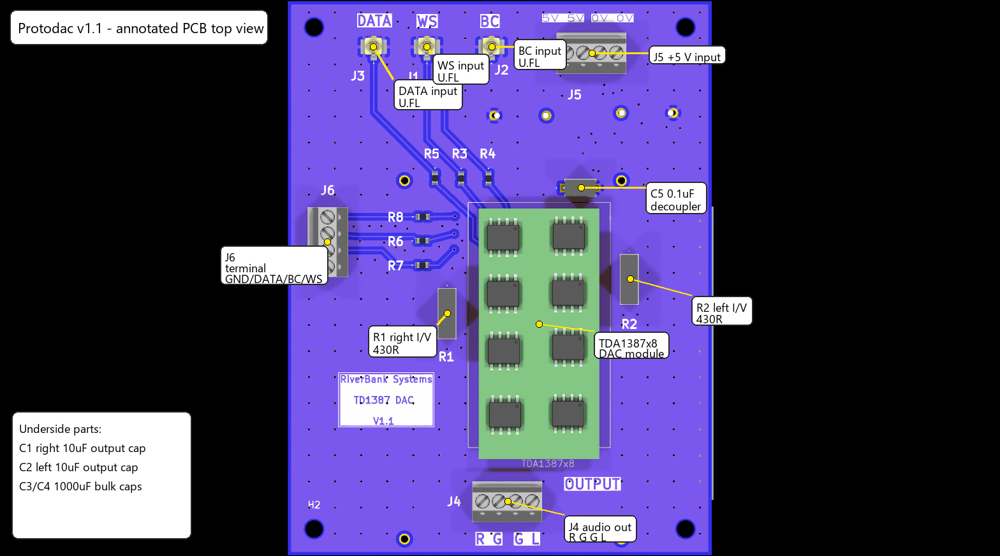
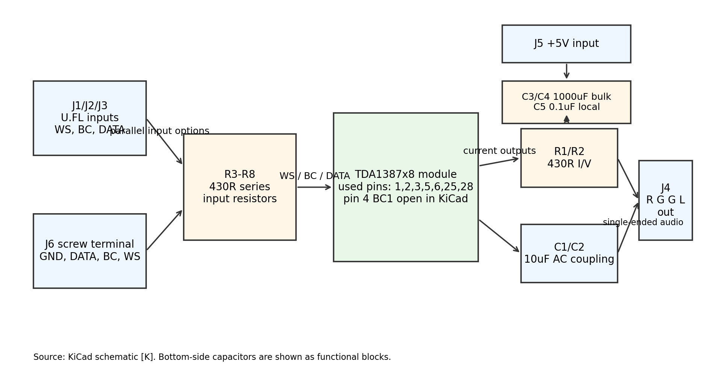
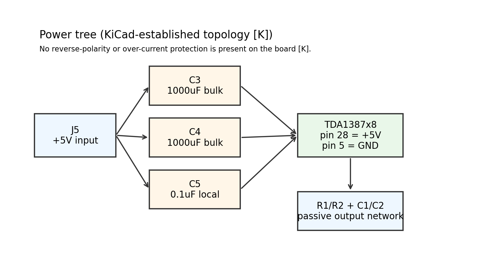

---
title: "Protodac - Engineering and Service Document"
subtitle: "RiverBank Systems ProtoDAC board using TDA1387x8 DAC module"
lang: en-GB
---

# 1. Document information

| Item | Value | Evidence |
|---|---|---|
| Product | Protodac Board | [K] schematic title block |
| PCB marking | `RiverBank Systems` / `TD1387 DAC` / `V1.1` | [K] PCB silkscreen |
| Schematic revision | Rev. `0.2`, dated `2024-11-19` | [K] schematic title block |
| KiCad source | `Protodac\protodac Board\protodac Board.kicad_sch` and `.kicad_pcb` | [K] |
| KiCad file format | KiCad 8.0 source, analysed read-only with kicad-cli 10.0.6 | [K] |
| Intended readers | Engineers, assemblers and service technicians | [I] |
| Related files | [OpenQuestions.md](OpenQuestions.md), [Circuit board reference](../../CircuitBoardReference.md) | – |

**Evidence labels used throughout**

| Label | Meaning |
|---|---|
| **[K]** | Established from the KiCad schematic, PCB, BOM or production files |
| **[D]** | Verified from a manufacturer datasheet retrieved for this document |
| **[C]** | Calculated from [K]/[D] values |
| **[I]** | Inferred from context or external background material, not proven from the KiCad files alone |
| **[M]** | Needs measurement or confirmation on hardware |

> **Scope and limits.** The KiCad project is treated as the source of truth. No hardware was powered, probed or measured. Nothing in this document is a test result. Where a value cannot be established from the files it is stated as *not established from these files*.

# 2. Overview

Protodac is a small digital-to-analogue converter carrier/interface board built around a **TDA1387x8 plug-in module** footprint (`TDA1387x8`) [K]. The PCB itself contains no active line-driver, regulator or analogue amplifier stages; it mainly provides [K]:

- two alternative digital audio input arrangements:
  - three individual U.FL inputs J1/J2/J3 labelled **WS**, **BC** and **DATA** [K]
  - one 4-way screw terminal J6 carrying **GND, DATA, BC, WS** [K]
- a 4-way screw terminal J5 for **+5 V, +5 V, 0 V, 0 V** supply entry [K]
- passive current-to-voltage and output-coupling parts around the DAC module:
  - R1 and R2, both 430R [K]
  - C1 and C2, both 10 uF film capacitors [K]
- bulk and local supply decoupling: C3 1000 uF, C4 1000 uF and C5 0.1 uF [K]
- a 4-way screw terminal J4 labelled **R G G L** for single-ended audio output [K].

The board is therefore best understood as a passive carrier/output board for an 8-chip TDA1387 DAC module rather than a complete DAC implementation on its own [K][I].

# 3. Specifications

| Parameter | Value | Evidence |
|---|---|---|
| PCB size | 65 mm x 85 mm | [K] edge-cuts rectangle 82,32 to 147,117 |
| PCB thickness | 1.6 mm | [K] PCB setup |
| Copper layers | 2-layer board (F.Cu and B.Cu) | [K] PCB layer table |
| Mounting | 4 x M2.5 mounting holes, 2.7 mm finished hole | [K] |
| Main supply input | +5 V on J5 pins 1 and 2; GND on J5 pins 3 and 4 | [K] |
| Supply connector rating | Phoenix Contact 1725672 / MPT 0,5/4-2,54, 6 A nominal, 63 V nominal, 2.54 mm pitch | [D] |
| Digital input connectors J1-J3 | Hirose U.FL-R-SMT-1(80) receptacles | [K] |
| DAC module supply pin | `TDA1387x8` pin 28 = +5 V, pin 5 = GND | [K] |
| Output arrangement | Right via J4 pin 1, left via J4 pin 4, grounds on J4 pins 2 and 3 | [K] |
| Output coupling parts | C1 and C2 = 10 uF film capacitors | [K] |
| I/V parts | R1 and R2 = 430R | [K] |
| Local decoupling | C5 = 0.1 uF ceramic, Vishay KG radial MLCC family | [K][D] |
| Bulk decoupling | C3 and C4 = 1000 uF electrolytic | [K] |
| Output capacitor family | C1/C2 footprints and datasheet fields point to ClarityCap ESA film capacitors | [K][D] |
| Board current consumption | Not established from these files; depends on the TDA1387x8 module fitted | [K] |
| Accepted digital logic levels | Not established from these files because the retrieved module/chip datasheet could not be confirmed | [K][M] |
| Output voltage / impedance | Not established from these files alone; depends on the DAC module behaviour and the connected load | [K][M] |

**Calculated checks**

| Check | Result | Evidence |
|---|---|---|
| Total bulk capacitance on +5 V rail | 1000 uF + 1000 uF = 2000 uF, plus 0.1 uF local decoupling | [C] from [K] |
| Input-drive contention if J6 and a U.FL input are driven to opposite logic states | Approx. 5 V / (430R + 430R) = 5.8 mA between sources, ignoring module input current | [C] |
| Output high-pass corner with 10 uF coupling cap and 10 kohm next-stage input | 1 / (2 pi x 10k x 10 uF) approx. 1.59 Hz | [C] |
| Output high-pass corner with 10 uF coupling cap and 47 kohm next-stage input | approx. 0.34 Hz | [C] |

These RC calculations are conditional on the external load; the actual load impedance is not defined in the KiCad files [K][I].

# 4. Connectors, controls, indicators and test points

There are **no switches, LEDs or user controls** on this PCB [K]. There is one test point, TP1, on the `WS` net [K].

## 4.1 J5 - supply input terminal [K][D]

Phoenix Contact 1725672, 4-way, 2.54 mm pitch, screw terminal block [K][D].

| Pin | Marking / net | Function |
|---|---|---|
| 1 | `5V` / +5V | +5 V input |
| 2 | `5V` / +5V | Parallel +5 V input |
| 3 | `0V` / GND | Ground |
| 4 | `0V` / GND | Parallel ground |

Two pins are paralleled for each supply rail [K]. No reverse-polarity or over-current protection components are present on the board [K].

## 4.2 J6 - 4-way digital input terminal [K]

| Pin | Net path | Function |
|---|---|---|
| 1 | GND | Digital ground |
| 2 | via R7 430R to `Net-(TDA1387x8-DATA)` | DATA input |
| 3 | via R6 430R to `Net-(TDA1387x8-BC)` | BC/BCK input |
| 4 | via R8 430R to `Net-(TDA1387x8-WS)` | WS/LRCK input |

The exact intended cable source is not established from these files. It is consistent with an off-board I2S source [I].

## 4.3 J1/J2/J3 - U.FL digital inputs [K]

| Ref | PCB marking | Net path |
|---|---|---|
| J1 | `WS` | via R3 430R to `Net-(TDA1387x8-WS)` |
| J2 | `BC` | via R4 430R to `Net-(TDA1387x8-BC)` |
| J3 | `DATA` | via R5 430R to `Net-(TDA1387x8-DATA)` |

Each U.FL connector has two ground shell pads and one signal pad [K]. J1/J2/J3 and J6 are wired as **parallel alternatives**, not switched alternatives [K].

## 4.4 J4 - audio output terminal [K][D]

Phoenix Contact 1725672, 4-way screw terminal block [K][D].

| Pin | PCB marking | Net |
|---|---|---|
| 1 | `R` | `Net-(C1-Pad2)` (right-channel AC-coupled output) |
| 2 | `G` | GND |
| 3 | `G` | GND |
| 4 | `L` | `Net-(C2-Pad2)` (left-channel AC-coupled output) |

## 4.5 TP1 - test point [K]

| Ref | Net | Comment |
|---|---|---|
| TP1 | `Net-(TDA1387x8-WS)` | Only explicit test point on the PCB |

# 5. Functional description

1. **Supply entry and decoupling.** J5 feeds the +5 V rail, which is decoupled by C3 and C4 (1000 uF each) and by C5 (0.1 uF) before feeding the DAC module pin 28 [K]. Ground returns to module pin 5 [K].
2. **Digital input options.** The board offers two connector styles for the same three digital signals: U.FL connectors J1/J2/J3 and screw terminal J6 [K]. Each signal path has its own 430R series resistor before joining the DAC-module input net [K].
3. **Module interface.** The `TDA1387x8` footprint uses only pins 1, 2, 3, 5, 6, 25 and 28. Pin 4 (`BC1`) is marked no-connect in the KiCad design [K].
4. **Current-to-voltage conversion.** The module's right and left analogue outputs appear on pins 6 and 25 respectively, each loaded by a 430R resistor to ground (R1, R2) [K]. This is a passive I/V conversion stage [K][I].
5. **AC coupling to the output terminal.** The analogue outputs then pass through C1 and C2 (10 uF) to J4 pins 1 and 4 [K]. J4 pins 2 and 3 are grounds [K].
6. **No on-board mute or filter stage.** The board does not include active output buffering, muting relays, de-emphasis control, regulators or anti-pop circuitry [K].

# 6. Assembly and commissioning

## 6.1 Assembly observations from the PCB data [K]

- The DAC module, J1-J6, TP1 and resistors are on the **top side** [K].
- C1-C4 are placed on the **bottom side** according to `positions.csv` [K].
- The board therefore requires two-sided assembly even though most serviceable items are on the top side [K].

## 6.2 Suggested build checks before power [M]

1. Verify there is no short between J5 +5 V and GND.
2. Check the fitted `TDA1387x8` module orientation against the footprint pin-1 location.
3. Confirm R1-R8 are all 430R and fitted in the intended positions.
4. Confirm C3/C4 polarity if polarised electrolytics are fitted.
5. Confirm that only one digital-input method will be used at a time unless the source arrangement has been explicitly validated.

## 6.3 Suggested first power-up sequence [M]

1. Power the board from a current-limited +5 V supply at J5.
2. Confirm +5 V reaches the DAC module pin 28 and C5.
3. Apply only one digital source path (either J6 or J1/J2/J3).
4. Verify the `WS` signal appears at TP1.
5. Confirm no excessive DC appears at J4 after the coupling capacitors; a small transient at power-up is possible but was not measured here.

No commissioning result is claimed here because no hardware was tested [M].

# 7. Testing and troubleshooting

## 7.1 CAD-rule checks from the KiCad source [K]

| Check | Result |
|---|---|
| ERC | 19 warnings, 0 errors |
| ERC detail | 15 `footprint_link_issues`, 3 `lib_symbol_mismatch`, 1 `lib_symbol_issues` |
| DRC | 22 warnings, 0 unconnected pads, 0 footprint errors |
| DRC detail | 16 `silk_over_copper`, 5 `lib_footprint_issues`, 1 `mirrored_text_on_front_layer` |

The library-link warnings are consistent with missing custom library context during analysis and are not by themselves proof of an electrical fault [K][I]. The silkscreen warnings around C1/C2 and the module/output area are real PCB legibility/clearance concerns [K].

## 7.2 Fault table

| Symptom | Likely cause | Checks |
|---|---|---|
| No output from either channel | No +5 V, wrong DAC-module orientation, no digital input, wrong source connected | Check J5 polarity, +5 V at module pin 28, TP1 `WS` activity, source wiring [K][M] |
| One channel missing | Fault in module, wrong/unsoldered R1 or R2, open C1 or C2, wiring error at J4 | Compare continuity from module pin 6/25 through R/C network to J4 [K][M] |
| Loud hum / poor grounding | Missing ground at J5 or J6/J1-J3 source path, wiring loop | Check J4 pins 2 and 3 to supply ground continuity [K][M] |
| Distorted output | Wrong DAC module, wrong I/V resistor value, unsuitable load, over-driven or invalid digital format | Verify R1/R2 are 430R, confirm source format, confirm load impedance [K][M] |
| DAC works on one input method but not the other | Cable / connector fault on J6 or J1-J3 path | Trace through R3-R8 to the shared nets [K][M] |
| Unstable or noisy digital operation | Both connector sets driven at once, long unshielded leads, inadequate source ground reference | Use one input path only; inspect J6 ground wiring; observe TP1 [K][C][M] |
| Mechanical assembly clash or unreadable markings | Silkscreen overlap and bottom-side capacitor clearances | Review DRC items and fitted capacitor body sizes [K][M] |

# 8. Repair and rework

- Through-hole screw terminals and the plug-in DAC module are the easiest items to replace [K].
- C1-C4 are bottom-side parts, so rework access from both sides is needed [K].
- The board relies on custom footprints for the DAC module and large audio capacitors; substitute parts should only be fitted after checking pin pitch, body clearance and polarity/orientation [K][M].
- After rework, repeat continuity checks on:
  - J5 supply to module pin 28 and ground to pin 5 [K]
  - J6/J1-J3 input paths through R3-R8 [K]
  - module outputs through R1/R2, C1/C2 and J4 [K].

# 9. BOM reference

| Ref | Qty | Value | Footprint / part family | Evidence |
|---|---|---|---|---|
| C1, C2 | 2 | 10uf | `Audio_Module:Clarity Cap` | [K] |
| C3, C4 | 2 | 1000uf | `Audio_Module:Audio Note Kaisei POLAR` | [K] |
| C5 | 1 | 0.1uf | `samsys:K104K20X7RK53H5G` | [K] |
| R1, R2 | 2 | 430R | `Y0007400R000V0L` | [K] |
| R3-R8 | 6 | 430R | `ERJH3` | [K] |
| J1, J2, J3 | 3 | `U.FL-R-SMT-1_80_` | `UFLRSMT180` | [K] |
| J4, J5, J6 | 3 | `1725672` | Phoenix Contact 4-way terminal block footprint | [K] |
| TP1 | 1 | `5085` | single test point | [K] |
| TDA1387x8 | 1 | `~` | `Audio_Module:TDA1387` custom module footprint | [K] |
| H1-H4 | 4 | MountingHole | `MountingHole_2.7mm_M2.5` | [K] |

**Notable BOM/traceability points**

- The schematic title block says **Rev. 0.2**, while the PCB silkscreen says **V1.1** [K].
- The schematic title block uses company name **Systems Thinking**, while the PCB silkscreen uses **RiverBank Systems** [K].
- No manufacturer part number or datasheet for the actual `TDA1387x8` module was embedded in the KiCad netlist export [K].

# 10. Limitations, risks and open points

1. **DAC module specification not fully established.** The board depends on a custom `TDA1387x8` module footprint, but the exact module datasheet, logic thresholds, current draw and analogue output characteristics were not established from the project files [K][M].
2. **Pin 4 (`BC1`) is left open.** KiCad marks module pin 4 as no-connect [K]. If the fitted module does not internally tie this function to pin 2 or otherwise tolerate the omission, operation could fail [K][I].
3. **Parallel digital input options can conflict.** J6 and J1/J2/J3 are simultaneously wired to the same DAC inputs through separate 430R resistors [K]. Driving both connector sets at once can create source contention [C].
4. **No input or power protection.** There is no reverse-polarity, surge, fuse or ESD protection on the J5 supply entry or on the digital input paths [K].
5. **Output behaviour depends on external load.** The board provides passive I/V plus AC coupling only [K]. Final output level, LF corner and distortion margin depend on the fitted DAC module and the receiving equipment input impedance [K][M].
6. **Silkscreen and custom-library issues remain.** DRC reports 16 silk-over-copper warnings and one mirrored front-layer text item [K]. These are serviceability/legibility issues rather than proven functional faults.
7. **Exact capacitor voltage grades not established from the KiCad value fields.** The capacitor families were identified, but the fitted voltage variants for C1-C4 were not encoded in the simple `10uf` / `1000uf` values [K][D].

# 11. References and revision history

## 11.1 References

- KiCad project files and production CSVs for `Protodac\protodac Board` [K]
- Phoenix Contact datasheet for 1725672 / MPT 0,5/4-2,54 terminal block [D]
- Vishay KG series radial MLCC datasheet for C5 family [D]
- ClarityCap ESA range datasheet for C1/C2 family [D]
- Public ProtoDAC background documentation in `moode-player/protodac` was consulted only as supporting background where explicitly marked [I]; it was **not** treated as the source of truth.

## 11.2 Revision history

| Version | Date | Change |
|---|---|---|
| 1.0 | 2026-10-11 | First engineering/service document generated from the KiCad source and retrieved component datasheets |
