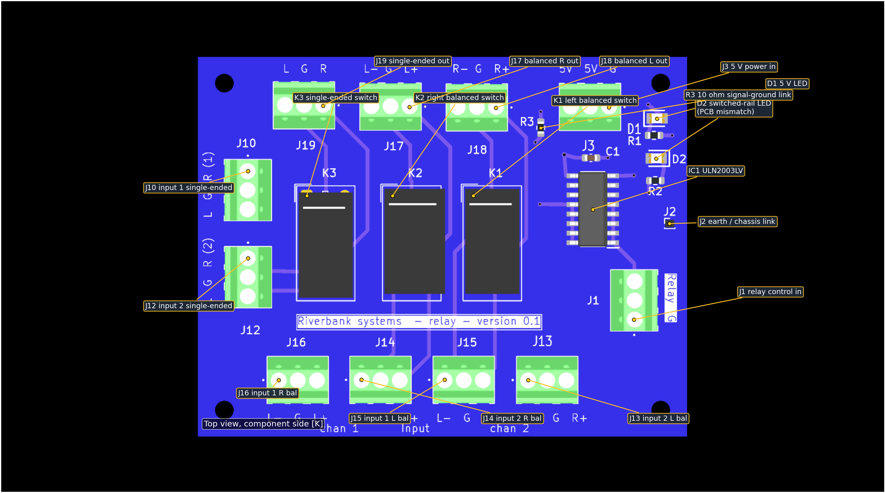
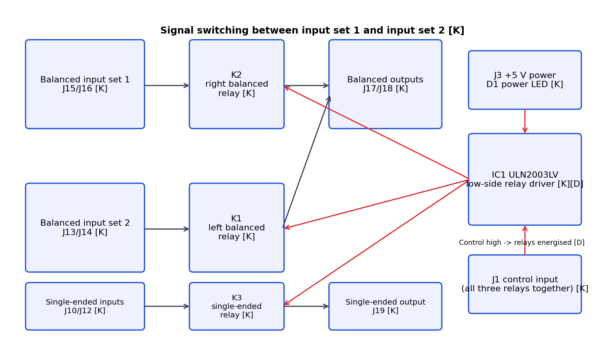
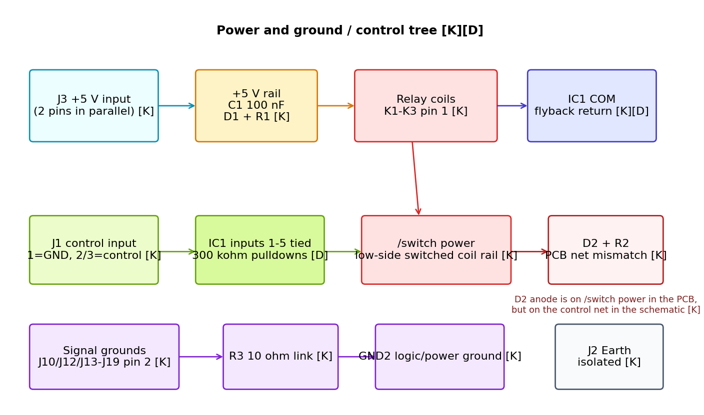

# 1. Document information

| Item | Value | Evidence |
|---|---|---|
| Board | Relay OUT Signal switch board | [K] |
| Silkscreen | `Riverbank systems - relay - version 0.1` | [K] |
| Schematic title | `Relay switching to switch between different to input XLR to one XLR and SE outputs` | [K] |
| KiCad source | `Relay OUT Signal switch board.kicad_sch` and `Relay OUT Signal switch board.kicad_pcb` | [K] |
| Schematic date / revision | `2024-12-06`, rev `v1.0` | [K] |
| Output files | This Markdown source, `RelayOutSignalSwitchBoard-EngineeringAndService.pdf`, `OpenQuestions.md` and the `figures\` folder | [K] |
| Scope | Engineering description and service guidance from the KiCad design files and manufacturer data only | [K][D] |

**Evidence labels used throughout**

| Label | Meaning |
|---|---|
| **[K]** | Established from the KiCad schematic, PCB, BOM or KiCad reports |
| **[D]** | Verified from a manufacturer datasheet read for this document |
| **[C]** | Calculated from [K] and/or [D] values |
| **[I]** | Inferred from the available evidence, but not directly proven |
| **[M]** | Needs measurement or confirmation on physical hardware |

> **Important limitation.** Nothing in this document was measured on hardware. No electrical test result, audio performance figure or thermal result is claimed here. Where the files do not establish a fact, this document states that explicitly.

# 2. Overview

The Relay OUT Signal Switch board is a **three-relay audio routing board** [K]. It accepts:

- two balanced stereo input sets on J13/J14 and J15/J16 [K];
- two single-ended stereo input sets on J10 and J12 [K];
- one relay-control input on J1 [K];
- one 5 V supply input on J3 [K].

It provides:

- one balanced stereo output on J17/J18 [K];
- one single-ended stereo output on J19 [K].

All three relays are switched together by one **ULN2003LVDR** low-side driver, so the balanced left, balanced right and single-ended paths change over at the same time [K][D]. The design intent stated in the schematic is to switch between **input set 1** and **input set 2** and present the selected source on one balanced output pair and one single-ended output pair [K].

The board also separates the audio signal return (`/sig ground`) from logic/power ground (`GND2`) with **R3 = 10 ohm** [K], and provides a separate single-pin `Earth` connection on J2 [K].

# 3. Specifications

| Parameter | Value | Evidence |
|---|---|---|
| PCB outline | Approximately `65.0 mm × 50.5 mm` | [K] |
| PCB thickness | `1.6 mm` | [K] |
| Copper layers | `6 copper layers` (`F.Cu`, `In1.Cu`, `In2.Cu`, `In3.Cu`, `In4.Cu`, `B.Cu`) | [K] |
| Mounting | `4 × 2.5 mm` mounting holes | [K] |
| Relay type | `EC2-5SNU`, miniature signal relay, `2 Form C` | [K][D] |
| Relay coil rating | `5.0 VDC`, `178 ohm ±10 %`, `3.75 V` operate, `0.50 V` release, `140 mW` nominal | [D] |
| Coil current per relay | `5.0 V / 178 ohm = 28.1 mA` | [C] |
| Total relay coil current | `3 × 28.1 mA = 84.3 mA` with all three relays energised | [C] |
| Relay contact rating | `2 A` maximum switching current, `30 W` / `62.5 VA`, `220 VDC` / `250 VAC` maximum switching voltage | [D] |
| Relay contact resistance | `75 mOhm` maximum initial | [D] |
| Relay operate / release time | Approximately `2 ms` / `1 ms` | [D] |
| Relay coil-to-contact isolation | `1500 VAC` for one minute (non-latch type) | [D] |
| Relay ambient rating | `-40 to +85 degC` | [D] |
| Driver IC | TI `ULN2003LVDR`, seven-channel low-side driver | [K][D] |
| Safe input range at IC1 inputs | `-0.3 V to 5.5 V` absolute maximum | [D] |
| Driver logic threshold | `VI(ON) >= 1.65 V`, `VI(OFF) <= 0.6 V` | [D] |
| Driver output capability | `100 mA` per channel at `VIN = 3.3 V`; `140 mA` per channel at `VIN = 5.0 V` | [D] |
| Driver ground-pin capability | Up to `1.0 A` total load current when channels are paralleled; `700 mA` absolute continuous above `125 degC` junction | [D] |
| Driver output / COM rating | `8 V` maximum | [D] |
| Driver package dissipation rating | `0.58 W` at `85 degC` ambient for the SOIC-16 package | [D] |
| Input pull-down | `300 kohm` typical internal pull-down per IC1 input | [D] |
| Audio ground link | `R3 = 10 ohm` between `/sig ground` and `GND2` | [K] |
| Decoupling on the 5 V rail | `C1 = 100 nF` only on the PCB | [K] |

**Driver margin check**

- One relay channel at `28.1 mA` [C] is well below the `100 mA` to `140 mA` continuous capability of one ULN2003LV channel [D].
- Three relays together draw about `84.3 mA` [C], well below the package-level current and dissipation limits [D].
- Even allowing roughly `0.17 V` to `0.24 V` output drop at higher currents [D], the relay coils still see about `4.8 V` at a `5.0 V` rail [C], which is comfortably above the `3.75 V` operate voltage [D].

# 4. Connectors, controls, indicators and test points

## 4.1 Connectors

The KiCad project uses part number **1725669** for every three-way off-board connector except J2 [K]. A Phoenix Contact manufacturer page is linked in the schematic properties [K], but it could not be fetched from this environment, so its full commercial specification was **not independently verified** here [M]. The PCB footprint spacing is `2.54 mm` between adjacent pins [K].

| Ref | Function | Pinout | Evidence |
|---|---|---|---|
| J3 | 5 V power input | Pin 1 = `GND2`; pins 2 and 3 = `+5V` in parallel | [K] |
| J1 | Relay-control input | Pin 1 = `GND2`; pins 2 and 3 = control input in parallel | [K] |
| J10 | Single-ended input set 1 | Pin 1 = `/SE_1_L`; pin 2 = `/sig ground`; pin 3 = `/SE_1_R` | [K] |
| J12 | Single-ended input set 2 | Pin 1 = `/SE_2_L`; pin 2 = `/sig ground`; pin 3 = `/SE_2_R` | [K] |
| J15 | Balanced input set 1, left channel | Pin 1 = `/inp_1_bal_L_-`; pin 2 = `/sig ground`; pin 3 = `/inp_1_bal_L_+` | [K] |
| J16 | Balanced input set 1, right channel | Pin 1 = `/inp_1_bal_R_-`; pin 2 = `/sig ground`; pin 3 = `/inp_1_bal_R_+` | [K] |
| J13 | Balanced input set 2, left channel | Pin 1 = `/inp_2_bal_L_-`; pin 2 = `/sig ground`; pin 3 = `/inp_2_bal_L_+` | [K] |
| J14 | Balanced input set 2, right channel | Pin 1 = `/inp_2_bal_R_-`; pin 2 = `/sig ground`; pin 3 = `/inp_2_bal_R_+` | [K] |
| J17 | Balanced right output | Pin 1 = `/out_R_+`; pin 2 = `/sig ground`; pin 3 = `/out_R_-` | [K] |
| J18 | Balanced left output | Pin 1 = `/out_L_+`; pin 2 = `/sig ground`; pin 3 = `/out_L_-` | [K] |
| J19 | Single-ended output | Pin 1 = `/SE_OUT_R`; pin 2 = `/sig ground`; pin 3 = `/SE_OUT_L` | [K] |
| J2 | Earth / chassis point | Pin 1 = `Earth`; no other PCB connection | [K] |

## 4.2 Relay contact mapping

The relay footprint uses the **same pad numbering as the EC2/EE2 datasheet** [K][D]:

- coil: pins **1** and **12** [K][D];
- one changeover contact: pins **3, 4, 5** [K][D];
- second changeover contact: pins **10, 9, 8** [K][D].

On this board:

| Relay | Output commons | Input set 1 side | Input set 2 side | Evidence |
|---|---|---|---|---|
| K1 (balanced left) | Pin 4 -> `/out_L_-`; pin 9 -> `/out_L_+` | Pin 3 = `/inp_1_bal_L_-`; pin 10 = `/inp_1_bal_L_+` | Pin 5 = `/inp_2_bal_L_-`; pin 8 = `/inp_2_bal_L_+` | [K] |
| K2 (balanced right) | Pin 4 -> `/out_R_-`; pin 9 -> `/out_R_+` | Pin 3 = `/inp_1_bal_R_-`; pin 10 = `/inp_1_bal_R_+` | Pin 5 = `/inp_2_bal_R_-`; pin 8 = `/inp_2_bal_R_+` | [K] |
| K3 (single-ended) | Pin 4 -> `/SE_OUT_L`; pin 9 -> `/SE_OUT_R` | Pin 3 = `/SE_1_L`; pin 10 = `/SE_1_R` | Pin 5 = `/SE_2_L`; pin 8 = `/SE_2_R` | [K] |

According to the non-latch pin diagram and the relay symbol, the de-energised position connects the commons to the **input set 1** side and the energised position connects them to the **input set 2** side [K][D]. This should still be confirmed on first hardware by continuity check [M].

## 4.3 Controls, indicators and test points

| Item | Description | Evidence |
|---|---|---|
| D1 + R1 | 5 V power-present LED. `D1` is tied to `+5V`; `R1 = 1 kohm` returns to `GND2` | [K] |
| D2 + R2 | Intended switched-state LED area. `R2 = 1 kohm`; actual PCB and schematic do not agree on the anode net | [K] |
| Test points | No dedicated test points are present | [K] |
| On-board controls | No switches, jumpers or user controls are present on this PCB | [K] |

# 5. Functional description

## 5.1 Power and relay supply

J3 feeds the board with `+5V` and `GND2` [K]. The `+5V` rail goes to:

- C1 (`100 nF`) [K];
- D1 and R1, forming a power LED [K];
- IC1 COM, which is the flyback return for the relay clamp diodes [K][D];
- relay coil pin 1 on K1, K2 and K3 [K].

The coil low side is the `/switch power` net [K]. IC1 outputs 1 to 5 are tied together to that net [K], so all three coils are energised together.

## 5.2 Relay-control input

J1 pin 1 is `GND2`, while pins 2 and 3 are tied together as one logic-control input [K]. On the PCB, J1 pins 2 and 3 go to **IC1 inputs 1 to 5** on the net `Net-(IC1-IN1)` [K]. IC1 inputs 6 and 7 and outputs 6 and 7 are unused [K].

The ULN2003LV input structure includes an internal pull-down of about `300 kohm` [D], so an open-circuit control input should default to relay-off rather than floating high [D].

The control-input thresholds are compatible with both `3.3 V` logic and `5 V` logic [D]:

- a high level of at least `1.65 V` is sufficient to switch on [D];
- a low level of `0.6 V` or less is guaranteed off [D];
- the input must not exceed `5.5 V` absolute maximum [D].

## 5.3 Audio switching paths

K1 switches the left balanced pair, K2 switches the right balanced pair, and K3 switches the single-ended left/right pair [K]. Signal grounds are **not** switched; every signal connector pin 2 is tied to `/sig ground` [K].

The intended path selection is:

- **Relay de-energised:** output commons on K1/K2/K3 connect to the **input set 1** side [K][D];
- **Relay energised:** output commons connect to the **input set 2** side [K][D].

That means one control line changes all three signal groups together [K]. The board cannot select balanced-left, balanced-right or single-ended paths independently [K].

## 5.4 Ground and earth arrangement

All signal-return pins from J10, J12, J13, J14, J15, J16, J17, J18 and J19 join on `/sig ground` [K]. That net connects to `GND2` only through **R3 = 10 ohm** [K].

J2 carries the separate `Earth` net [K]. No PCB trace links `Earth` to `/sig ground` or `GND2` [K], so any bond between chassis earth and circuit grounds must happen elsewhere in the system [K][M].

# 6. Assembly and commissioning

## 6.1 Pre-power checks

Before first power-up [M]:

1. Verify that J3 pin 1 really goes to `GND2`, and J3 pins 2 and 3 really go to `+5V` [K].
2. Check for a short between `+5V` and `GND2` at J3 [M].
3. Check coil resistance from pin 1 to pin 12 on each relay; expected nominal value is `178 ohm` at `20 degC` [D][M].
4. Confirm continuity of R3 (`10 ohm`) between `/sig ground` and `GND2` [K][M].
5. Inspect the D2 area carefully; the PCB DRC already reports an unconnected item at D2 [K].

## 6.2 Suggested first power-up sequence

This is a recommended procedure only; it is **not** a claimed test result.

1. Apply `5.0 V` to J3 with current limiting [M].
2. Expect D1 to light, because it is tied directly to `+5V` through R1 [K][M].
3. With J1 open-circuit, expect the relays to remain de-energised because IC1 has internal input pull-downs [D][M].
4. Drive J1 pin 2 or pin 3 high relative to J1 pin 1. A `3.3 V` or `5.0 V` control level should be acceptable [D][M].
5. Expect all three relays to operate together [K][D][M].
6. Additional supply current from the relay coils should be about `84.3 mA` [C][M], plus any LED current.

## 6.3 Signal-path confirmation

Recommended continuity checks on a built board [M]:

- relay off: confirm that each output connector is connected to the corresponding **input set 1** connector [K][D][M];
- relay on: confirm changeover to **input set 2** [K][D][M];
- confirm that signal-return pin 2 remains common across all signal connectors through `/sig ground` [K][M].

## 6.4 Commissioning caveat

D2 cannot currently be relied on as a commissioning indicator. The **schematic** places D2 anode on the control-input net, while the **PCB** places D2 anode on `/switch power`, and the PCB DRC reports the D2 anode pad as unconnected [K]. In other words, the indication circuit is inconsistent in the current source files [K].

# 7. Testing and troubleshooting

| Symptom | Likely cause | Checks |
|---|---|---|
| D1 off | No 5 V input, reverse connection, or D1/R1 assembly fault | Measure J3; check D1 polarity and R1 continuity [K][M] |
| Relays never switch | No J1 control voltage, J1 ground missing, IC1 fault, or broken control net | Measure J1 pin 2 or 3 relative to pin 1; check continuity to IC1 pins 1 to 5 [K][M] |
| Relays chatter or drop out | 5 V rail sagging under coil current; insufficient external source stiffness | Observe J3 under load; expected extra current about `84.3 mA` when all relays energise [C][M] |
| D2 does not light | Known PCB/schematic mismatch or missing PCB connection at D2 | Inspect D2 pad 2 and the DRC-reported unconnected item [K][M] |
| Balanced output missing one polarity | Wiring error at J13/J14/J15/J16/J17/J18 or one relay contact path open | Continuity-check the relevant K1 or K2 contact pins [K][M] |
| Single-ended output wrong source | K3 not switching, or incorrect assumption about de-energised state | Check K3 pins 3/4/5 and 10/9/8 by continuity in both relay states [K][D][M] |
| Audible hum or ground-loop behaviour | External earthing arrangement not implemented as intended | Check whether J2 Earth is bonded elsewhere and verify R3 is still `10 ohm` [K][M] |
| Relay control works but audio still absent | Off-board connector mapping or harness issue | Verify every connector pin against section 4 before fault-finding deeper [K] |

# 8. Repair and rework

- Use the KiCad PCB as the source of truth for rework, not the schematic alone, because D2 and the J1/IC1 input net names do not currently match between them [K].
- Replacement relay part should remain **EC2-5SNU** or an engineering-approved equivalent with the same pinout, `5 V` coil and `2 Form C` contact form [K][D].
- Replacement driver should remain **ULN2003LVDR** or an approved equivalent with the same input thresholds and clamp-diode arrangement [K][D].
- After relay replacement, re-check the contact mapping of pins `3/4/5` and `10/9/8` before returning the board to service [K][D][M].
- After any repair around J1, IC1 or D2, verify:
  - continuity from J1 pins 2/3 to IC1 pins 1 to 5 [K][M];
  - continuity from IC1 outputs 12 to 16 to relay pin 12 on K1/K2/K3 [K][M];
  - whether D2 indication is required and whether the PCB connection has been restored [K][M].

# 9. BOM reference

| Refdes | Qty | Value / part | Note | Evidence |
|---|---|---|---|---|
| C1 | 1 | `C0603C104K4RAC3190` | `100 nF` decoupler on `+5V` | [K] |
| D1, D2 | 2 | `LS_R976` | Indicator LEDs | [K] |
| IC1 | 1 | `ULN2003LVDR` | Seven-channel low-side driver | [K] |
| J1, J3, J10, J12, J13, J14, J15, J16, J17, J18, J19 | 11 | `1725669` | Three-way off-board connectors | [K] |
| J2 | 1 | `Conn_01x01_Socket` | Single-pin Earth point | [K] |
| K1, K2, K3 | 3 | `EC2-5SNU` | Audio switching relays | [K] |
| R1, R2 | 2 | `1k` | LED resistors | [K] |
| R3 | 1 | `10R` | Signal-ground to `GND2` link | [K] |
| H1, H2, H3, H4 | 4 | `MountingHole_2.5mm` | Mechanical only | [K] |

# 10. Limitations, risks and open points

## 10.1 Design findings

1. **D2 indication circuit mismatch.** The schematic ties D2 anode to the control-input net, but the PCB ties D2 anode to `/switch power` and leaves the pad electrically unconnected in the DRC report [K]. This is the clearest issue in the current design files.
2. **Minimal rail decoupling for relay switching.** The board shows only `100 nF` local decoupling on the 5 V rail [K], with no bulk capacitor near three `5 V` relay coils [K][D]. Whether the external supply wiring makes this acceptable is not established [M].
3. **Earth strategy not completed on the PCB itself.** J2 `Earth` is isolated [K], while `/sig ground` reaches `GND2` only through `10 ohm` [K]. The intended chassis/earth bond must therefore exist off-board if required [M].
4. **All signal groups switch together.** One control input drives all three relays in parallel [K]. This is correct if the requirement is one global source-select, but it prevents any independent routing [K].
5. **Connector specification not fully verified.** The KiCad part number is available [K], but the Phoenix Contact manufacturer page could not be fetched from this environment, so its current, voltage and mechanical specifications were not independently verified here [M].
6. **No measured audio performance.** Contact resistance, crosstalk, distortion, hum performance and switching artefacts were not measured [M].

## 10.2 KiCad report summary

| Check | Result | Comment | Evidence |
|---|---|---|---|
| ERC | `21` messages total: `2` errors, `19` warnings | The footprint-library and symbol-mismatch warnings look environmental. The power-flag / power-pin errors still need review. | [K] |
| DRC | `8` violations plus `1` unconnected item | The unconnected item is a real electrical issue at D2; the footprint mismatch items are local-library artefacts. | [K] |

## 10.3 Not established from these files

- the intended external harnesses and connector gendering [M];
- the exact Phoenix Contact connector rating for part `1725669` from manufacturer literature [M];
- measured relay acoustic noise, contact bounce at system level or audio quality impact [M];
- whether input set 1 / input set 2 selection is labelled consistently in the wider system wiring [M].

# 11. References and revision history

## 11.1 References

1. `Relay OUT Signal switch board.kicad_sch` and `Relay OUT Signal switch board.kicad_pcb` [K]  
2. `production\bom.csv` in the same KiCad project [K]  
3. Texas Instruments **ULN2003LV** datasheet, revision `SLRS059B`, April 2012 / June 2015 [D]  
4. KEMET / YAGEO **EC2/EE2 Miniature Signal Relay** datasheet, document `R7002_EC2_EE2`, dated `2026-07-15` [D]  
5. [Open questions](OpenQuestions.md) for items needing measurement or design-owner confirmation

No older summary file matching this board name was found under `docs\userDocumentation\service-guide`, so no pointer banner was added elsewhere [K].

## 11.2 Revision history

| Version | Date | Summary |
|---|---|---|
| 0.1 | 2026-10-11 | First engineering and service issue generated from the KiCad source files and datasheets |

