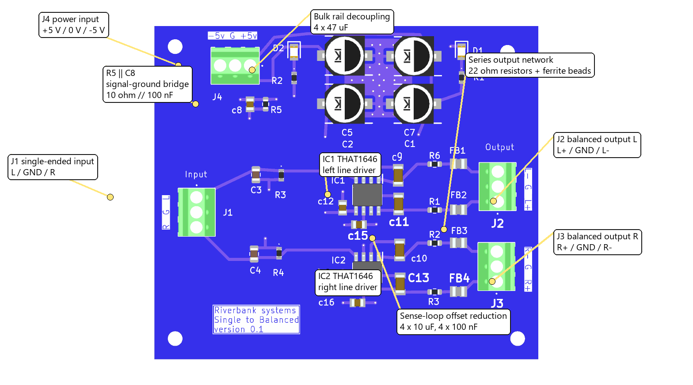
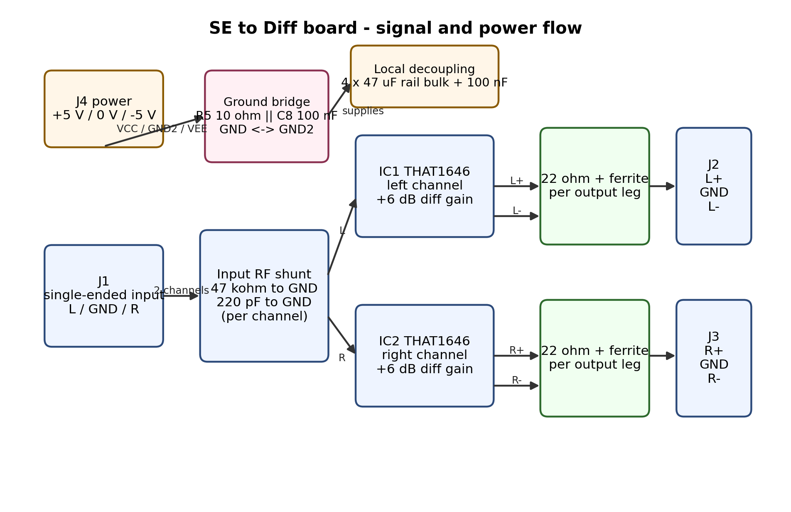
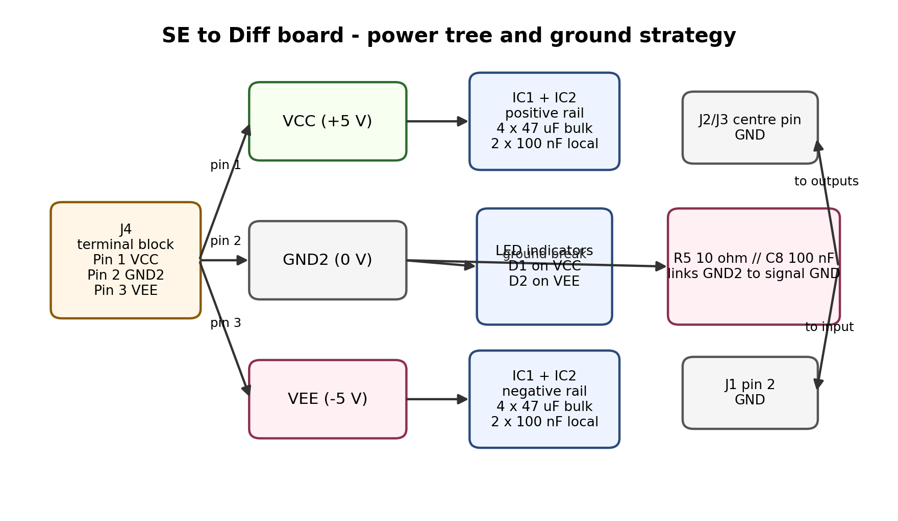

# SE to Diff board: Engineering and Service Document

**Evidence tags:** [K] taken from the KiCad schematic, PCB or part metadata; [D] verified from a manufacturer datasheet retrieved for this document; [C] calculated here from [K]/[D]; [I] inferred, not confirmed; [M] needs measurement on hardware. **Nothing in this document was measured on a physical board.**

## 1. Document information

| Item | Value |
|---|---|
| Board | `Riverbank systems / Single to Balanced / version 0.1` silkscreen [K] |
| Source | `C:\Users\antho\Documents\StreamerDac Project\Documents\kicad\Streamer schematic\ControlBoardTiny\tinyControlBoard\se_to_diff board\se_to_diff board.kicad_sch` and `.kicad_pcb` [K] |
| KiCad source format | KiCad 8.0 project files, analysed with `kicad-cli` 10.0.6 without modifying the source [K] |
| Source dates | Schematic last saved 2026-01-28 21:25:51; PCB last saved 2026-01-29 19:20:37 [K] |
| Revision / title block | Schematic title, date and revision are blank [K] |
| Related | [Open questions](OpenQuestions.md); superseded subsystem note: [Single-Ended to Balanced Line Driver](../../dac-subsystem/SingleEndedToBalancedLineDriver.md) |

This document supersedes the older subsystem-only note for service work on this PCB. One important correction is that the board does **not** present a 47 kOhm line input: the THAT1646 input impedance dominates, so the effective input load is about **4.52 kOhm per channel** [C][D][K].

## 2. Overview

The SE to Diff board is a **two-channel single-ended to balanced line-driver board** [K]. Each channel uses one **THAT1646S08-U** balanced line-driver IC (IC1 left, IC2 right) powered from a **bipolar +5 V / -5 V supply** brought in on J4 as **VCC / GND2 / VEE** [K]. A single-ended stereo input enters on J1, each channel is conditioned by a small RF-shunt network, then converted to balanced outputs that leave on J2 and J3 through **22 ohm series resistors** and **ferrite beads** on every output leg [K].

The board has two different ground nets: **GND2** is the supply mid-point used by the IC supply decoupling, while **GND** is the signal ground used by J1, J2, J3 and IC pin 3. They are linked only by **R5 10 ohm in parallel with C8 100 nF** [K]. This is a deliberate ground-break network, not a solid copper short [K].

Not established from these files: the exact source impedance of the upstream DAC/output stage, the intended cable/shield strategy on J2/J3 pin 2, and the maximum system-level balanced output level required by the rest of the product [M].

## 3. Specifications

| Parameter | Value | Tag |
|---|---|---|
| PCB | 65.0 mm x 56.5 mm, 4 copper layers, 1.6 mm board thickness | [K] |
| Assembly side | All fitted parts are on the top side | [K] |
| Mounting | 4 x 2.5 mm mounting holes | [K] |
| Channels | 2 (left and right) | [K] |
| Supply input | J4 pin 1 = VCC, pin 2 = GND2, pin 3 = VEE | [K] |
| Nominal supply implied by schematic text | +5 V VCC and -5 V VEE relative to GND2 | [K] |
| Driver IC | THAT1646S08-U balanced line driver, SO-8 | [K][D] |
| Driver supply range | -4 V to +18 V allowed; absolute maximum +/-20 V | [D] |
| Driver operating temperature | -40 C to +85 C | [D] |
| Differential gain | +6.0 dB typ. (factor 2) | [D] |
| Driver input impedance | 5.0 kOhm typ. per channel | [D] |
| Added input shunt | 47 kOhm to GND and 220 pF to GND per channel | [K] |
| Effective input impedance seen at J1 | about 4.52 kOhm per channel (`5 kOhm || 47 kOhm`) | [C][D][K] |
| Small-signal bandwidth of THAT1646 | 10 MHz typ. | [D] |
| Datasheet output noise | -101 dBu, 22 Hz to 20 kHz, balanced, measured at +/-18 V test conditions | [D] |
| Datasheet THD+N | 0.0007 % typ. at 1 kHz equivalent test band, 10 Vrms into 600 ohm balanced, measured at +/-18 V test conditions | [D] |
| Output impedance of IC | 50 ohm typ. per leg | [D] |
| Added series resistance | 22 ohm on each output leg, plus ferrite bead | [K] |
| Approximate output impedance at audio frequencies | about 72 ohm per leg, excluding ferrite bead HF behaviour | [C][D][K] |
| Approximate maximum differential output on this +5 V / -5 V board | typ. 3.92 Vrms (+14.1 dBu); guaranteed by no-load swing limits at least 2.97 Vrms (+11.7 dBu) | [C][D] |
| Approximate maximum input before differential clipping | typ. 1.96 Vrms; guaranteed at least 1.48 Vrms, because gain is +6 dB | [C][D] |
| IC quiescent current | 4.9 mA typ. to 5.75 mA max each, unloaded | [D] |
| IC-only quiescent dissipation at +5 V / -5 V | about 57.5 mW per IC, 115 mW total for two ICs | [C][D] |
| Connector family | Phoenix Contact 1725669, 3-way, 2.54 mm pitch screw terminal block; KiCad metadata states 6 A nominal and 160 V (III/2) | [K] |

Notes on the table above:

- The **THD+N and noise values are datasheet figures taken at +/-18 V**, not measured results from this +5 V / -5 V board [D][M].
- The board should be treated as a **low-impedance audio driver stage**, not a high-impedance line input, because the THAT1646 input itself is only about 5 kOhm [D].
- Thermal margin is good in normal use: 57.5 mW in a 150 C/W SO-8 package implies only about **8.6 C** self-heating per IC before PCB heat-spreading is counted [C][D].

## 4. Connectors, controls, indicators and test points

### 4.1 Connectors

| Ref | Function | Pin 1 | Pin 2 | Pin 3 |
|---|---|---|---|---|
| J1 | Single-ended stereo input | `/in L` | `GND` | `/in R` |
| J2 | Left balanced output | `/Sout L +` | `GND` | `/Sout L -` |
| J3 | Right balanced output | `/Sout R +` | `GND` | `/Sout R -` |
| J4 | Power input | `VCC` | `GND2` | `VEE` |

Important service note: **J1/J2/J3 use `GND`, while J4 uses `GND2`** [K]. These are not directly shorted on the PCB; they are linked only through R5 and C8 [K].

### 4.2 Indicators

| Ref | Function |
|---|---|
| D1 + R1 | Positive-rail indicator from VCC to GND2 [K] |
| D2 + R2 | Negative-rail indicator from VEE to GND2 [K] |

The source files do not state LED forward voltage or target brightness. If the schematic value **3 kOhm** is correct, LED current is expected to be low [K][I].

### 4.3 Controls and test points

- No switches, jumpers or adjustable parts are fitted [K].
- No dedicated test points are provided [K]. Service measurements must be taken at connector pins or IC pins [K].
- Useful service nodes are J4 pins 1/2/3, J1 pin 2, J2 pin 2, J3 pin 2, IC1/IC2 pins 5 and 6, and the output nets before and after the ferrite beads [K].

## 5. Functional description

### 5.1 Power and grounding

J4 feeds the board with **+5 V, 0 V, -5 V** on **VCC, GND2, VEE** respectively [K]. The two THAT1646 devices run directly from these rails [K]. VCC has bulk capacitors **C1 and C7 (47 uF each)**, VEE has **C2 and C5 (47 uF each)**, and each IC has local **100 nF** rail bypass capacitors (**C12/C15** for IC1, **C14/C16** for IC2) returned to **GND2** [K].

The supply ground **GND2** is linked to the signal ground **GND** only by **R5 10 ohm || C8 100 nF** [K]. The impedance of that bridge is therefore about **10 ohm at low audio frequencies** and about **8.88 ohm at 20 kHz** [C]. This is useful as a loop-break network, but it also means any return or shield current flowing between `GND` and `GND2` will create a small voltage difference instead of a hard short [C][I].

### 5.2 Input network

Each input channel consists of:

- one **47 kOhm** resistor to GND (R3 left, R4 right) [K];
- one **220 pF** capacitor to GND (C3 left, C4 right) [K];
- direct connection into pin 4 (`IN`) of the THAT1646 [K].

The **220 pF capacitor is an RF shunt**, not an audio low-pass set by 47 kOhm. The audio pole depends on the source impedance feeding J1. For example, the pole would be about **1.21 MHz with a 600 ohm source** and about **723 kHz with a 1 kOhm source** [C].

The important practical result is instead the **heavy input loading**: the THAT1646 itself is about **5 kOhm**, so J1 loads each source with about **4.52 kOhm** in total [C][D][K]. The THAT datasheet explicitly recommends a **low-impedance source, preferably directly from op-amp outputs** [D].

### 5.3 Differential driver stage

IC1 and IC2 are wired very closely to the datasheet's **Figure 5** application for the THAT1646 with common-mode offset reduction [D][K]:

- pin 1 = `OUT-` [K]
- pin 2 = `SNS-`, AC-coupled to `OUT-` through **10 uF** (C9 left, C10 right) [K]
- pin 3 = `GND` [K]
- pin 4 = `IN` [K]
- pin 5 = `VEE` [K]
- pin 6 = `VCC` [K]
- pin 7 = `SNS+`, AC-coupled to `OUT+` through **10 uF** (C11 left, C13 right) [K]
- pin 8 = `OUT+` [K]

With these sense capacitors fitted, the datasheet's common-mode output offset limit improves from **up to +/-250 mV** to about **+/-15 mV max.** [D].

### 5.4 Output network

Each output leg goes through a **22 ohm series resistor** and then a **Murata NFZ2MSD101SZ10L ferrite bead** before reaching J2 or J3 [K]. The mapping is:

- Left channel: `R6` and `22R1`, then `FB1` and `FB2` [K]
- Right channel: `22R2` and `22R3`, then `FB3` and `FB4` [K]

This follows the **spirit** of the THAT1646 datasheet's RFI-protection guidance, but **not the full Figure 8 protection network** [D][K]. The PCB does **not** include the datasheet's recommended **100 pF shunts to chassis** or the optional **1N4004 rail-clamp diodes** for 48 V phantom-power abuse [D][K]. If J2/J3 can ever reach studio wiring, XLR harnesses or other field cabling, that omission should be reviewed [I].

### 5.5 Level and headroom implications

The THAT1646 has **+6 dB differential gain** [D]. On +5 V / -5 V rails, output headroom becomes the dominant limit. Using the datasheet output-swing limits, this board can deliver about:

- **3.92 Vrms differential typ.** (+14.1 dBu) [C][D]
- **2.97 Vrms differential worst-case guaranteed by no-load swing limits** (+11.7 dBu) [C][D]

That means a **2 Vrms single-ended source** would ask the board for **4 Vrms differential output**. This is slightly above the typical calculated swing and clearly above the guaranteed worst-case swing [C][D]. In other words, a modern 2 Vrms consumer DAC may be at or beyond the board's clean headroom limit [C][I].

## 6. Assembly and commissioning

No build or power-up results are claimed here; the following is a suggested service procedure only [M].

1. **Visual inspection** [M]  
   - Confirm J1-J4 are the correct 3-way terminal blocks and are not rotated [K].  
   - Check polarity of **C1, C2, C5, C7** and LEDs **D1, D2** [K].  
   - Check that **IC1** and **IC2** pin 1 orientation matches the PCB footprint [K].
2. **Unpowered resistance checks** [M]  
   - J4 pin 1 to pin 2 and pin 3 to pin 2 should not be short circuits [K].  
   - J1 pin 2 to J4 pin 2 should read about **10 ohm DC** through R5, not a direct short [K][C].
3. **First power application** [M]  
   - Use a current-limited bench supply that provides **+5 V, 0 V and -5 V**.  
   - Check J4 pin 1 to pin 2 = **+5 V** and pin 3 to pin 2 = **-5 V** [K].  
   - Check IC1/IC2 pin 6 to GND2 = **+5 V** and pin 5 to GND2 = **-5 V** [K].  
   - D1 and D2 should light if both rails and LED polarities are correct [K][I].
4. **Signal proving** [M]  
   - Inject a low-level sine wave into J1 pin 1 or pin 3 with J1 pin 2 as signal ground.  
   - Verify that the corresponding output connector presents two equal-amplitude, opposite-phase signals on pins 1 and 3 [D][K].  
   - Keep the input below about **1.5 Vrms** until actual headroom is measured on hardware [C][M].

## 7. Testing and troubleshooting

| Symptom | Likely cause | Check |
|---|---|---|
| Both channels dead, D1 and D2 off | Missing or reversed +5 V / -5 V feed | J4 pin voltages relative to J4 pin 2 [K] |
| Both channels dead, LEDs on | IC supply not reaching pins 5/6, or GND/GND2 not as expected | Measure IC pin 6 to GND2, pin 5 to GND2, and J1/J2/J3 pin 2 to J4 pin 2 resistance [K] |
| One channel dead | Fault in one THAT1646, one input network, or one output network | Compare IC1 against IC2, then trace from J1 to IC input and from IC output to J2/J3 [K] |
| One output leg dead | Open 22 ohm resistor, ferrite bead or connector pin | Check continuity through R6/22R1/22R2/22R3 and FB1-FB4 [K] |
| Distortion with an apparently normal line-level source | Board headroom exceeded on +5 V / -5 V rails | Check input level; clean differential output is only about 3.0 to 3.9 Vrms expected [C][D] |
| Source device becomes heavily loaded or level drops | Upstream source cannot drive about 4.5 kOhm | Measure source behaviour into J1; review whether the source is truly low impedance [C][D] |
| Hum, buzz or shield-current problems | `GND` and `GND2` are only linked by 10 ohm // 100 nF | Check where cable shields are terminated and whether the system expects a direct 0 V bond [K][I] |
| Large DC at J2/J3 outputs | Wrong or open sense capacitors C9/C10/C11/C13, or wrong IC wiring | Compare to datasheet Figure 5 topology and measure DC on both output legs [D][K][M] |

## 8. Repair and rework

- Replace **IC1/IC2 only with the correct THAT1646S08-U** unless an alternative has been electrically re-qualified for this board [K][D]. The datasheet notes pin-compatibility with some other line drivers, but this document does not approve substitutes [D].
- Keep **C9/C10/C11/C13 (10 uF)** and the **100 nF local bypass capacitors** physically close to the IC pins, as in the existing layout [K].
- If a ferrite bead or 22 ohm resistor is damaged, replace like-for-like; do not hard-short around the network without a noise/EMC review [K][I].
- Do not short **GND** and **GND2** permanently during rework unless the full system grounding strategy has been re-reviewed [K][I].
- After any work on the supply area, repeat the section 6 resistance and rail-voltage checks before reconnecting external audio equipment [M].

## 9. BOM reference

The table below is a service reference, not a purchasing release. **Several resistor manufacturer fields in the KiCad source are inconsistent with the schematic values** and should not be trusted until the BOM metadata is corrected [K].

| Ref(s) | Qty | Value / part information | Notes |
|---|---:|---|---|
| IC1, IC2 | 2 | THAT 1646S08-U | Balanced line drivers [K][D] |
| J1-J4 | 4 | Phoenix Contact 1725669 | 3-way, 2.54 mm terminal blocks [K] |
| FB1-FB4 | 4 | Murata NFZ2MSD101SZ10L | Output ferrite beads [K] |
| C1, C2, C5, C7 | 4 | 47 uF, KEMET EDT476M016S9HAA | Rail bulk capacitors [K] |
| C9, C10, C11, C13 | 4 | 10 uF, Kyocera AVX 12063C106KAT2A | Sense-loop capacitors [K] |
| C8, C12, C14, C15, C16 | 5 | 100 nF, 0805YC104M4T2A | Ground bridge and local decoupling [K] |
| C3, C4 | 2 | 220 pF, 0805 | Input RF shunts [K] |
| R1, R2 | 2 | 3 kOhm schematic value | LED resistors; KiCad MPN field appears stale/wrong [K] |
| R3, R4 | 2 | 47 kOhm schematic value | Input shunts; KiCad MPN field appears stale/wrong [K] |
| R5 | 1 | 10 ohm | GND-to-GND2 bridge resistor [K] |
| R6, 22R1, 22R2, 22R3 | 4 | 22 ohm | Output series resistors [K] |
| D1, D2 | 2 | LS R976 red LED | Rail indicators [K] |
| H1-H4 | 4 | 2.5 mm mounting holes | Mechanical only [K] |

## 10. Limitations, risks and open points

Design-check findings from the source files and datasheet review:

1. **This board is easy to overdrive from modern 2 Vrms sources.** With +6 dB gain and only +5 V / -5 V rails, calculated clean differential output is roughly **+11.7 to +14.1 dBu** [C][D]. A 2 Vrms input asks for about **4 Vrms differential output**, which is at or beyond that range [C][D].
2. **The input is low impedance.** The effective load is only about **4.52 kOhm/channel**, not 47 kOhm [C][D][K]. Upstream circuitry should therefore be an active low-impedance source, not a passive attenuator or a lightly loaded DAC output [D][I].
3. **Ground strategy must be intentional.** J1/J2/J3 use `GND`, J4 uses `GND2`, and the only bridge is **10 ohm || 100 nF** [K]. That can help loop control, but it can also create audible or EMC-related ground voltage if cable shield currents are significant [C][I].
4. **The board omits the full datasheet protection network.** The THAT1646 datasheet shows optional **100 pF-to-chassis** RFI shunts and **1N4004** rail clamps for phantom-power abuse; this PCB has neither [D][K].
5. **KiCad resistor metadata is inconsistent.** R1-R4 all carry the same Panasonic **300 ohm** part metadata even though the schematic values are **3 kOhm** and **47 kOhm** [K]. This is a documentation/BOM risk during servicing.
6. **Connector voltage/current figures were available only from KiCad part metadata in this review.** Direct automated retrieval of the Phoenix product page was blocked, so those connector ratings should be rechecked manually before formal release documentation [K][M].
7. **No physical measurements exist yet.** Actual headroom, output noise, LED current, shield-current behaviour and DC offsets on built boards remain to be verified [M].

The superseded subsystem note is mostly consistent with the KiCad source, but it does not mention findings 1, 2, 5 or 6 above, and its wording that the `47 kOhm // 220 pF` network "sets the input impedance" is incomplete for service use because the THAT1646 input dominates the load [K][D][C].

## 11. References and revision history

### References

1. KiCad source files for `se_to_diff board.kicad_sch` and `se_to_diff board.kicad_pcb` [K].
2. THAT Corporation, **THAT 1606, 1646 Balanced Line Driver ICs**, Document 600078 Rev. 05 [D].
3. Existing subsystem note: [Single-Ended to Balanced Line Driver](../../dac-subsystem/SingleEndedToBalancedLineDriver.md) [K].

### Revision history

| Revision | Date | Notes |
|---|---|---|
| A | 2026-10-11 | First engineering and service issue created from KiCad source review, ERC/DRC runs, datasheet review and desk calculations. |
