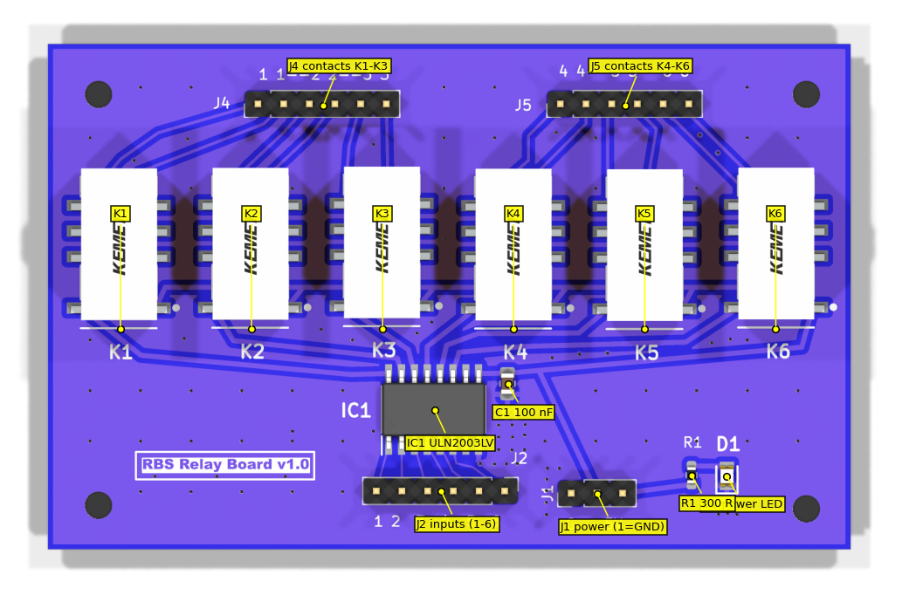
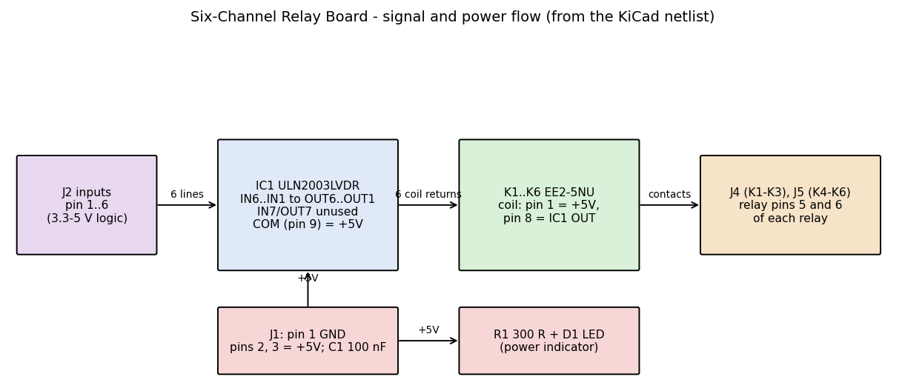

# Six-Channel Relay Board – Engineering and Service Document

**Evidence tags:** [K] taken from the KiCad project; [D] manufacturer datasheet; [C] calculated here; [I] inferred, not confirmed; [M] needs measurement on hardware. **Nothing in this document was measured on a physical board.**

## 1. Document information

| Item | Value |
|---|---|
| Board | RBS Relay Board v1.0 (silkscreen) [K] |
| Source | `...\ControlBoardTiny\tinyControlBoard\RelayBoard\RelayBoard` (`RelayBoard.kicad_sch`, `.kicad_pcb`, `production\bom.csv`, `positions.csv`) |
| Tool | Schematic/PCB files written by KiCad 8.0 format; analysed with kicad-cli 10.0.6 |
| Source dates | PCB and schematic last saved 19 July 2025; production export 30 July 2025 [K] |
| Revision / date | No revision or date text exists in the schematic title block [K] |
| Related | [Circuit board reference](../../CircuitBoardReference.md), [Open questions](OpenQuestions.md), [Tiny Control Board](../TinyControlBoard/TinyControlBoard-EngineeringAndService.md) |

## 2. Overview

A six-channel, low-side-driven relay board. One ULN2003LVDR driver (IC1) switches the coils of six KEMET EE2-5NU 5 V signal relays (K1–K6). Each relay brings **one contact pair** out to a 2.54 mm pin header (J4 for K1–K3, J5 for K4–K6). Logic inputs arrive on J2; 5 V power and ground arrive on J1. A red LED (D1) with R1 indicates that power is present [K].

Not established from these files: what drives J2 and what is connected to J4/J5 in the complete streamer. The link to the Tiny Control Board J6 outputs is a design intent that must be confirmed against that board's documentation.

## 3. Specifications

| Parameter | Value | Tag |
|---|---|---|
| Board size | 79.375 × 50 mm, two layers, 1.6 mm | [K] |
| Mounting | 4 × M2.5 holes (2.7 mm) | [K] |
| Supply | Nominal 5 V (coil rating, silkscreen "5V"). The schematic net has no name (auto-named `Net-(IC1-COM)`) | [K][D] |
| Relay coil | 178 Ω ±10 % at 20 °C, operate 3.75 V, release 0.50 V, ≈ 140 mW | [D] |
| Coil current | ≈ 28 mA each at 5.0 V; ≈ 169 mA for all six | [C] |
| LED current | (5 V − Vf) / 300 Ω; a few mA, Vf not verified | [C] |
| Driver limits | 100 mA/channel at 3.3 V drive, 140 mA at 5 V drive; input absolute maximum 5.5 V; output/COM 8 V | [D] |
| Driver input thresholds | On ≥ 1.65 V; off ≤ 0.6 V; inputs have internal pull-downs | [D] |
| Relay contacts | 2 A, 30 W / 62.5 VA, up to 220 VDC / 250 VAC switching voltage, minimum load 10 mV / 10 µA | [D] |
| Relay timing | Operate ≈ 2 ms, release ≈ 1 ms | [D] |
| Coil-to-contact isolation | 1500 VAC (relay itself) | [D] |
| Ambient | Relay −40 to +85 °C; IC −40 to +85 °C | [D] |

Margin check [C]: 28 mA per channel is about a quarter of the 100 mA per-channel rating; total 169 mA is far below the 1 A ground-pin limit; IC dissipation is well under the 0.58 W allowed at 85 °C.

## 4. Connectors, controls and indicators

All connectors are **2.54 mm vertical pin headers**, not screw terminals [K] (this corrects the earlier summary).

| Ref | Type | Pin | Function |
|---|---|---|---|
| J1 | 1×3 header ("Out") | 1 | GND |
| | | 2, 3 | Supply (+5 V), both pins on the same net |
| J2 | 1×6 header | 1 | `/Relay 1 in` → IC1 IN6 → K6 |
| | | 2 | → IC1 IN5 → K5 |
| | | 3 | → IC1 IN4 → K4 |
| | | 4 | → IC1 IN3 → K3 |
| | | 5 | → IC1 IN2 → K2 |
| | | 6 | `/Relay 6 in` → IC1 IN1 → K1 |
| J4 | 1×6 header | 1–2 / 3–4 / 5–6 | K1 / K2 / K3 contact pair |
| J5 | 1×6 header | 1–2 / 3–4 / 5–6 | K4 / K5 / K6 contact pair |

**Input numbering is reversed relative to the relays**: J2 pin 1 operates K6 and J2 pin 6 operates K1 [K]. The net names `/Relay 1 in` and `/Relay 6 in` do not match the relay they drive. Check the harness numbering before use.

Silkscreen: "1 2 3 4 5 6" at J2, "G" and "5V" at J1, "1 1--2 2--3 3" at J4 and "4 4--5 5--6 6" at J5 [K]. Each "n--m" pair marks the two pins of one relay's contact.

Indicators: D1 (red) lights when the supply is present; it does not show relay state [K]. There are no controls and no dedicated test points [K].

## 5. Functional description

1. **Power.** J1 pin 1 is ground; J1 pins 2 and 3 supply the board. The supply net feeds IC1 COM (pin 9), pin 1 of every relay coil, R1 and C1 (100 nF to GND) [K].
2. **Drive.** A logic high at a J2 pin turns on the matching IC1 channel. The output pulls relay coil pin 8 low and the relay operates [K][D]. The internal clamp diodes return to COM (the supply), which gives flyback protection [D].
3. **Unused channel.** IC1 IN7 (pin 7) and OUT7 (pin 10) are unconnected. Unused inputs have internal pull-downs [D].
4. **Contacts.** The relay is a 2 Form C part [D]. Only footprint pins 5 and 6 are routed out. By pad geometry these map to datasheet pins 8 and 9 (pole B, normally-open and common) [I]. The expected behaviour is therefore **normally open**: contact closed when the relay is energised. Confirm by continuity test [M].
5. **Mapping.** J2 pin n operates relay K(7−n). The relay's contact pair appears on J4 (K1–K3) or J5 (K4–K6) as shown in section 4.

## 6. Assembly and commissioning

Before power [M]:
1. Inspect for solder bridges at IC1 (SOIC-16, 1.27 mm pitch) and the relay pins.
2. Check resistance between J1 pin 1 and pins 2/3 for a short.
3. Check that IC1 pin 1 orientation matches the PCB marking, and the LED polarity.

First power-up (suggested procedure, not a result):
1. Apply 5 V through a current-limited supply; with all inputs low expect only LED current (a few mA).
2. Drive J2 pin 6 high; K1 should click, supply current should rise by about 28 mA [C], and J4 pins 1–2 should close [I].
3. Repeat for each input in turn and record which contact pair closes. Confirm the reversed numbering in section 4.
4. Operate all six together; expect about 170 mA [C].

## 7. Testing and troubleshooting

| Symptom | Likely cause | Check |
|---|---|---|
| LED off | No supply, wrong J1 pin order, R1/D1 fault | Voltage J1 pin 2 to pin 1; D1 orientation |
| No relay operates | IC1 not powered or ground open; input voltage < 1.65 V | IC1 pins 8 and 9; input level at IC1 [D] |
| One relay never operates | Open track or solder on IC1 output; failed coil (≈ 178 Ω expected) | Coil resistance between relay pins 1 and 8 |
| Wrong relay operates | Input numbering reversed (by design) | Section 4 table |
| Relay operates but contact stays open | Contact pair uses datasheet pins 8/9, which are normally open when de-energised | Continuity with relay energised [I] |
| Relay chatters | Supply sag; no bulk capacitor on the board | Scope the supply at J1 [M] |
| Contact stays closed | Welded contact after overload, or wrong pole | Measure with the relay off |
| Input always high | Driving source fault; inputs have internal pull-downs [D] | Disconnect J2 and re-test |

## 8. Repair and rework

- Use a rework station suitable for SOIC-16 for IC1. Check the manufacturer's soldering guidance for the relays before reworking them (not reviewed here).
- Replacement relay: KEMET/YAGEO EE2-5NU (5 V non-latching, 2 Form C). Do not substitute a latching or different-voltage coil.
- Replacement driver: ULN2003LVDR. Other ULN2003 variants have different input thresholds; verify against the datasheet before substituting.
- After any rework repeat the section 6 checks.

## 9. BOM reference [K]

| Ref | Qty | Value | Footprint |
|---|---|---|---|
| C1 | 1 | 100 nF | 0805 |
| D1 | 1 | LS R976 (red LED) | 0805 (LEDC2012X40N) |
| R1 | 1 | 300 Ω | 0603 |
| IC1 | 1 | ULN2003LVDR | SOIC-16 |
| K1–K6 | 6 | EE2-5NU | EE2-5NU |
| J1 | 1 | 1×3 header (value field "Out") | 2.54 mm vertical |
| J2, J4, J5 | 3 | 1×6 header (value field "Buffer") | 2.54 mm vertical |
| H1–H4 | 4 | M2.5 mounting hole | 2.7 mm |

The BOM has no supplier part numbers (LCSC column empty). The "Out" and "Buffer" values are labels, not part descriptions.

## 10. Limitations, risks and open points

Design-check findings (not test results):

1. **Mains-voltage suitability not established.** The relay contacts are rated to 250 VAC [D], but the board uses 2.54 mm pin headers and signal-level spacing. Do not use for mains without a creepage and clearance review [M].
2. **Supply net is unlabelled** and no power flag exists, which gives the ERC warning `power_pin_not_driven` [K].
3. **No input protection or reverse-polarity protection** on J1 or J2. Input drive must not exceed 5.5 V [D].
4. **Decoupling:** one 100 nF capacitor for up to ≈ 170 mA of switching load, no bulk capacitor [C]. Adequacy depends on the supply wiring [M].
5. **Input numbering is reversed** against the relay numbering (section 4) [K].
6. **Contact configuration is inferred** (pole B, normally open) from pad geometry [I]; the second pole is unused.
7. **PCB:** DRC reports 23 warnings and no errors. 20 are silkscreen text-thickness warnings (rule set oddity), 2 are dangling vias on GND and 1 a 0.177 mm dangling track on `Net-(J4-Pin_3)` near (99.9, 51.95) [K]. ERC: 0 errors, 1 power-pin warning, 1 symbol mismatch (LED_Small) and 6 footprint-link warnings that come from the analysis environment.
8. **J1 pins 2 and 3 are the same net** — do not feed two different supplies.
9. The earlier summary page said "one switched contact pair", "screw terminals" and "details read from a screenshot". These are superseded by this document.

## 11. References and revision history

- Texas Instruments, ULN2003LV datasheet, SLRS059B.
- KEMET/YAGEO, EC2/EE2 relay datasheet R7002_EC2_EE2.
- KiCad project files listed in section 1.

| Version | Change |
|---|---|
| 1.0 | First engineering and service document, written from the KiCad files and datasheets. No hardware measurements. |

