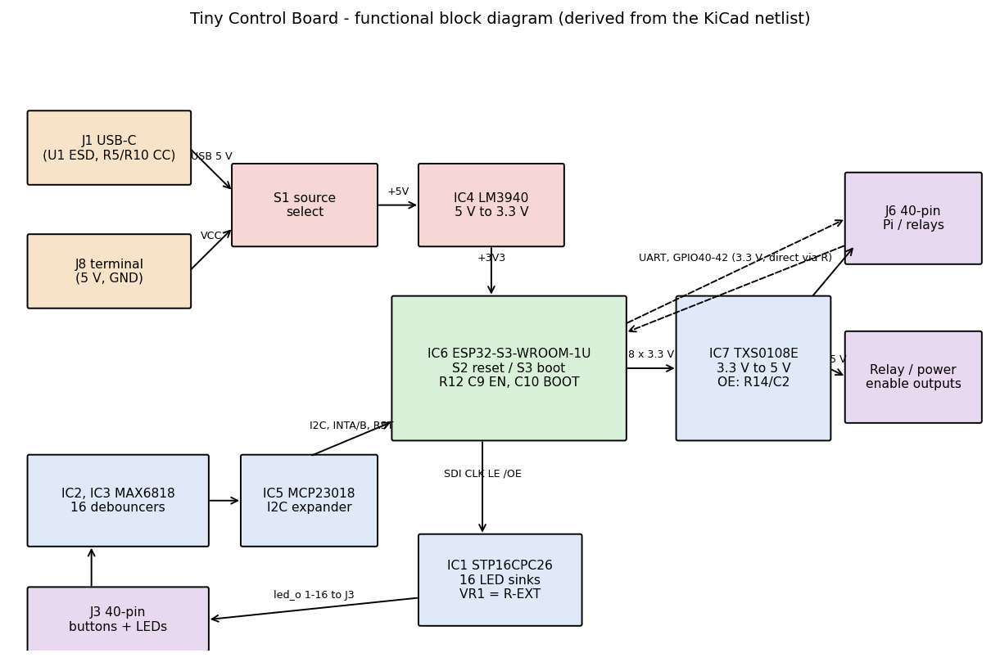
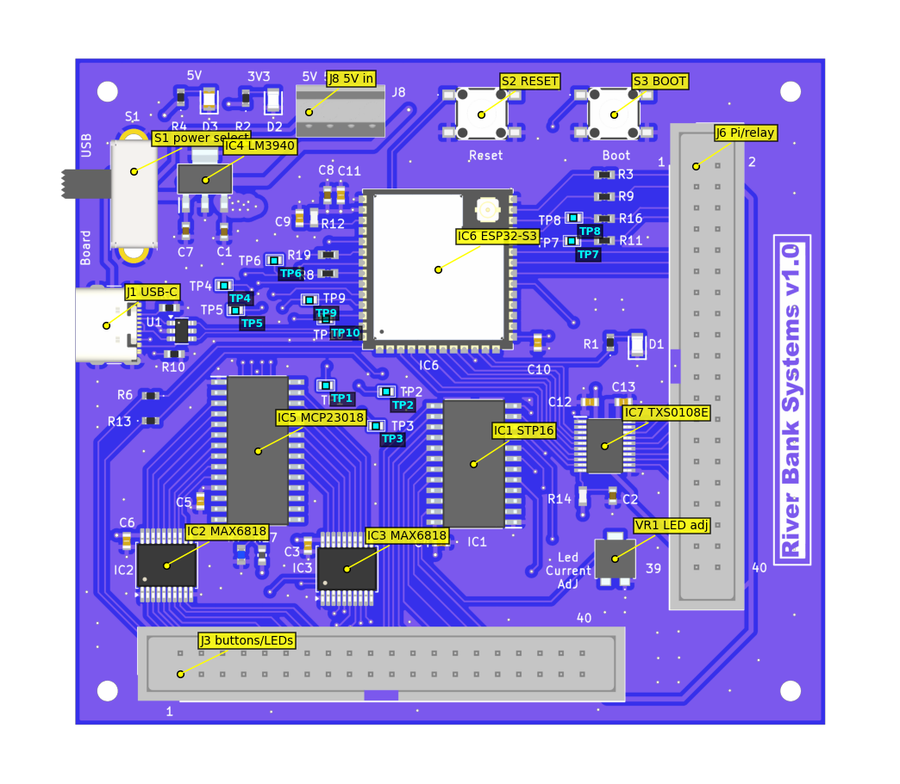
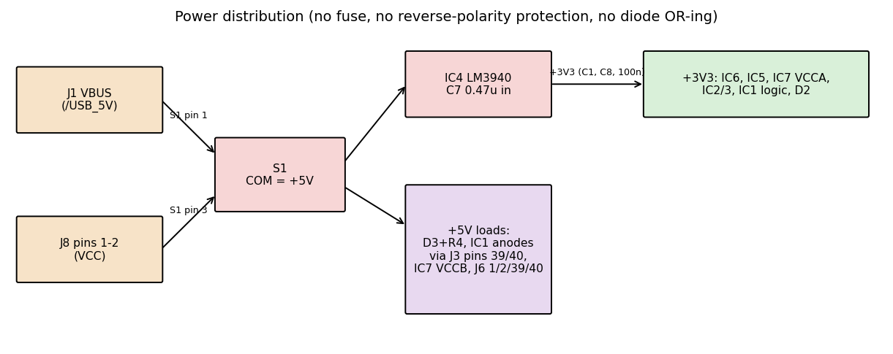

# 1. Document information

| Item | Value | Evidence |
|---|---|---|
| Product | Tiny Control Board for RPi 4 – control board for Streamer DAC | KiCad title block |
| Silkscreen marking | "River Bank Systems v1.0" | KiCad PCB |
| Schematic date | 2024-08-08 (single A3 sheet, no revision field) | KiCad |
| KiCad source format | KiCad 8.0 files (opened and analysed with kicad-cli 10.0.6; sources not modified) | KiCad |
| Source project | `ControlBoardTiny\tinyControlBoard` (`.kicad_sch`, `.kicad_pcb`, `Bom.csv`) | – |
| Intended readers | Engineers, assemblers and service technicians | – |

**Evidence labels used throughout**

| Label | Meaning |
|---|---|
| **[K]** | Established from the KiCad schematic, PCB or BOM |
| **[D]** | Verified from a manufacturer datasheet that was read for this document |
| **[C]** | Calculated from [K]/[D] values (working shown) |
| **[I]** | Inferred; plausible but not proven |
| **[M]** | Needs measurement or firmware confirmation on a physical board |

> **Scope and limits.** No physical board was measured and no firmware was inspected. Nothing in this document is a test result. Where a value is not in the project files it is stated as *not established*. Open points are collected in [OpenQuestions.md](OpenQuestions.md).

# 2. Overview

The Tiny Control Board is the user-interface and sequencing controller of the Streamer DAC. An **ESP32-S3-WROOM-1U-N16** module (IC6) [K]:

- scans 16 front-panel buttons, debounced by two MAX6818 devices (IC2, IC3) and read through an MCP23018 I²C expander (IC5);
- drives 16 button/indicator LEDs through an STP16CPC26 constant-current sink (IC1) with PWM dimming;
- drives eight control lines at 5 V through a TXS0108E level shifter (IC7), for relays, DAC, screen, Raspberry Pi and output-stage power sequencing;
- talks to the Raspberry Pi 4 over a UART and three handshake lines on J6;
- has a USB-C port (J1) wired to the ESP32-S3 native USB (D+/D−), and its own boot and reset buttons.

The board is powered from a 5 V terminal (J8) or from USB-C VBUS, selected by slide switch S1, and makes 3.3 V with an LM3940 (IC4).

# 3. Specifications

| Parameter | Value | Evidence |
|---|---|---|
| PCB | 4 layers, 1.6 mm; F.Cu signal, In1.Cu GND, In2.Cu +3V3, B.Cu GND | [K] |
| Outline | 90 mm × 80 mm; four M2.5 mounting holes (H1–H4) | [K] |
| Assembly | All components on the top side | [K] |
| Input voltage | 5 V nominal on J8 or USB VBUS. LM3940 input range 4.5–5.5 V, absolute maximum 7.5 V | [K]/[D] |
| Logic supply | +3V3 from IC4 LM3940IMPX-3.3, 1 A rated, 3.20–3.40 V at 25 °C | [D] |
| ESP32 module supply | 3.0–3.6 V; supply must deliver ≥ 0.5 A | [D] |
| Power protection | None: no fuse, reverse-polarity or OR-ing diode on J8/USB | [K] |
| Control outputs to J6 | 8 × 5 V level-shifted (IC7 VCCB = +5V) | [K] |
| Pi interface levels | UART and J6-9/11/12 are 3.3 V direct from the ESP32 (no level shifter) | [K] |
| MCP23018 I²C address | 0x20 (ADDR divider 0.206 V) | [C]/[I]; confirm with an I²C scan [M] |
| Idle/active current, LED current, temperature range | Not established | – |

**Design checks (calculated or datasheet-derived)**

| Check | Result | Evidence |
|---|---|---|
| ADDR divider R7 1 kΩ / R17 15 kΩ from 3.3 V | 3.3 × 1/(1+15) = 0.206 V, inside the 0.00–0.23 V window for address bits 0 (schematic note and MCP23018 Fig. 1-3) | [C]/[D] |
| TXS0108E OE delay R14 10 kΩ × C2 10 µF | τ = 100 ms; rises past 0.65 × 3.3 V ≈ 2.15 V after ≈ 105 ms | [C] |
| LM3940 output capacitance | Datasheet requires ≥ 33 µF with ESR in a specified window. Board has C1 0.33 µF + C8 10 µF + 6 × 100 nF ≈ 10.9 µF, all ceramic | [D]/[K] – **deviation** |
| LED current (STP16) | I = 18 × 1.24 V / R-EXT is the formula recalled from memory; the STP16CPC26 datasheet could not be downloaded, so this is **not verified**. See §6.4 | [I] |

# 4. Connectors, controls and test points

## 4.1 J8 – 5 V input (Phoenix 1725672, 4-way terminal block) [K]

| Pin | Net | Note |
|---|---|---|
| 1, 2 | VCC | 5 V in; switched by S1 position 3 |
| 3, 4 | GND | |

Silkscreen shows "5V 5V G G". There is no reverse-polarity protection.

## 4.2 S1 – power source select (EG1206A slide switch) [K]

| S1 pin | Net |
|---|---|
| 1 | /USB_5V (J1 VBUS via U1 protection node) |
| 2 (COM) | +5V rail |
| 3 | VCC (J8) |

One position connects USB to the rail; the other connects J8. Which physical slide direction is which is **not established** [M].

## 4.3 J1 – USB-C (GCT USB4105-GF-A) [K]

| Signal | Connection |
|---|---|
| VBUS (A4/A9/B4/B9) | /USB_5V |
| CC1 / CC2 | R5 / R10, 5.1 kΩ to GND (presents as a sink/UFP) |
| D+ / D− | U1 USBLC6-2SC6, then ESP32 IO20 (USB_P) / IO19 (USB_N) |
| SBU1/SBU2 | Not connected |
| Shield | GND |

## 4.4 J3 – front panel: buttons and LEDs (Molex 70246-4001, 2×20, 2.54 mm) [K]

Pin 1 is at the bottom-left of the board as viewed from the top, and pin 40 at the right end; the silkscreen shows "1" and "40". Which row is odd/even is **to be confirmed** [M].

| Pins | Function |
|---|---|
| 1 | on_led via R6 300 Ω from ESP IO3 |
| 2 | standby_led via R13 300 Ω from ESP IO4 |
| 3,5,7,…,17 | btn_in_9 … btn_in_16 |
| 4,6,8,…,18 | btn_in_1 … btn_in_8 |
| 19 | led_o_1 |
| 21, 23, 25, 27, 29, 31, 33 | led_o_2 … led_o_8 |
| 20, 22, 24, 26, 28, 30 | led_o_9 … led_o_14 |
| 32 | **led_o_16** |
| 34 | **led_o_15** (16 and 15 appear swapped; see Open Questions) |
| 35–38 | GND |
| 39, 40 | +5V (LED anodes) |

Buttons are switches to GND; LEDs are wired anode to +5V, cathode to the STP16 output [K]. LED return/polarity for pins 1 and 2 is stated in the schematic note as LED anode on the pin and return to a ground pin [K].

## 4.5 J6 – Raspberry Pi and external control (Molex 70246-4001, 2×20) [K]

Silkscreen: "1" and "2" at the top end, "39"/"40" at the bottom; odd pins on the left column, even on the right as viewed from the top [K, from render].

| Pin | Net | Direction / note |
|---|---|---|
| 1, 2, 39, 40 | +5V | |
| 3 | Serial Tx | ESP IO2 via R9 22 Ω |
| 4 | Serial Rx | ESP IO1 via R3 22 Ω |
| 5 | Debug TX | ESP TXD0 via R16 22 Ω (TP8) |
| 6 | Debug RX | ESP RXD0 via R11 22 Ω (TP7) |
| 9 | rpi4_data_ready | Pi → ESP (IO42): Pi has received messages |
| 11 | esp_ir_sent | ESP (IO41) → Pi: messages waiting |
| 12 | rpi_state | ESP IO40 |
| 16 | – | Not connected |
| 21 | relay_gen_1_out | IC7 B2 (from IO47) |
| 23 | dac_on_out | IC7 B3 (IO14) |
| 25 | screen_on_out | IC7 B4 (IO13) |
| 27 | dac_power_out | IC7 B5 (IO12) |
| 29 | rpi_power_out | IC7 B6 (IO11) |
| 31 | protodac_en_out | IC7 B7 (IO10) |
| 33 | output_stage_out | IC7 B8 (IO9) |
| 35 | gen_relay_1_out | IC7 B1 (IO39 *relay_gen_2*) – name mismatch, see Open Questions |
| 7, 8, 10, 13–15, 17–20, 22, 24, 26, 28, 30, 32, 34, 36–38 | GND | |

Signal directions for 9 and 11 come from the schematic note. Direction of 12 is not documented [I: ESP → Pi].

## 4.6 Controls and test points [K]

| Item | Function |
|---|---|
| S2 | Reset: pulls EN to GND (R12 10 kΩ pull-up, C9 100 nF) |
| S3 | Boot: pulls IO0 to GND (C10 100 nF to GND; no external pull-up) |
| VR1 | Bourns 3214G-1-103E 10 kΩ, silkscreen "Led Current Adj"; wiper to STP16 R-EXT, CCW end to GND, CW end open |
| TP1 | stp_clk (after R19) |
| TP2 | stp_le |
| TP3 | stp_sdi |
| TP4 | mcp_sda |
| TP5 | mcp_reset |
| TP6 | mcp_clk |
| TP7 | RXDO (debug UART RX) |
| TP8 | TXDO (debug UART TX) |
| TP9 | IntA |
| TP10 | IntB |
| D1 (green) | /app_active from IO48 via R1: "blinks when software OK" |
| D2 (green) | +3V3 present, via R2 |
| D3 (red) | +5V present, via R4 300 Ω |

No dedicated GND test point exists; use J8 pins 3/4 or a connector ground pin. Nets 3V3 and 5V have no test point [K].

# 5. Functional description

## 5.1 Power

- S1 selects J8 (VCC) or USB VBUS onto the +5V rail [K]. 5 V is routed as 0.5–1 mm traces; +3V3 is distributed on In2 plus 0.5/2 mm traces [K].
- IC4 LM3940 (SOT-223) makes +3V3; C7 0.47 µF at its input matches the datasheet recommendation [D]. Output capacitors are discussed in §3 and Open Questions.
- LM3940 junction-to-ambient 59.3 °C/W (SOT-223) [D]. Dissipation = (5 − 3.3) V × I₃V₃. Example: 0.3 A gives about 0.51 W, a rise of roughly 30 °C [C]. The real 3.3 V load is not established [M].
- Powering from USB and J8 simultaneously is prevented only by S1 [K].

## 5.2 ESP32-S3 (IC6)

- Module is the "1U" variant, with a U.FL antenna connector [K].
- EN: R12 10 kΩ pull-up, C9 100 nF, S2 reset [K]. BOOT/IO0: S3 plus C10 100 nF; the schematic note says C10 "may" be removed "to prevent esp32 from failing to boot on power application" [K], a designer-acknowledged risk.
- Strapping pins [D]: IO0 (weak pull-up), IO3 (no internal pull, selects JTAG source), IO45 and IO46 (weak pull-down). IO45/46 are unconnected here [K]. **IO3 drives the on_led output through R6**, so the LED circuit loads a strapping pin; the effect on boot is not established [M].
- IO35–IO37 are unused (reserved on the N16 module) [K].
- Debug UART0 (TXD0/RXD0) goes to J6 pins 5/6 and TP7/TP8; the application UART uses IO1/IO2 (J6 pins 3/4) [K].
- USB D−/D+ on IO19/IO20 through U1 and the CC pull-downs support native USB programming [K].

## 5.3 Button input chain

- J3 button pins are switches to GND. IC2 and IC3 (MAX6818, SSOP-20) debounce buttons 1–8 and 9–16. /EN is tied to GND (enabled); /CH is not connected [K].
- IC2/IC3 outputs (`btn_l_1`–`16`) feed IC5 GPB0–7 and GPA0–7. Which logic level represents "pressed", and the debounce time, are MAX6818 properties not verified here (datasheet not retrieved) [M].
- IC5 MCP23018 (SOIC-28): SDA = IO16, SCL = IO15 via R8 22 Ω, RESET = IO17, INTA = IO18, INTB = IO8 [K]. ADDR from the R7/R17 divider (0.206 V) gives 0x20 [C]/[D].
- **I²C has no external pull-up resistors** on the board. SDA/SCL depend on ESP32 internal pull-ups, which is marginal at 400 kHz [K]/[I]. MCP23018 outputs are open-drain [D]. RESET has no pull-up and floats until firmware drives IO17 [K].

## 5.4 LED driver

- IC1 STP16CPC26: SDI = IO7, CLK = IO6 via R19 22 Ω, LE = IO5, /OE = IO21 (PWM dimming), SDO = IO38 [K]. OUT0–OUT15 map to `led_o_1`–`16` on J3 [K].
- R-EXT is set only by VR1's wiper; there is **no fixed series resistor** [K]. At the CCW end the wiper resistance is about 0 Ω, so the programmed current would be at or beyond the device maximum [I]; at 10 kΩ it is very low. Set VR1 **mid-range or higher** before connecting a front panel, then adjust under measurement (§6.4) [M].
- The existing short summary states that VR1 "sets brightness of all LEDs"; the netlist confirms it sets the common current-setting resistor, so it sets the maximum current of all outputs.

## 5.5 Level shifter and sequencing outputs

- IC7 TXS0108E: VCCA = +3V3, VCCB = +5V. A1–A8 come from IO39 (relay_gen_2), IO47 (relay_gen_1), IO14, IO13, IO12, IO11, IO10, IO9 [K].
- OE (pin 10) is pulled up to +3V3 through R14 with C2 10 µF to GND, so the outputs enable about 0.1 s after 3.3 V appears [C].
- The TXS0108E datasheet recommends OE be pulled down during power up, to keep Hi-Z [D]. This board does the opposite on purpose. State of J6 outputs while the ESP32 boots is not established, and the TXS0108E has weak internal pull-ups (≈4 kΩ while high, ≈40 kΩ while low) and low drive [D]. Downstream relay inputs should be high-impedance; verify with a scope on J6 pins 21–35 while powering up [M].

## 5.6 Handshake with the Raspberry Pi

`esp_ir_sent` (ESP → Pi, J6-11) requests an interrupt to tell the Pi that messages are waiting; `rpi4_data_ready` (Pi → ESP, J6-9) tells the ESP that messages have been received [K, schematic note]. The 3.3 V outputs go straight to the Pi 3.3 V GPIO [K]; do not connect 5 V loads to them.

# 6. Assembly and commissioning

## 6.1 Equipment

Bench supply with current limit, multimeter, oscilloscope, USB-C cable, 16-LED/button front panel or test jig, 3-pin 3.3 V USB-UART adapter (for J6-5/6 or TP7/TP8).

## 6.2 Before power

1. Inspect the board for solder bridges on IC1, IC2, IC3, IC5, IC7 (fine pitch) and the ESP32 module ground pad [K: 9 GND pads].
2. **R1/R2**: the BOM labels them "100R", but their manufacturer part number ERJ-H3EF1200V is a **120 Ω** part. Fit and check the actual value [K]. LED current is (3.3 − Vf)/R; with 120 Ω this is lower than 100 Ω.
3. Check resistance between +5V and GND, and +3V3 and GND, with power off (no shorts).
4. Set VR1 to about mid-travel (see §5.4).
5. Disconnect J3 and J6 for the first power-up.

## 6.3 First power-up (suggested sequence – not a validated procedure)

| Step | Action | Expected |
|---|---|---|
| 1 | Set S1 to J8; apply 5.0 V with a 200 mA limit | D3 (red) lights |
| 2 | Measure +3V3 (IC4 output, C1) | 3.20–3.40 V [D]; D2 lights |
| 3 | Scope +3V3 at C8 | No oscillation (see the LM3940 output-capacitor deviation) [M] |
| 4 | Measure IC7 pin 10 (OE) | Rises to 3.3 V after about 0.1 s [C] |
| 5 | Connect USB (S1 to USB), check enumeration | Native USB device appears once firmware runs |
| 6 | Flash firmware (hold S3 Boot, tap S2 Reset) | Download mode over USB or UART0 |
| 7 | After boot, D1 blinks | "Software OK" per schematic note |

Expected current, boot-time behaviour and normal-operation values are not established.

## 6.4 LED current calibration

1. Obtain the STP16CPC26 datasheet and confirm the R-EXT equation and limits (**not done in this document**).
2. With the front panel connected and VR1 at a safe setting, measure R-EXT (wiper-to-GND) with power off, then measure LED current at one output with firmware driving it on.
3. Use the lowest current that gives acceptable brightness. The 0.5 mm 5 V traces and the LM3940 are not designed for an unbounded LED current.
4. Record the final R-EXT value in the build record.

# 7. Testing and troubleshooting

## 7.1 Test point reference

See §4.6. Use TP4/TP6 for I²C, TP1–TP3 for the LED driver bus, TP7/TP8 for the debug UART, TP9/TP10 for MCP23018 interrupts, TP5 for MCP23018 reset.

## 7.2 Fault table

| Symptom | Possible cause | Check |
|---|---|---|
| No LEDs lit, no 5 V | S1 on the wrong source, J8 polarity or supply off | Voltage at S1 pin 2; J8 pins |
| D3 on, D2 off | IC4 failure, +3V3 short or overload | +3V3 to GND resistance; IC4 temperature |
| D2 on, D1 never blinks | Firmware not running; boot-mode strap issue (IO0 held low by C10/S3 fault; IO3 loaded by LED) | EN, IO0 levels; UART0 boot log on TP7/TP8 |
| Intermittent boot on power application | C10 (BOOT) slows IO0 at power-on (designer's note) | Scope IO0/EN during power-up; try without C10 [M] |
| Resets or brown-outs when Wi-Fi starts | LM3940 output capacitance outside datasheet limits, supply sag | Scope +3V3 during radio activity |
| USB not recognised | CC resistors, D+/D− swapped, U1, J1 solder | R5/R10 at 5.1 kΩ; IO19/IO20 continuity |
| Buttons dead | IC2/IC3 power or /EN, I²C, MCP23018 address/reset | TP4/TP6 activity, TP5 level, ADDR ≈ 0.206 V |
| Wrong I²C device or no response | ADDR divider wrong (R7/R17), no pull-ups | Measure ADDR; check SDA/SCL idle high |
| LEDs very dim or out | VR1 too high resistance, /OE (IO21) held high, LE/CLK/SDI | Voltage at R-EXT; TP1–TP3 |
| LEDs too bright or IC1 hot | VR1 too low | See §6.4 |
| Last two LEDs swapped | J3 pins 32 and 34 wiring (led_o_16 and led_o_15) | Compare with the front panel loom |
| Relay or power outputs misbehave at boot | OE timing, floating A-side pins, TXS0108E weak drive | Scope J6 pins 21–35 during power-up |
| Pi handshake fails | Wrong direction assumption; GND missing | J6-9, J6-11, J6-12 and GND |

# 8. Repair and rework

- All parts are surface mount on the top side except the connectors and terminal block (through-hole) [K]; standard hot-air/iron rework applies.
- The ESP32 module has nine GND pads under it [K]; use pre-heat and hot air.
- **After replacing IC4**, verify the output with the oscilloscope.
- If C10 is removed to cure boot problems, record it as a build variant; the design note says it "may" be removed.
- Replacing R7 or R17 changes the I²C address.
- After any rework run the §6.3 sequence.

# 9. Bill of materials reference

Quantities from `Bom.csv` and the netlist [K].

| Ref | Value / part |
|---|---|
| C1 | 0.33 µF, 0603YC334JAT2A (LM3940 output side) |
| C2, C8 | 10 µF, 0603YD106MAT2A |
| C3–C6, C9–C13 | 100 nF, C0603C104K4RAC3190 (9 off) |
| C7 | 0.47 µF, GCM188R71C474KA55J (LM3940 input) |
| D1, D2 | LG R971-KN-1 (green) |
| D3 | LS R976 (red) |
| IC1 | STP16CPC26MTR |
| IC2, IC3 | MAX6818EAP+T |
| IC4 | LM3940IMPX-3.3 |
| IC5 | MCP23018-E/SO |
| IC6 | ESP32-S3-WROOM-1U-N16 |
| IC7 | TXS0108EPWRG4 |
| J1 | USB4105-GF-A |
| J3, J6 | Molex 70246-4001 |
| J8 | 1725672 |
| R1, R2 | BOM "100R", MPN ERJ-H3EF1200V (120 Ω) – discrepancy |
| R3, R8, R9, R11, R16, R19 | 22 Ω |
| R4, R6, R13 | 300 Ω |
| R5, R10 | 5.1 kΩ |
| R7 | 1 kΩ, 0.5 % |
| R12, R14 | 10 kΩ |
| R17 | 15 kΩ, 0.1 % |
| S1 | EG1206A |
| S2, S3 | 430182043816 tactile switches |
| TP1–TP10 | Harwin S2761-46R |
| U1 | USBLC6-2SC6 |
| VR1 | Bourns 3214G-1-103E, 10 kΩ |
| H1–H4 | M2.5 mounting holes |

R15 and R18 do not exist (numbering gaps) [K].

# 10. Limitations, risks and open points

Highlights (full list in [OpenQuestions.md](OpenQuestions.md)):

1. LM3940 output capacitance is well below the datasheet minimum of 33 µF [D]; stability not shown.
2. No input protection (fuse, reverse polarity); two 5 V sources only separated by S1.
3. VR1 is the only R-EXT resistor; a minimum-resistance setting can over-drive the LED driver [I].
4. I²C has no external pull-ups.
5. C10 on BOOT and IO3 loaded by an LED are boot-reliability risks [K]/[D].
6. R1/R2 BOM value and part number disagree.
7. J3 pins 32/34 (led_o_16/led_o_15) look swapped.
8. Level-shifter output state during ESP32 boot is not established.
9. ERC: 31 warnings, all library mismatch or footprint-link warnings, 0 errors. DRC: 40 silkscreen-overlap warnings (test-point silkscreen clearance), 0 unconnected, 0 other errors [K, from kicad-cli 10.0.6]. The ERC warnings may be caused by the library environment used for the check.

# 11. References and revision history

**Source files:** `tinyControlBoard.kicad_sch`, `.kicad_pcb`, `.kicad_pro`, `Bom.csv` (KiCad 8.0 format, 2024-08-08).

**Datasheets read:** Texas Instruments LM3940 and TXS0108E; Microchip MCP23018; Espressif ESP32-S3-WROOM-1/-1U v1.8.

**Datasheets not retrieved (statements about these parts are not datasheet-verified):** Analog Devices/Maxim MAX6818; ST STP16CPC26; ST USBLC6-2SC6; connector, switch and terminal-block datasheets.

| Revision | Date | Description |
|---|---|---|
| Draft 1 | – | First engineering and service draft from the KiCad project files |

**Corrections to the earlier summary** ([../TinyControlBoard.md](../TinyControlBoard.md)): the ESP32 is IC6 (not IC8); current net names are `rpi4_data_ready`, `esp_ir_sent`, `rpi_state`, `relay_gen_1_out`, `gen_relay_1_out`; C1 is 0.33 µF.
