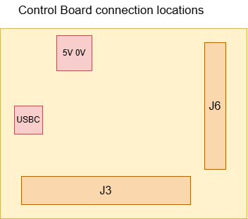
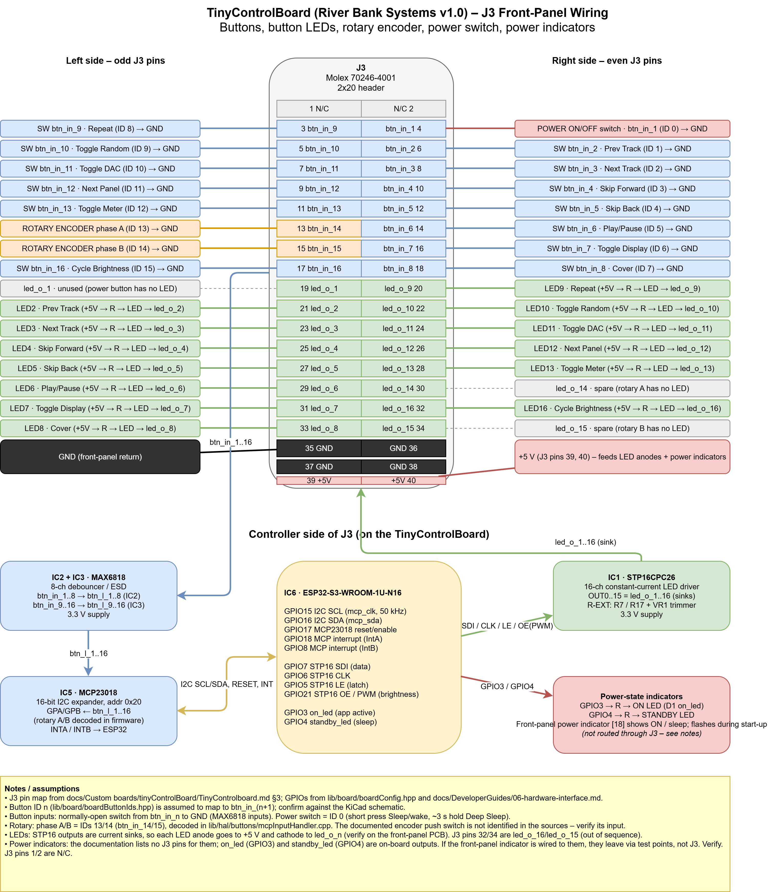
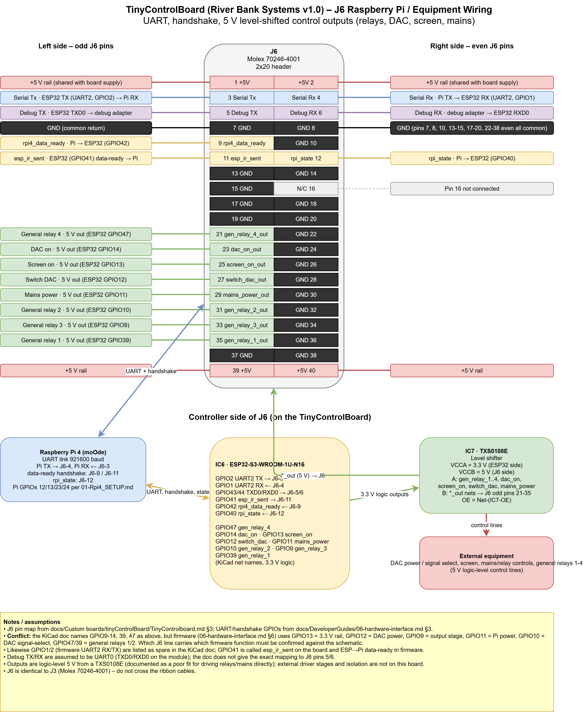
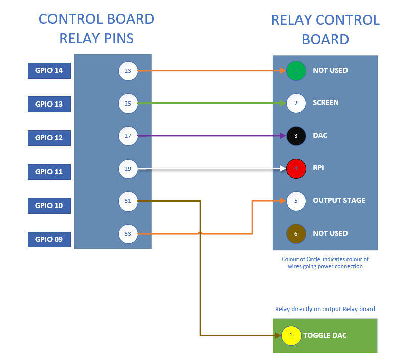
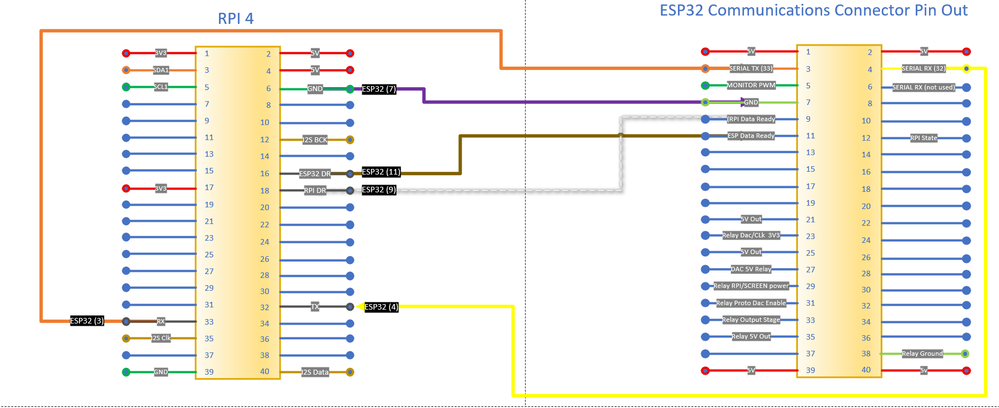

# TinyControlBoard Wiring Guide

This guide covers the TinyControlBoard's external power connections, front-panel
header, and Raspberry Pi/equipment interface. Use the diagrams below to identify
the connectors and follow the signal paths. For complete pin assignments, see
the [TinyControlBoard connector reference](../Custom%20boards/tinyControlBoard/TinyControlboard.md#3-connectors).

## Board connections

The overview shows where the external connections are located on the board.
Check the board silkscreen and the pin-1 marker before attaching a cable.

## Power and setup

The board accepts 5 V from USB-C, the J8 screw terminal, or a 40-pin header.
Slide switch S1 selects the USB or board power rail; set it for the source you
intend to use. USB-C is useful for firmware updates and bench testing, while J8
is the external 5 V input for normal operation.

**Avoid connecting multiple 5 V sources at the same time.** USB, J8, and the
header 5 V rails are not isolated from one another and can back-feed. The
[power distribution guide](PowerDistribution.md) describes the wider system
power connections.

## J3: front-panel controls and LEDs

J3 is a 2x20 header for the front panel. It carries the 16 button input signals
and 16 LED outputs, along with ground and 5 V. Pins 1 and 2 are not connected.
The diagram shows the pin numbering and how the button and LED signals connect
to the front panel.

## J6: Raspberry Pi and equipment interface

J6 is a 2x20 header for the Raspberry Pi and external equipment. It carries
UART and handshake signals, ground and 5 V, and 5 V level-shifted control
signals for the relays, DAC, screen, and mains-control interface. See the
diagram for the pin assignments and signal directions.

The control lines are logic-level signals, not power outputs. Do not connect
them directly to relay coils, mains, or other loads; use suitable external
driver and isolation circuitry.

## Equipment connection examples

The following diagrams show the relay and Raspberry Pi connections.

**Important:** J3 and J6 use identical connectors. Identify each cable at both
ends before connecting it; plugging a cable into the wrong header can connect
the wrong signals.
