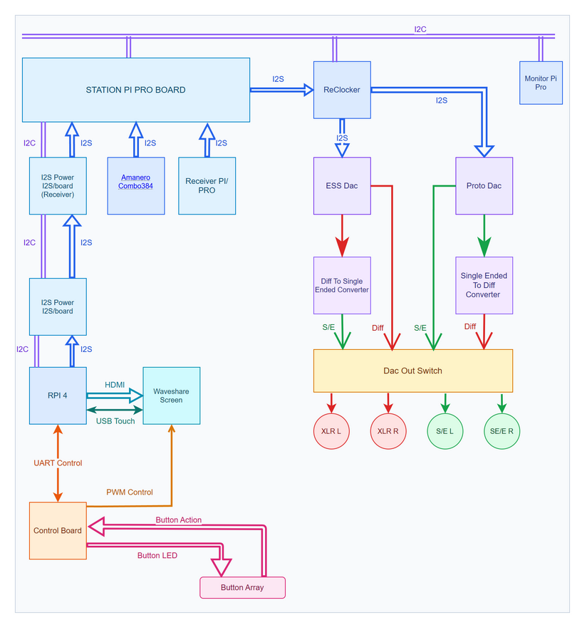

# Overall Wiring Overview

This diagram gives a high-level view of how the Streamer DAC's audio, control,
and display components connect. It is intended as a guide to the system, not a
pin-by-pin wiring plan.

**Figure 1 — Overall wiring overview.** The diagram brings together the audio
path and the connections between the Raspberry Pi, control board, screen, and
front-panel button array.

### Diagram color key

- **Blue:** I2S audio connections.
- **Purple:** I2C connections.
- **Teal:** Display connections, including HDMI and USB touch.
- **Orange:** Control connections, including UART and PWM.
- **Pink:** Front-panel button actions and LED control.
- **Green:** Single-ended analogue audio.
- **Red:** Differential analogue audio.

## How to read the diagram

### Audio path

As drawn, I2S sources feed the Station Pi Pro board, which connects to the
reclocker. The reclocker feeds the ESS DAC and ProtoDAC paths. The diagram then
shows the ESS DAC's differential output and the ProtoDAC's single-ended output
feeding their respective conversion stages and the DAC output switch. The
switch connects to the balanced XLR and single-ended outputs.

### Control and display

The Raspberry Pi connects to the Waveshare screen by HDMI and USB touch. The
control board connects to the Pi over UART and provides PWM control to the
screen. The front-panel button array sends button actions to the control board
and receives LED control from it. The diagram also shows I2C connections
between the Pi and the audio/display modules.

## Scope and related references

This overview does not specify connector pin numbers, cable construction,
power wiring, or electrical limits. For those details, consult the
[TinyControlBoard wiring guide](ControlBoardWiring.md), the
[power distribution guide](PowerDistribution.md), and the documentation for
the individual [custom boards](../Custom%20boards/README.md). The
[system architecture](../01-system-architecture.md) describes the software
and communication roles of the main components.

The editable source is available as
[OverallWiring.drawio](Media/OverallWiring.drawio).