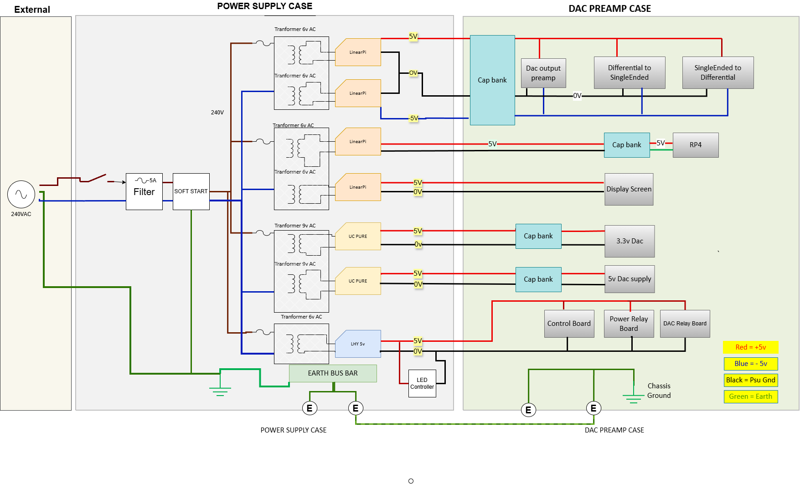
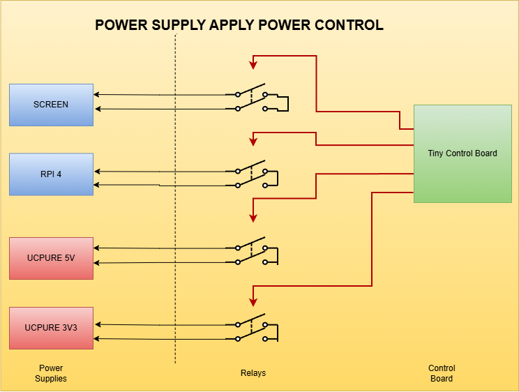

**Power Distribution Diagram**

This diagram shows how power is supplied to each component.

Power comes from an external 240 VAC mains supply. It passes through a switched, fused mains filter and then a soft-start circuit, which limits inrush current and helps prevent the fuse from blowing.

The mains power is distributed to the transformers. The 6 V transformers supply the Linear Pi boards, the two 9 V transformers supply the two UcPure modules, and a separate 6 V transformer supplies the control logic. The resulting power outputs are routed through two connections to the DAC case, where they are distributed to the DAC components. Control signals used by the DAC to manage power to the UcPure and Linear Pi modules are not shown.

The Dac Chassis is directly earthed  via a cable to the power supply chassis which in turn is connected to saftey ground.

**Power Supply control Wires**

The power Supply control  wires allow the power supples to be switched off and on by the Control Board. This is useful when moving into different supply modes . For example, in sleep or deepsleep modes. Note that there is no control power for the control board as that remains on all the time  , and can only be switched off if the mains power is disconnected via the Filter switch.

