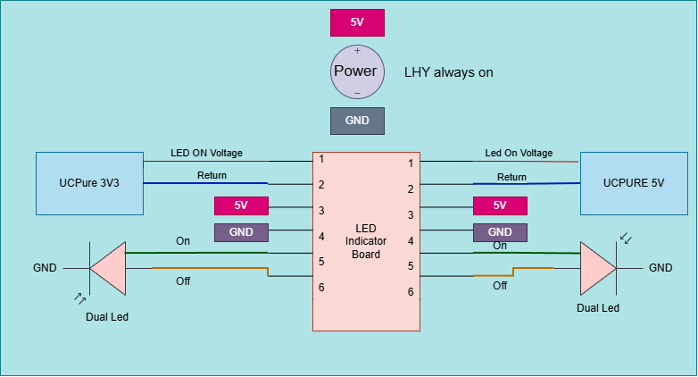

# Power Distribution and Safety Notes

This page gives a high-level overview of the DAC power system and its control
signals. It is not a wiring, construction, test, or repair procedure. The
diagrams do not provide enough verified detail to build or service the mains
power supply safely.

## Read before working on the equipment

> **Warning: mains voltage can cause fatal electric shock, burns, or fire.**
> Work inside the power supply or DAC only by a person qualified to work on
> mains-powered equipment, using an appropriate, reviewed procedure. Do not
> work on energized equipment.

- Isolate the equipment from the mains supply before opening it. A front-panel
  switch, software power mode, or control-board command is not proof that the
  equipment is electrically isolated.
- Capacitors can retain hazardous energy after power is removed. Do not assume
  that waiting, an indicator going dark, or switching the unit off has made
  the equipment safe. Do not short capacitors to discharge them. Stored energy
  must be assessed and handled by a qualified person.
- Protective earth must remain continuous to accessible conductive chassis
  parts. Do not remove, switch, or fuse the protective-earth connection, and
  do not treat signal ground or a control-board ground as protective earth.
  The intended bonding arrangement must be verified on the actual assembly.
- Do not use this page or the bill of materials to choose a fuse, wire,
  connector, insulation, or clearance. The required ratings and installation
  details are not documented here.
- If the equipment, wiring, labels, or diagrams do not agree, stop and have
  the design and physical assembly checked before applying power.

## System overview

The current project notes describe an external mains input passing through a
switched, fused mains filter and a soft-start circuit before power is
distributed to transformers. The diagram below is an overview only; it is not
a complete mains wiring diagram or a verified construction drawing.

**Figure 1 — Power distribution.** This overview shows the mains input path
through the filter and soft-start circuit to the transformers, and how the
transformer outputs supply the DAC components.

The 9 V transformer has two 120 V primary windings connected for the 240 V
mains input, and two separate secondary windings. Each secondary feeds a
separate power-supply circuit for one UcPure module. This is one transformer,
not two: the separate secondary outputs are for separate UC Pure circuits.
The project notes also describe 6 V transformer supplies for the Linear Pi
boards and control logic; verify those connections against the released
schematic and the physical build. No transformer current ratings, fuse
ratings, wire sizes, or connector pin assignments are specified on this page.

The notes also describe a protective-earth connection between the DAC chassis
and power-supply chassis. This statement is not a substitute for confirming
the protective-earth path, bonding hardware, and continuity on the physical
unit.

## Power-control signals

The control diagram shows signals used by the control board to switch some
power-supply outputs for operating modes such as Sleep and Deep Sleep. The
diagram does not specify enough information to safely wire these signals:
their connector pinout, voltage/current limits, polarity, isolation, and
fail-safe behavior need to be verified against the schematics and hardware.

**Figure 2 — Power-supply control wiring.** The control board switches selected
supplies for modes such as Sleep and Deep Sleep; the control board itself
remains powered.

The current notes say that the control board remains powered while the
controlled supplies are off. Sleep and Deep Sleep therefore must not be
treated as mains isolation or as permission to open the equipment.

## UcPure indicators

The indicator diagram describes orange LEDs as showing capacitor charging and
green LEDs as showing that the capacitors are supplying power. A separate
power-on indicator is connected to the soft-start board. Indicator state is
not proof that stored energy is absent or that the equipment is safe to touch.

**Figure 3 — UcPure indicators.** Orange LEDs indicate capacitor charging;
green LEDs indicate that the capacitors are supplying power. A separate
power-on indicator connects to the soft-start board.

## Information needed for a safe, build-ready guide

Before expanding this overview into wiring or service instructions, verify and
document the following from the released schematics, component data, and
physical assembly:

- The exact mains input range, filter and soft-start part numbers, and approved
  fuse type, rating, and location.
- Transformer part numbers, primary and secondary connections, output ratings,
  and which loads each winding supplies.
- The complete mains wiring diagram, including protective-earth bonding,
  insulation/isolation boundaries, wire types and sizes, terminals, and
  enclosure entry/strain relief.
- The power-control connector pinouts, signal levels, polarity, isolation,
  default state, and what happens if the controller or its wiring fails.
- Capacitor discharge provisions, residual voltage/energy expectations, and a
  qualified-person service procedure for verifying a safe state.
- The exact revision of each schematic and diagram, matched to the physical
  build.

Until those details have been checked, use this page only to understand the
intended system at a high level. Have mains-related design, construction, and
testing reviewed by a qualified electrical professional.
