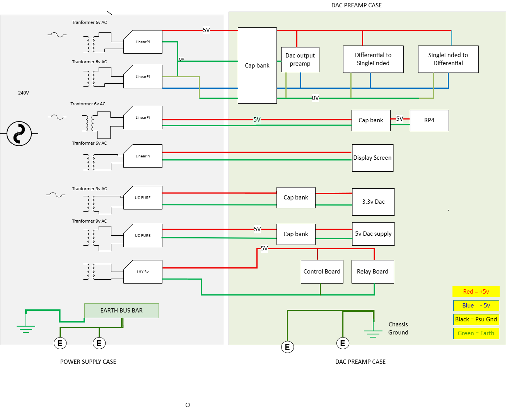

# Riverbank Streamer DAC

## Service and Build Guide

**Author:** Anthony Roy

<figure>

<figcaption>
Riverbank Streamer DAC
</figcaption>
</figure>

## Safety Information

> **Warning — hazardous mains voltage:** This project uses a toroidal transformer connected to 110 V or 230 V AC mains. Contact with exposed mains connections can cause fatal electric shock or severe injury.

- Insulate all mains connections—including the IEC inlet, fuse holder, power switch, and transformer primary wiring—with suitable heat-shrink tubing or equivalent insulation.
- Disconnect the power cord from the wall outlet before opening the chassis or working on the equipment.
- Install a slow-blow fuse of the correct rating in the live AC line. Select the fuse for the transformer and the local mains supply; transformer inrush current can be high.
- Observe DC polarity. Reversed connections can damage microcontrollers, DACs, and other components. Use ESD precautions when handling exposed semiconductor devices.

This guide is provided for informational and educational purposes. Construction and use are undertaken at the builder's own risk. Mains-powered equipment should be assembled, inspected, and tested only by people qualified to work safely with hazardous voltages.

**Reference:** [Transformer wiring](https://electro-dan.co.uk/electronics/wiringtrans.aspx)

------------------------------------------------------------------------

## Contents

- [Project Overview](#project-overview)
- [System Architecture](#system-architecture)
- [Component Overview](#component-overview)
- [Circuit Board Reference](service-guide/CircuitBoardReference.md)
- [DAC and Audio Subsystem](service-guide/DacSubsystem.md)
- [Power Supply Subsystem](service-guide/PowerSupplySubsystem.md)
- [Mechanical Construction](service-guide/MechanicalConstruction.md)
- [System Wiring and Commissioning](service-guide/SystemWiring.md)
- [Parts Lists](#parts-lists)
- [Revision History](#revision-history)

Use the focused guides for board-level information, construction, wiring, and subsystem-specific details. This index provides the project overview and links to the system diagrams. Electrical details and parts should be verified against the current schematics and manufacturer documentation before construction or repair.

## Project Overview

The Riverbank Streamer DAC combines a Raspberry Pi running moOde Audio, the TinyControlBoard
controller, digital audio modules, and analogue output stages in a custom enclosure. For
the canonical system boundaries, control flow, and architecture diagrams, see
[01 — System Architecture](../01-system-architecture.md).

This build guide focuses on construction and service. The audio assembly includes a
FIFOPi Q7 reclocking stage, selectable ESS DAC and ProtoDAC paths, and independent linear
supplies for selected digital, analogue, control, and clock domains. UcPure
ultra-capacitor modules provide local energy storage and conditioning in selected circuits.

The documented digital audio sources are:

- Raspberry Pi network streaming via I2S
- Optical (TOSLINK) S/PDIF input
- Coaxial S/PDIF input
- USB input

The audio source and output topology is shown in the architecture document. For board
details, consult the focused [DAC and audio subsystem guide](service-guide/DacSubsystem.md).

### Displays and Controls

The front-panel display presents artwork and playback information. A secondary OLED
provides input, status, and configuration feedback, and illuminated controls provide
direct access to common functions. The software components and their responsibilities are
described in the architecture and developer guides; this guide covers the physical build.

### Build Requirements

- Raspberry Pi running moOde Audio
- Custom ESP32 firmware written in C++
- UART communication between the Raspberry Pi and ESP32
- Advanced skill level: the build involves mains wiring, metal chassis work, electronics assembly, Linux command-line use, firmware deployment, and system troubleshooting
- Estimated build time: approximately 20–30 hours, depending on enclosure work and testing

## System Architecture

The control/communication and audio-system diagrams are maintained in
[01 — System Architecture](../01-system-architecture.md#3-system-context-and-scope) to
avoid divergent copies. Use the architecture document for system-level views and the
focused subsystem guides below for build and service detail.

### Power Connection Diagram

## Component Overview

### Display

See the [Waveshare display documentation](https://www.waveshare.com/wiki/9.3inch_1600x600_LCD#Working_with_Raspberry_Pi).

## Focused Guides

- [Circuit Board Reference](service-guide/CircuitBoardReference.md) — control, interface, and relay board descriptions and service notes.
- [DAC and Audio Subsystem](service-guide/DacSubsystem.md) — digital-to-analogue conversion boards, signal selection, and audio output stages.
- [Power Supply Subsystem](service-guide/PowerSupplySubsystem.md) — power boards, supply rails, transformers, and power-supply parts.
- [Mechanical Construction](service-guide/MechanicalConstruction.md) — enclosure drawings, mechanical parts, and assembly notes.
- [System Wiring and Commissioning](service-guide/SystemWiring.md) — inter-board connections, signal routing, system wiring, and commissioning checks.

## Parts Lists

- [Main assembly bill of materials](service-guide/MechanicalConstruction.md#main-assembly-bill-of-materials)
- [Power supply bill of materials](service-guide/PowerSupplySubsystem.md#bill-of-materials)

## Revision History

| Revision | Date | Changes |
|----------|------|---------|
| 1.0 | TBD | Initial release |
