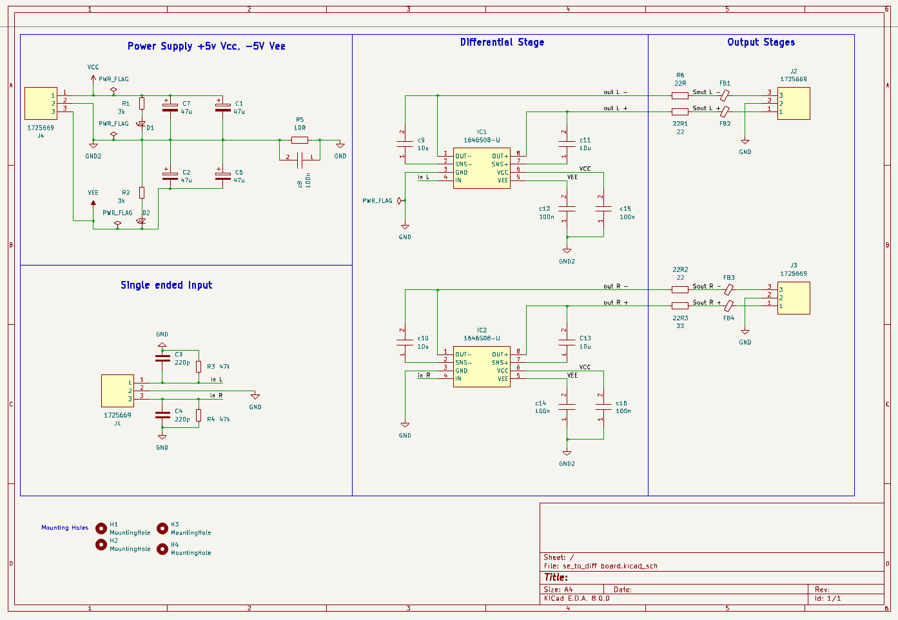
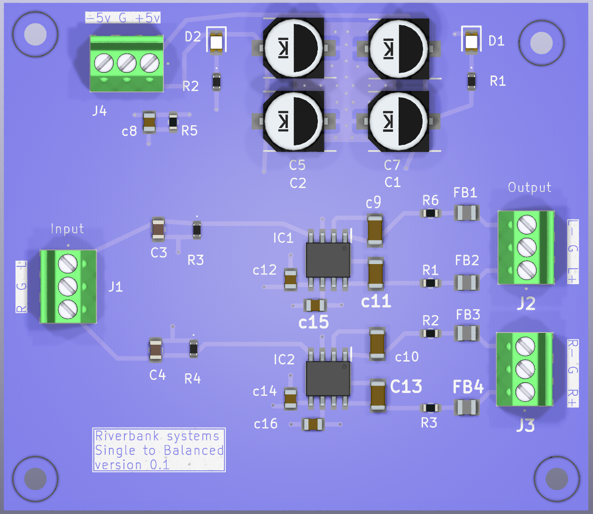

# Single-Ended to Balanced Line Driver

[DAC and audio subsystem](../DacSubsystem.md) · [Circuit Board Reference](../CircuitBoardReference.md) · [Service Guide](../../ServiceGuide.md)

Stereo converter board: unbalanced stereo input in, balanced stereo output out, powered from a dual ±5 V supply.

## What It Does

Each channel passes through one THAT 1646 balanced line driver (IC1 left, IC2 right; the schematic label reads `1646S08-U`). The driver converts the single-ended input into a differential output, which leaves through a 22 Ω resistor and a ferrite bead on each leg.

**Signal path:** J1 (input) → input network → IC1 / IC2 → 22 Ω + ferrite bead per leg → J2 (left out) / J3 (right out)

## Connectors

All connectors are 3-pin (1725669).

| Ref | Use | Pin 1 | Pin 2 | Pin 3 |
|---|---|---|---|---|
| J1 | Input | In L | GND | In R |
| J2 | Left output | Sout L + | GND | Sout L − |
| J3 | Right output | Sout R + | GND | Sout R − |
| J4 | Power input | VCC (+5 V) | GND2 (0 V) | VEE (−5 V) |

## Power Supply

- J4 takes a **dual supply: +5 V (VCC) and −5 V (VEE), with 0 V on GND2**.
- Each rail has 2 x 47 µF bulk capacitors: C7 and C1 on VCC, C2 and C5 on VEE.
- **D1** (with R1, 3 kΩ) and **D2** (with R2, 3 kΩ) are indicator LEDs on the +5 V and −5 V rails *(verify)*.
- **GND2** is the supply ground. It joins the signal **GND** only through **R5 (10 Ω) in parallel with C8 (100 nF)**.
- Each driver has 100 nF decoupling on its supply pins: C12 and C15 on IC1, C14 and C16 on IC2, all returned to GND2.

## Input Stage

For each channel, a **47 kΩ resistor in parallel with 220 pF** goes from the input to GND (R3 and C3 for left, R4 and C4 for right). This sets the input impedance and filters RF. The signal then goes directly to pin 4 (IN) of the driver.

## Driver Stage (IC1 Left, IC2 Right)

| Pin | Name | Connection |
|---|---|---|
| 1 | OUT− | `out −` net |
| 2 | SNS− | Via 10 µF to `out −` (C9 left, C10 right) |
| 3 | GND | GND (signal ground) |
| 4 | IN | Input signal |
| 5 | VEE | −5 V |
| 6 | VCC | +5 V |
| 7 | SNS+ | Via 10 µF to `out +` (C11 left, C13 right) |
| 8 | OUT+ | `out +` net |

## Output Stage

Each output leg has a **22 Ω series resistor** followed by a **ferrite bead**:

| Channel | Resistors | Ferrite beads |
|---|---|---|
| Left | R6, 22R1 | FB1 (−), FB2 (+) |
| Right | 22R2, 22R3 | FB3 (−), FB4 (+) |

## Quick Checks

| Check | Expected |
|---|---|
| J4 pin 1 to pin 2 | +5 V |
| J4 pin 3 to pin 2 | −5 V |
| IC pin 6 to GND2 | +5 V |
| IC pin 5 to GND2 | −5 V |
| D1 and D2 | Both lit |

## Quick Troubleshooting

| Symptom | Check |
|---|---|
| No output on either channel | J4 supply, D1 and D2, then VCC and VEE at the driver pins |
| One channel dead | Input wiring on J1, then pin 4 signal, supply pins and output on the affected IC |
| One output leg dead | The 22 Ω resistor and ferrite bead on that leg, then the connector |
| Hum or noise | R5 / C8 ground link, GND and GND2 connections, input cable |
| Distortion or low level | Output loading, supply voltage under load, sense capacitors (C9, C11 left; C10, C13 right) |
| One rail missing | Supply wiring, the bulk capacitors on that rail, and the supply itself |

## Notes

- The two grounds are intentional: **GND** is the signal ground (input and driver pin 3) and **GND2** is the supply return. Do not link them anywhere except through R5 and C8.
- The driver part number is read from the schematic label. Confirm against the BOM before ordering replacements.
